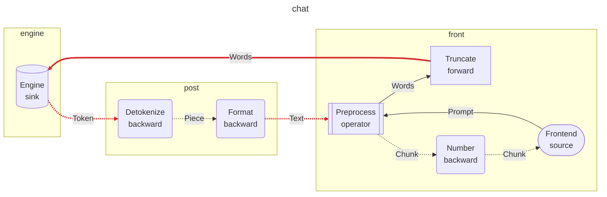

# dynamo-gdl

gdl is a graph definition language and runtime for request/response streaming pipelines. A request goes into a graph of nodes, and a stream of items comes back. The same graph runs in one process, or split into segments that run as separate programs and talk over [velo](https://github.com/ai-dynamo/velo).

You define the graph once, with its message types. A placement puts each node in a segment. The generator, `gdl-gen`, writes one crate per segment. Each segment crate depends only on the implementations of the nodes that it hosts.

## The model

A graph has one source and a nested chain of hops. Each node has one of five roles:

| Role | Sees | Does |
|---|---|---|
| source | nothing | Sends the request into the graph and receives the item stream. It is the caller, not an implementation. |
| operator | the request and the response | Calls the rest of the graph through `Next`, zero or more times (for example, to retry), and returns a stream. |
| forward | the request only | Changes the request on its way in. |
| sink | the request | Produces the item stream. |
| backward | the response stream only | Changes the item stream on its way out. |

A hop is an outer end (the source or an operator), its forward nodes, an inner end (a sink or an operator), and its backward nodes. An operator is the inner end of one hop and the outer end of the next hop.

## Define a graph

A contract crate holds the message types and one `gdl::graph!` invocation:

```rust
gdl::graph! {
    name = "chat", schema = 1;
    source   Frontend: Prompt -> stream Chunk;
    operator Preprocess: (Prompt -> stream Chunk) over (Words -> stream Text);
    forward  Truncate: Words -> Words;
    sink     Engine: Words -> stream Token;
    backward Detokenize: Token -> Piece;
    backward Format: Piece -> Text;
    backward Number: Chunk -> Chunk;
    topology: Frontend => Preprocess { Truncate => Engine => Detokenize => Format } => Number;
}
```

In the topology, each hop lists its forward nodes, then its inner end, then its backward nodes in the order that the response goes through them. An operator owns its hop in braces.

This is the same graph as a diagram, from `manifest().to_mermaid(None)`. Solid edges carry requests, and dashed edges carry responses. Each edge has the name of its message type.


The macro checks the topology at compile time. An implementation with the wrong role or types for its node does not compile. The macro generates:

- `Bindings`: one slot for each node other than the source, filled with `Bindings::new().preprocess(...).engine(...)`.
- `local(bindings)`: the whole graph as nested calls in one process.
- `assemble(&deployment, bindings)`: the part of the graph that one segment runs. It fails if the deployment was made for another contract, or if a node that the segment hosts has no binding.
- `manifest()`: the graph as data, with the wire capability of each edge type.
- `SourceReq` and `SourceItem`: the source's request and item types.

Bump `schema` when the wire form of a message type changes.

### Streamed requests

A request can also be a stream. In a request position, `Head + stream Item` declares a request that has a head value and a stream of items, and `stream Item` declares one with a head of `()`. The node receives a `gdl::Streamed<Head, Item>`. Its items end after their first error. The response streams back while the request still streams in.

```rust
sink Recognizer: Session + stream Audio -> stream Transcript;
```

A streamed request can cross segments like any other request. The stage that receives it creates an anchor for its items, and the sender streams the items into that anchor while the response comes back.

### Compose a graph from message names

A graph file holds the body of a `graph!` invocation. Where `graph!` has Rust types, the file has message names. In a message position, the file accepts a bare name such as `Prompt`, or `()`.

The message types are in one or more protocols crates. A protocols crate depends on `gdl-message`, a small crate without the gdl runtime, and offers a type to graph files with `derive(gdl_message::Message)`. The type must be `Send + 'static`, and it must not be generic:

```rust
#[derive(serde::Serialize, serde::Deserialize, gdl_message::Message)]
pub struct Prompt {
    pub text: String,
}
```

A crate can also offer a message that is defined in another module or another crate, under a path of its own. Mark the `pub use` with `#[gdl_message::export]`:

```rust
#[gdl_message::export]
pub use chat_protocols::Prompt;
```

A crate that depends on gdl can write `gdl::Message` and `gdl::export` instead.

`cargo gdl extract <crate dir | name@version>` prints what a crate offers (its messages, exports, and nodes), read from its source without building it. With `--catalog <dir>`, it writes the entry to `<dir>/<name>/<version>.toml` instead. With `--verify`, it also builds the crate and fails if what the markers register differs from what it read, for example a message that a macro makes. The generator is the `cargo-gdl` binary of `crates/gdl-gen`: install it with `cargo install --path crates/gdl-gen`, or run it with `cargo run -p gdl-gen --`.

A spec names the graph file instead of a contract crate, and lists the crates that offer its messages:

```toml
[graph]
path = "chat.gdl"

[messages]
crates = ["protocols"]
pin = { Chunk = "chat_protocols::Chunk" }   # optional

[gdl]
path = "../../crates/gdl"
```

`cargo gdl resolve --spec gdl.toml` prints the type that each message name resolves to, and whether it is a wire type:

```text
Chunk   chat_protocols::Chunk          wire
Piece   chat_protocols::Piece          local
Prompt  chat_protocols::Prompt         wire
```

First, the generator makes sure that the names agree on each edge. Each error gives the line and column in the graph file. Then it reads the source of the listed crates with `gdl-extract`. It builds nothing, so a crate whose build needs a toolkit that is not installed can still be read. A listed crate offers the messages that it defines and the messages that it exports. Each name must resolve to exactly one message. A message that two listed crates offer, one by its definition and one by an export, is one message. If a name resolves to two different messages, the generator reports an error. Add a `pin` entry to choose one. The generator reports all errors at once.

From a `[graph]` spec, the generator also generates the contract crate, in `contract/` under the output directory. Its `graph!` invocation names each message by a public path through a listed crate: an export's path if there is one, else the definition's. The contract hash covers that path, so it changes when a name resolves to another message. A message that is defined in a private module must be exported. The chat example uses a graph file. The ASR example uses a contract crate that holds its own `graph!` invocation.

## Split a graph into segments

A spec file names the graph, the placement, and the implementation of each node. `examples/chat/gdl.toml` is a full spec. It names the graph file, the crate that holds its messages, the crates that implement its nodes, and the placement in three segments:

```toml
[graph]
path = "chat.gdl"

[messages]
crates = ["protocols"]

[nodes]
crates = ["front-nodes", "engine-mock", "post-nodes"]

[gdl]
path = "../../crates/gdl"

[segment.front]
nodes = ["Frontend", "Preprocess", "Truncate", "Number"]

[segment.engine]
nodes = ["Engine"]

[segment.post]
nodes = ["Detokenize", "Format"]
```

A node crate marks each node type with `#[derive(gdl::Node)]`. The node's name is the type's name, and its role and messages come from the role trait that the type implements:

```rust
#[derive(gdl::Node)]
pub struct Engine { /* .. */ }

impl gdl::Sink for Engine {
    type Req = Words;
    type Item = Token;
    // ..
}
```

Each graph node binds to the node of its name that a listed crate offers. Its implementation is the type of that name at the crate's root, here `chat_engine_mock::Engine`. If two crates offer one name, add `pin = { Engine = "chat_engine_mock::Engine" }` to `[nodes]` to choose one. The node must have the role that the graph gives it, and at each port the message that the graph's name for the port resolves to. The generator reads the node crates' source and does not compile them, so a crate that needs CUDA, for example, does not have to build there. When the node crate compiles, the derive makes sure that the type is `pub` and sits at the crate root.

A spec with a contract crate binds each node with a table instead:

```toml
[bind.Engine]
crate = "chat-engine-mock"
path = "engine-mock"
type = "chat_engine_mock::Engine"
```

The generator compiles only the contract crate to read its manifest. Then it checks the placement and the bindings against the manifest, and it reports every error that it finds. A message type that crosses between segments must implement `Serialize` and `Deserialize`.

For each segment, the generator writes a crate with:

- A library. `start(node, roster, config, nodes)` deploys the segment inside a program.
- A binary. It builds each hosted node through `gdl::Build`, meets the other segments in a shared roster directory, and waits until every instance that it can send to is serving. Then it serves until Ctrl-C.
- On the segment that hosts the source, the binary instead reads one JSON request per line on stdin, writes the items as JSON lines (`gdl::serve_json_lines`), and stops at the end of the input. It does this only if the source's request type and item type both implement `Serialize` and `Deserialize`, and the request is not streamed. For other source types, the binary serves until Ctrl-C, and your own program calls the graph through the generated library.

The generator owns the directory of each segment crate. Each generated file starts with a do-not-edit marker. `cargo gdl generate --check` writes nothing. It fails if a generated file is missing, changed, or stale, or if a segment crate holds a file that the generator did not write.

## Draw a graph

`cargo gdl diagram` writes the placed graph to stdout as Graphviz DOT or as a Mermaid flowchart. It writes no files.

```bash
cargo run -p gdl-gen -- diagram --spec examples/chat/gdl.toml --format mermaid
cargo run -p gdl-gen -- diagram --spec examples/chat/gdl.toml --format dot | dot -Tsvg -o chat.svg
```

- Request edges are solid. Response edges are dashed.
- Each edge has the name of its message type. If the type has no codec, the label says `(no codec)`, because a placement cannot cut that edge.
- Each segment is a cluster. An edge that crosses segments is thick and red.

For the chat spec, `--format mermaid` writes this diagram. Three edges cross segments: `Words` into `engine`, `Token` out of `engine`, and `Text` out of `post`.



In a program, `Manifest::to_dot` and `Manifest::to_mermaid` draw a contract's `manifest()`. Give them `None` to draw the graph without segments, or a `Layout` from `gdl::layout` to draw it placed. They return an error if the layout was made for another contract.

## Run the example

1. Generate the segment crates:

   ```bash
   cargo run -p gdl-gen -- generate --spec examples/chat/gdl.toml --out examples/chat/segments
   ```

2. Build the three segment binaries:

   ```bash
   cargo build --manifest-path examples/chat/Cargo.toml --bins
   ```

3. Write one config file for each segment. Each config file names a listen address and a roster directory. The roster directory must be fresh for each deployment, and all segments must share it.

   ```toml
   listen = "127.0.0.1:0"
   roster = "/tmp/chat-roster"
   [node.Engine]
   uppercase = true
   ```

   If a segment runs more than one instance, give the count of instances in an `[instances]` table, for example `engine = 2`, in every config file. All instances must agree on these counts.

4. Start `chat-engine` and `chat-post`, each with its config file.
5. Start `chat-front` with its config file, and write a request to its stdin:

   ```bash
   echo '{"text": "hello big wide world", "max_words": 3}' | examples/chat/target/debug/chat-front front.toml
   ```

`crates/gdl-gen/tests/chat.rs` does these steps as a test.

### A graph with a streamed request

`examples/asr` is a speech recognition pipeline with a mock recognizer. Its request is a session's settings and a stream of audio chunks:

```rust
source   Client: Session + stream Audio -> stream Transcript;
operator Gateway: (Session + stream Audio -> stream Transcript) over (Session + stream Audio -> stream Partial);
forward  Resample: Session + stream Audio -> Session + stream Pcm;
sink     Recognizer: Session + stream Pcm -> stream Partial;
backward Punctuate: Partial -> Partial;
```

Its placement puts `Resample` in a segment of its own, so the audio crosses two times. The generated binary of the source's segment has no JSON-lines server, because one line cannot carry a streamed request. Call the source through the segment library. `examples/asr/demo` starts the three generated segments in one process, sends audio, and receives transcripts while the audio streams in. `crates/gdl-gen/tests/asr.rs` runs it as a test.

## Across segments

- **Responses.** Each response stream goes to an anchor that its consumer created. The runtime never matches a response to a request by a request id.
- **Stop and cancel.** A stop ends the stream after the items that are already buffered. A cancel ends it at once. Both reach the remote producer, also when the consumer holds the stream and does not read it.
- **Deadlines.** A deadline crosses segments as wall-clock time with a clock-skew allowance. Work can end early by up to two times the skew, but never late. A request without a deadline gets `RuntimeConfig::default_deadline` (600 s) before it leaves its segment.
- **Admission.** Each instance admits a limited number of root requests. A request that enters the same instance more than one time uses one admission.
- **Egress.** Each instance limits the number of streams that it produces at the same time. A full instance refuses new work.
- **Failure.** An error item ends a stream. A stream that ends without a finish from its producer ends with an error, not as a success.
- **Streamed requests.** The items of a streamed request go to an anchor that the receiving stage created. The input ends cleanly only when its sender finishes it. A stage that stops reading its input ends its sender, and the response still decides the result. A stop does not end the input. A stop from the caller reaches every stage that has handed the request on or produces a stream, and a stage can end its input when it sees the stop. A stop that a node asks for on its own context reaches the same stages, with one exception: a stage that relays the request reaches the stages after it only while its run lasts. A stop that it asks for after its own input has ended, or just before it ends its own output, does not reach them. In another segment, a forward node that waits for a stop inside `forward`, before it hands the request on, is not reached either. In both cases the deadline ends the request. A stage that relays a streamed request keeps its admission until it has sent all of the items on.

The design and its rulings are in `agent-docs/plan.md`.

## Cost

A graph that is not cut costs no encoding. A local graph is nested calls, and the nodes of one segment pass values to each other directly. A cut costs one encode and one decode for each message on each edge that crosses segments. There is one more case. If the request of a hop leaves the segment of the hop's outer end, the response items return to the outer end through an anchor. Each item is then encoded and decoded one time, also when no response edge crosses segments. A streamed request's head and each of its items are encoded once on each crossing that they go through. `crates/gdl/tests/crossings.rs` counts these encodes.

On one aarch64 workstation, over loopback TCP:

- **Per request.** The seven-node reference graph takes about 26 us in one process and about 223 us over two segments. A request with one hop over two segments, whose request is one value, takes about the same time as the same request written directly on velo (about 200 us to 250 us; the run-to-run variance is larger than the difference). gdl adds two tasks and 48 allocations to each request.
- **Per item, at each crossing.** Encoding and decoding cost 123 ns (16 B), 223 ns (1 KiB), and 811 ns (16 KiB). Of that, 80 ns to 400 ns is more than velo direct, which also encodes.
- **Throughput.** Item throughput is 0% to 11% lower than direct velo, about the size of the run-to-run variance. velo's rate for a single stream, about 11 K items/s here, limits both.

- **Streamed requests.** Items of a streamed request cross at velo's rate, the same as on velo directly. A one-item upload over two segments takes about 524 us, against 403 us for the same exchange written directly on velo.

The measurements and the method are in `agent-docs/perf/m3-remote.md` and `agent-docs/perf/streamed.md`.

## Repository layout

| Path | Contents |
|---|---|
| `crates/gdl` | Request context, node roles, local composition, manifest, placement, and the velo runtime |
| `crates/gdl-syntax` | The graph syntax: the parser and checked model that `graph!` and the generator share |
| `crates/gdl-message` | `derive(Message)`, the `Message` and `Shape` traits, and the message catalogue, without the runtime |
| `crates/gdl-extract` | The source reader: what a crate offers to graphs (messages, exports, and nodes), read from its source without building it |
| `crates/gdl-macros` | The `graph!` macro and `derive(Message)` |
| `crates/gdl-gen` | The generator, `cargo gdl`: `extract`, `resolve`, `generate`, and `diagram` |
| `examples/chat` | A graph file, the protocols crate that holds its messages, its node implementations, and the generated contract and segment crates. It is a separate Cargo workspace. |
| `examples/asr` | A graph with a streamed request: a contract, its node implementations, the generated segment crates, and a demo that runs them in one process. It is a separate Cargo workspace. |
| `agent-docs/` | The plan, review records, and measurements |

## Build and test

```bash
cargo fmt --all --check
cargo clippy --workspace --all-targets --all-features -- -D warnings
cargo test --workspace --all-features --no-run
timeout 300 cargo test --workspace --all-features
```

Build the tests first (`--no-run`): the `timeout` then counts only the tests, which take about a minute. It turns a hung test into a failure; set it to two or three times the run you expect.

The tests start velo nodes in one process on ports that the OS assigns. The example tests build the example workspaces in `target/examples`.
