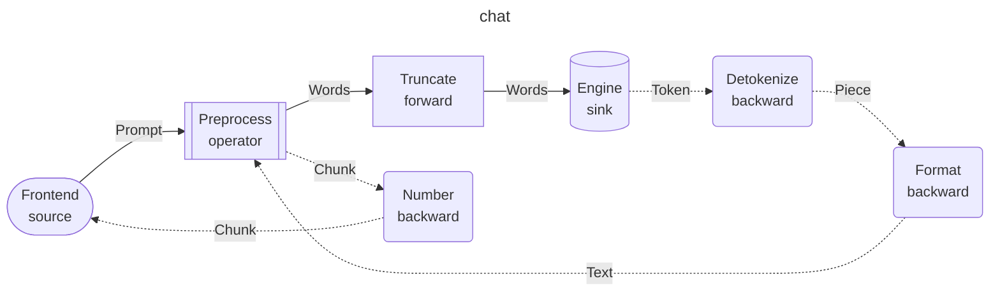
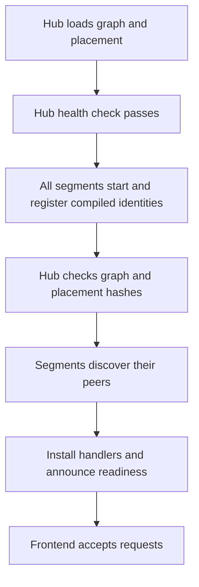

# dynamo-gdl

gdl is a graph definition language and runtime for request/response streaming pipelines. A request goes into a graph of nodes, and a stream of items comes back. The same graph runs in one process, or split into segments that run as separate programs and talk over [velo](https://github.com/ai-dynamo/velo).

You define the graph once, with its message types. A placement puts each node in a segment. The generator, `cargo gdl generate`, writes one crate per segment. Each segment crate depends only on the implementations of the nodes that it hosts.

gdl is two crates. A crate that implements nodes depends on `gdl`: the node roles, the request context, the selector trait, the derives, and local composition, so that it can run its nodes in one process. It does not link velo. The runtime, `gdl-runtime`, runs those nodes: segments, crossings over velo, discovery, and the segment binaries. Contract crates, generated segment crates, and programs that run a graph depend on `gdl-runtime`, which re-exports the `gdl` it was built with as `gdl_runtime::gdl`.


Known limitations, with what lifts each, are in [LIMITATIONS.md](LIMITATIONS.md).
## The model

A graph has one or more source roots, each with a nested chain of hops. A sink can receive requests from several roots through explicit connections. Each node has one of five roles:

| Role | Sees | Does |
|---|---|---|
| source | `Frontend` for a hosted service | Sends typed requests into the graph and receives response streams. It can also remain a programmatic entry point. |
| operator | the request and the response | Calls the rest of the graph through `Next`, zero or more times (for example, to retry), and returns a stream. |
| forward | the request only | Changes the request on its way in. |
| sink | the request | Produces the item stream. |
| backward | the response stream only | Changes the item stream on its way out. |

A hop is an outer end (the source or an operator), its forward nodes, an inner end (a sink or an operator), and its backward nodes. An operator is the inner end of one hop and the outer end of the next hop.

## Define a graph

A contract crate holds the message types and one `gdl_runtime::graph!` invocation:

```rust
gdl_runtime::graph! {
    name = "chat", schema = 1;
    source   Frontend: Prompt -> stream Chunk;
    operator Preprocess: (Prompt -> stream Chunk) over (Words -> stream Text);
    forward  Truncate: Words -> Words;
    sink     Engine: Words -> stream Token;
    backward Detokenize: Token -> Piece;
    backward Format: Piece -> Text;
    backward Number: Chunk -> Chunk;
    topology: Frontend => Preprocess { Truncate => Engine => Detokenize => Format } => Number;
}
```

In the topology, each hop lists its forward nodes, then its inner end, then its backward nodes in the order that the response goes through them. An operator owns its hop in braces.

This is the same graph as a diagram, from `manifest().to_mermaid(None)`. Solid edges carry requests, and dashed edges carry responses. Each edge has the name of its message type.



The macro checks the topology at compile time. An implementation with the wrong role or types for its node does not compile. The macro generates:

- `Bindings`: one slot for each node other than the source, filled with `Bindings::new().preprocess(...).engine(...)`.
- `local(bindings)`: the whole graph as nested calls in one process.
- `assemble(&deployment, bindings)`: the part of the graph that one segment runs. It fails if the deployment was made for another contract, or if a node that the segment hosts has no binding.
- `manifest()`: the graph as data, with the wire capability of each edge type.
- `SourceReq` and `SourceItem`: the source's request and item types.

Bump `schema` when the wire form of a message type changes.

### Streamed requests

A request can also be a stream. In a request position, `Head + stream Item` declares a request that has a head value and a stream of items, and `stream Item` declares one with a head of `()`. The node receives a `gdl::Streamed<Head, Item>`. Its items end after their first error. The response streams back while the request still streams in.

```rust
sink Recognizer: Session + stream Audio -> stream Transcript;
```

A streamed request can cross segments like any other request. The stage that receives it creates an anchor for its items, and the sender streams the items into that anchor while the response comes back.

### Compose a graph from message names

A graph file holds the body of a `graph!` invocation. Where `graph!` has Rust types, the file has message names. In a message position, the file accepts a bare name such as `Prompt`, or `()`.

The message types are in one or more protocols crates. A protocols crate depends on `gdl-message`, a small crate without the gdl runtime, and offers a type to graph files with `derive(gdl_message::Message)`. The type must be `Send + 'static`, and it must not be generic:

```rust
#[derive(serde::Serialize, serde::Deserialize, gdl_message::Message)]
pub struct Prompt {
    pub text: String,
}
```

A crate can also offer a message that is defined in another module or another crate, under a path of its own. Mark the `pub use` with `#[gdl_message::export]`:

```rust
#[gdl_message::export]
pub use chat_protocols::Prompt;
```

A crate that depends on gdl can write `gdl::Message` and `gdl::export` instead.

`cargo gdl extract <crate dir | name@version>` prints what a crate offers (its messages, exports, and nodes), read from its source without building it. A `name@version` is fetched from crates.io with `cargo metadata`, which builds nothing. With `--catalog <dir>`, it adds the crate to a working catalogue instead: `<dir>/<name>/<version>.toml`, with the time it was added and the registry's checksum of the crate. A published version already there is kept, because it never changes. A crate from a directory has one entry, which adding it again replaces, since it changes as it is edited. `cargo gdl catalog <dir>` prints the catalogue's index: each entry, each message name with the messages of that name, and each node with the messages at its ports. With `--verify`, it also builds the crate and fails if what the markers register differs from what it read, for example a message that a macro makes. The generator is the `cargo-gdl` binary of `crates/gdl-gen`: install it with `cargo install --path crates/gdl-gen`, or run it with `cargo run -p gdl-gen --`.

A spec names the graph file instead of a contract crate, and lists the crates that offer its messages. A listed crate is a directory, `name@version` on crates.io, or a Git table: `{ package = "protocols", git = "https://example.com/repo", rev = "<commit>" }`. A Git table can also specify `lib` when the library name differs from the package name. The generator fetches and reads remote crates. Generated crates depend on such a crate at exactly that version:

```toml
[graph]
path = "chat.gdl"

[messages]
crates = ["protocols"]
pin = { Chunk = "chat_protocols::Chunk" }   # optional

[gdl]
path = "../../crates/gdl-runtime"
```

`cargo gdl resolve --spec gdl.toml` prints the type that each message name resolves to, and whether it is a wire type. It fetches a crate listed by version into `--target-dir` (`target` beside the spec by default):

```text
Chunk   chat_protocols::Chunk          wire
Piece   chat_protocols::Piece          local
Prompt  chat_protocols::Prompt         wire
```

First, the generator makes sure that the names agree on each edge. Each error gives the line and column in the graph file. Then it reads the source of the listed crates with `gdl-extract`. It builds nothing, so a crate whose build needs a toolkit that is not installed can still be read. A listed crate offers the messages that it defines and the messages that it exports. Each name must resolve to exactly one message. A message that two listed crates offer, one by its definition and one by an export, is one message. If a name resolves to two different messages, the generator reports an error. Add a `pin` entry to choose one. The generator reports all errors at once.

From a `[graph]` spec, the generator also generates the contract crate, in `contract/` under the output directory. Its `graph!` invocation names each message by a public path through a listed crate: an export's path if there is one, else the definition's. The contract hash covers that path, so it changes when a name resolves to another message. A message that is defined in a private module must be exported: resolution reports it, read from source. The chat example uses a graph file. The ASR example uses a contract crate that holds its own `graph!` invocation.

## Split a graph into segments

A spec file names the graph, the placement, and the implementation of each node. `examples/chat/gdl.toml` is a full spec. It names the graph file, the crate that holds its messages, the crates that implement its nodes, and the placement in three segments:

```toml
[graph]
path = "chat.gdl"

[messages]
crates = ["protocols"]

[nodes]
crates = ["front-nodes", "engine-mock", "post-nodes"]

[gdl]
path = "../../crates/gdl-runtime"

[segment.front]
nodes = ["Frontend", "Preprocess", "Truncate", "Number"]

[segment.engine]
nodes = ["Engine"]

[segment.post]
nodes = ["Detokenize", "Format"]
```

A node crate marks each node type with `#[derive(gdl::Node)]`. The node's name is the type's name, and its role and messages come from the role trait that the type implements:

```rust
#[derive(gdl::Node)]
pub struct Engine { /* .. */ }

impl gdl::Sink for Engine {
    type Req = Words;
    type Item = Token;
    // ..
}
```

Each graph node binds to the node of its name that a listed crate offers. Its implementation is the type of that name at the crate's root, here `chat_engine_mock::Engine`. If two crates offer one name, add `pin = { Engine = "chat_engine_mock::Engine" }` to `[nodes]` to choose one. The node must have the role that the graph gives it, and at each port the message that the graph's name for the port resolves to. The generator reads the node crates' source and does not compile them, so a crate that needs CUDA, for example, does not have to build there. When the node crate compiles, the derive makes sure that the type is `pub` and sits at the crate root.

A spec with a contract crate binds each node with a table instead:

```toml
[bind.Engine]
crate = "chat-engine-mock"
path = "engine-mock"
type = "chat_engine_mock::Engine"
```

For a graph spec, the generator compiles nothing: it builds the contract's manifest from the graph file and what the source reader found, including which messages are wire types. For a contract spec, it compiles only the contract crate to read its manifest. Then it checks the placement and the bindings against the manifest, and it reports every error that it finds. A message type that crosses between segments must implement `Serialize` and `Deserialize`. If the reader takes a type for a wire type that is not one, the segment's build or its deployment, which checks the placement against the compiled contract, fails. If it misses a wire type's serde impls (for example, impls that a macro writes), the generator refuses a cut that would work. `cargo gdl extract --verify` finds both.

For each segment, the generator writes a crate with:

- A library. `start(node, roster, config, nodes)` deploys the segment inside a program. `Binary` implements `gdl_runtime::SegmentBinary` with what differs between segments: the settings tables, how the hosted implementations are built, and what the segment serves.
- A binary. Its `main` is `gdl_runtime::segment_main::<Binary>()`: the lifecycle that every segment shares is the runtime's, and it is tested once there. It builds each hosted node through `gdl::Build`, meets the other segments in a shared roster directory, and waits until every instance that it can send to is serving; a request that reaches it earlier waits at its roster. Then it serves until SIGINT or SIGTERM, or until its hub lease is lost. A stop retires the instance: its peers stop routing to it while another instance of its segment serves, and it drains while the others serve on. A source's instance finishes the requests it holds, and every instance keeps serving until the instances that send to it have promised to avoid it (then for the runtime's setup timeout), or until each source instance that can reach it has drained or left, whichever comes first; then it holds no request, and each stream it sent has been handed on by velo, before it exits. All of this is within `[runtime] drain_ms` (the request deadline by default). Stopping every instance at once is the same path: once every instance of a segment is retired, peers route to them until the sources drain.
- With a pinned `Frontend`, the source binary builds and runs that service using `[frontend]` configuration. Without a source pin, it instead reads one JSON request per line on stdin, writes the items as JSON lines (`gdl_runtime::serve_json_lines`), and stops at the end of the input. A stop signal ends reading but lets the answer being written finish; a second signal ends the process at once. It does this only if the source's request type and item type both implement `Serialize` and `Deserialize`, and the request is not streamed. For other source types, the binary serves until it is stopped, and your own program calls the graph through the generated library.

A segment binary takes its settings from TOML files, each overriding the ones before it, then from `GDL_` environment variables, with `__` between nested keys: `GDL_RUNTIME__ADMISSION_LIMIT=64`, or `GDL_NODE__TRUNCATE__MAX=3` for `[node.Truncate] max = 3`. A key set in the environment is matched without regard to case (a file's keys are as spelled), and only the settings' own keys are read, so the build scripts' `GDL_PROFILE` and `GDL_IMAGE_PREFIX` do not stop a segment from starting. A misspelled key is an error. The settings name `listen` (under a hub, an unspecified address such as `0.0.0.0:9000` advertises the address the container's `HOSTNAME` resolves to, and a concrete one is bound as given), and exactly one of `roster` (a directory every instance shares, fresh for each deployment, where `[instances]` says how many of each segment to wait for) or a `[hub]` table with the discovery hub's `host` (and, optionally, its `public_port`, `control_port`, and the lease's `heartbeat_ms`), where `[min_replicas]` says how many loaded instances of each segment to wait for. Every node's `Build::ready` is awaited before the segment announces itself; a node that loads a model after construction resolves it then. The binary stops on SIGINT or SIGTERM, and a frontend drains the requests it holds first; a second signal ends the drain. It takes the signals from its start, so a stop while its nodes load ends the launch rather than killing the process.

A `[system]` table turns on the system listener, which answers dynamo's probes: `GET /live` answers 200 from the start, and `GET /health` answers 200 only while the instance serves (after the barrier, before a stop or a lost lease) and 503 otherwise. Both bodies are dynamo's JSON, `{"status": "ready" | "notready", "uptime": ...}`, with gdl's `"phase": "starting" | "ready" | "draining"` added. `GET /metrics` serves the process's metrics in Prometheus's text format (see [Node metrics](#node-metrics)). It is off unless `port` is set; dynamo's variables `DYN_SYSTEM_HOST`, `DYN_SYSTEM_PORT` (negative is off, 0 an ephemeral port), `DYN_SYSTEM_LIVE_PATH`, and `DYN_SYSTEM_HEALTH_PATH` set it too, so the dynamo operator's probes find it, and `GDL_SYSTEM__*` variables override them. `<binary> --healthcheck <config.toml> ...` asks a running instance's health path, dialling loopback for an unspecified host, so an image needs no HTTP client. Under a hub the lease is kept by a heartbeat every `heartbeat_ms` (5 s by default) and lost after five misses: a segment whose lease is lost drains and stops, and the deployment starts it again. A segment name is lowercase and at most 58 characters, so that a count set in the environment names it and a hub can name its readiness services.

The generator owns the directory of each segment crate. Each generated file starts with a do-not-edit marker. `cargo gdl generate --check` writes nothing. It fails if a generated file is missing, changed, or stale, or if a segment crate holds a file that the generator did not write.

`[gdl]` names the runtime that the generated crates build on, `gdl-runtime`, by `path`, by `version`, or by `git` with `rev`.

### Export the segments

`cargo gdl export --spec gdl.toml --out chat.tar.gz` writes the same crates as one archive, with a `README.md` and a `build-all.sh`:

```bash
tar xzf chat.tar.gz
sh chat/build-all.sh          # one `cargo build` per segment, into chat/target
```

Each crate in the archive is its own Cargo workspace, so each segment's build resolves only the dependencies of the nodes that it hosts. The builds share one target directory. `GDL_PROFILE` picks the profile (`release` by default), and the script passes its arguments on to `cargo build`. A crate outside the archive is named by its absolute path on the machine that wrote the archive, so the archive builds on that machine. A crate named by a version or a git revision builds anywhere. Two exports of one spec are the same bytes.

When every crate comes from crates.io or git (a graph spec whose crates use exact versions or Git revisions, with `[gdl] git`), the archive also builds images: a `Dockerfile` per segment, a multi-stage build from the archive alone, and `sh build-images.sh`, which builds one image per segment, named for its package after `GDL_IMAGE_PREFIX`. The archive does not push images anywhere.

## Docker Compose deployment

The web composer's **Deploy** tab generates and previews `compose.yaml`, the hub Dockerfile, and each segment's Dockerfile and runtime config. Settings changes regenerate the preview. Download stays disabled until generation succeeds. The downloaded archive contains the exact previewed files; download does not regenerate them.


The **Deploy** tab follows **Graph** and **Segments**. It checks the placement, then offers Docker Compose settings and a build bundle to download. Set the default runtime image, the build image, and any per-segment overrides. Published ports and runtime TOML are configured per segment. Deploy accepts only Git or crates.io node and message packages. Start the server with `--gdl-git https://github.com/ryanolson/gdl --gdl-rev <commit>` to make the runtime fetchable too. Local packages remain available for graph editing. The tab also reports what the server's host offers: Docker Compose, if `docker compose` and the Docker daemon answer, and Kubernetes, if `kubectl` has a kubeconfig and a current context (reported only). If the server was started with `--docker`, **Build and apply** generates the previewed bundle again on the server. It writes the bundle to `<target-dir>/deployments/gdl-<graph>/` and runs `docker compose -p gdl-<graph> up --build --detach` there. The page shows the output while the command runs. A second apply replaces that directory and updates the same project. One apply runs at a time. Graph and Segments retain separate zoom levels; action tooltips appear after a short hover.

The CLI produces the same build directory:

```bash
cargo run -p gdl-gen -- compose --spec examples/api/deploy.toml --out /tmp/deployment
# Copy this directory to the Docker host, then:
cd /path/to/deployment
docker compose up --build
```

The output contains a Dockerfile and runtime config for each segment, a hub Dockerfile, `deployment.json`, and `compose.yaml`. The output directory must be new. Cargo fetches Git and registry dependencies during the image build. The bundle contains no local dependency source snapshot. The public example in `examples/api/deploy.toml` pins both the example package and GDL to the same Git commit. That commit must carry the runtime the generator emits for (`gdl_runtime::ProcessConfig` and `gdl_runtime::Hosted`), so bump the pin whenever the generator and the runtime change together; a bundle built against an older gdl does not compile.


Image settings belong in the graph spec:

```toml
[deployment]
base_image = "debian:bookworm-slim"
build_image = "rust:1.93-slim-bookworm"
hub_image = "debian:bookworm-slim"

[deployment.segment.s1]
base_image = "ubuntu:24.04"
ports = ["8082:8082"]

[deployment.segment.s1.config.frontend]
listen = "0.0.0.0:8082"

[deployment.segment.sink]
base_image = "nvcr.io/nvidia/cuda:12.8.1-runtime-ubuntu24.04"
```

Each segment inherits `base_image` unless it sets an override. The hub also inherits it unless `hub_image` is set. The runtime image must support the executable built in `build_image` and supply its runtime libraries. The generator installs no packages into custom runtime images.



The hub is velo's, at the revision `Cargo.toml` pins, with admission restricted to one deployment: a segment built for another graph or placement is refused. Each segment registers as soon as its nodes are built, so the hub knows it is live while they load; once every node is ready it announces itself as loaded, waits for at least `[min_replicas]` loaded instances of each segment (one by default), and routes to those. It then installs its handlers, announces that it is serving, and waits for the instances in its roster that it sends to before the frontend accepts a request; a request that reaches a segment before its wait is over waits at its roster. How many instances a segment has is not fixed. An instance that starts while the others serve joins: once it has passed its own wait and announced that it is ready, every instance that sends to its segment adds it. An instance that is stopped retires: its peers stop routing to it while its segment has another instance, say so through the hub, and it leaves once it has drained. A roster directory has exact counts, and nothing joins it; an instance stopped there retires the same way. Kubernetes and srt-slurm generation are not implemented.

## Compose in a browser

An empty catalog offers **Load examples** to import the public API frontend package from Git. With the public GDL repository configured, the import uses the server's runtime revision. **Clear catalog** asks for confirmation, archives the catalog entries on the server, and clears the current graph. It does not delete package sources.


`gdl-web` serves the composer: a page that builds a graph from the nodes and messages of a working catalogue.

```bash
cargo run -p gdl-web -- --catalog catalogue --gdl-path crates/gdl-runtime
# gdl-web: serving http://127.0.0.1:8080/
```

The package, Git-branch, and folder icons open the crates.io, Git, and local dialogs. Hover over an icon to see its label. **Add from crates.io** searches after a 350 ms typing pause. Select a result, then use its current version or enter another exact version. **Add from Git** takes an HTTP(S) repository URL, a branch or commit, and an optional package path within the repository. The import pins the resolved commit. Generated dependencies retain that Git URL and commit.

The server answers to `localhost`, IP addresses, and each name given with `--host <name>`, and refuses every other `Host`: a DNS name an attacker points at your machine would otherwise make their page same-origin with the composer in your browser. It also refuses a state-changing request whose `Origin` is not its own.

Local imports are disabled by default, in both the page and API. To enable the directory browser, launch with `--local-root <directory>`, for example `--local-root "$PWD"`. **Add from local** then browses only that directory and its descendants. Choose a package directory and press **Add package**. The server reads source without compiling it, in a child process whose memory and time are limited: a crate the reader cannot handle is refused, and the server goes on.

Building and starting a deployment on the server's host is disabled by default. Launch with `--docker` to enable **Build and apply** in the Deploy tab. The tab reports what the host offers either way.

Expand a package in **Catalog** to inspect its messages and nodes. Messages show their Rust paths, visibility, and network codec availability. Nodes show their roles and ports. Search filters package names, message and node names, and Rust paths. It does not search serialized metadata.

Use the pencil beside **Graph Name** to edit the graph name. Select **Save**, press Enter, or leave the field to save. Press Escape to cancel.

In the source box, choose a catalog frontend or drop a source node onto the card. Its `Req` and `Item` ports set the graph contract. For a programmatic source, choose **Single** or **Stream** input and select its message. Stream input can also have an optional header message. Output is **Stream**; Single output is not available. You can select messages by name or drag them from the catalog onto the input and output cards.

After you select both messages, connect nodes through the offered slots. Each slot accepts a matching node from its selector or from the catalog. Requests flow down to each hop's inner end. Responses flow back through the backward nodes. Operators and sinks span the request and response columns. An operator contains another two-column hop beneath it.

The server checks complete flows automatically. **Segments** becomes available after the graph passes. Switch to that tab to assign nodes to segments. Choose **New segment…** beside a node, or select an existing segment. Each move updates its request and response boundaries together. Clicking an edge opens a placement dialog for a connected node. Edges with a scissors icon open the boundary dialog. Edges without a network codec stay local; hover over them for the message type. Node labels and colors show segment membership. Endpoint adapters are ordinary graph nodes and can be assigned to separate segments. The summary counts segments and actual network crossings. Expand **Node placement** to move nodes, or **Rename segments** to change names. **Undo** and **Redo** restore graph edits and placement changes during the current session. Use Ctrl/Command+Z to undo and Ctrl/Command+Shift+Z to redo outside text fields. Return to **Graph** to change nodes or source messages. **Validation & generated files** shows a rendered Mermaid diagram, problems, crossings, the graph file, and its spec. **Download segments** exports the current validated graph. In Graph mode, the export contains one segment. In Segments mode, it uses the selected placement.

Request routers select a replica when a request crosses a segment boundary. In **Segments**, click the **Round robin** control on a cut request connection to select **Round robin**, **Random**, or one of gdl's selectors (`affinity`, `least_loaded`), which the server lists with the catalogue. A selector from another crate is written in the spec by hand. A request stream stays with the selected replica. Responses return through their response/stream anchors; the request router does not select their destination. Undo/redo includes router changes.

The deployment specification stores policies by the node where the remote request run begins:

```toml
[routing]
Engine = "random"
```

Unspecified boundaries use `round_robin`. Each dispatching process has its own selection sequence. Policies apply to the replicas in the runtime roster. A router target must start a remote request run; local nodes and response-only boundaries cannot have a request router.

A boundary can also name a selector: `Engine = { selector = "least_loaded" }`. A selector is a type that implements `gdl::Selector`. It chooses one of the destination segment's eligible replicas for each request, from the same routing table that the policies use, so it never sees a replica that its sender has stopped routing to. It sees the request's context and its head: the head's own type, which the segment checks against the boundary's edge when it starts, or `gdl::Encoded` for the head's bytes. Its choice can carry a lease, which the sending segment holds while it holds the request, and metadata, which the receiving segment sees in `cx.meta()`. A selector can wait, until the request's deadline. A selector that cannot choose returns `Error::routing`. Two selectors come with gdl, and need no registration:

- `affinity`: requests with the same key go to the same replica, from every sender. The key is the value of the metadata entry `[selector.affinity] key` names, or else the request's head.
- `least_loaded`: each request goes to the replica where this sender holds the fewest leases.

A selector is built as a node is, through `gdl::Build`: its settings are the segment's `[selector.<name>]` table, its metrics carry its name as `dynamo_endpoint`, and the instance announces that it is loaded only after the selector is ready. A segment binary builds gdl's own selectors from their tables, `[selector.affinity] key = "session"` for example; a table for a selector that the binary does not register is refused. A hand-written `SegmentBinary` registers another selector with `builder.selector::<S>("<name>")` in its `build`, and an in-process deployment adds it to `RuntimeConfig::selectors`. A selector name is lowercase letters and digits in words joined by single `_`s, and is part of the placement's identity. A selector costs a load of the routing table, a decode of the head when it reads a type, and its own work; `round_robin` and `random` do not go through it.


Generated crates take the gdl runtime from `--gdl-path`, or from `--gdl-git <url> --gdl-rev <rev>`. The editor uses the dashboard's dark surfaces and green accents. On narrow screens, the catalog appears above the canvas.

The binary embeds Mermaid 12.2.0 for local diagram rendering, without a CDN. `crates/gdl-web/assets/vendor/mermaid.js` is `dist/mermaid.min.js` from the npm package `mermaid@12.2.0`. Its license is in the same directory.

Run the editor behavior tests with Node.js:

```bash
timeout 60 node --test crates/gdl-web/tests/editor.cjs
```

## Hosted source nodes

`gdl::Frontend` is the implementation contract for a source that hosts an HTTP, gRPC, or other service. It extends `Build` and declares `Req` and `Item`. Its `serve` method takes a typed `Next<Req, Item>` graph client and a shutdown future. `Build` prepares the listener. The generated binary starts serving after every segment is ready, and signals shutdown on SIGINT or SIGTERM, or when its hub lease is lost.

Mark the implementation with `#[derive(gdl::Node)]` to expose a `source` node in the catalog. Pin the graph source to that implementation under `[nodes] pin`. The generated source binary reads its configuration from `[frontend]`. Other segments do not build or run the frontend. Pipeline `Bindings` still contain only the nodes behind the source.

Graph responses remain streams. A frontend can stream them over its protocol or collect them into one external response. This does not introduce a Single-output graph contract. Each external request needs a fresh `Cx`, and the frontend must release its graph stream on disconnect.

[The Axum example](examples/http/README.md) provides a working source, a local graph, and a graph spec for generated deployment. Dynamo packages can implement the same frontend contract for their existing services.

## Configurable service entries

A frontend with several public contracts implements `gdl::Service`. Its client bundle derives `gdl::Endpoints`: one optional typed client per endpoint, annotated with its path and enabling configuration field. Each enabled entry builds an arm of forward nodes, operators, and backward nodes. Each arm explicitly selects a named pipeline through its leaf `target`. Matching contracts permit a connection; they do not create one. Arms can select separate pipelines or the same pipeline. Disabled entries have no client.

Use `#[derive(gdl::Config)]` on an implementation's deserializable configuration type. The derive is the only way to implement `gdl::ConfigSchema`: the source reader takes the fields from its attributes, so a hand-written impl does not build. Mark builder-visible fields with `#[gdl(graph, default = ...)]`, and add `#[gdl(config = Settings)]` to the node. Unmarked fields stay runtime-only. Graph controls support `bool`, `i64`, and `String` with literal defaults. Optional `label` and `subtext` annotations name each setting in the UI. Doc comments supply expandable help in settings dialogs. Generated graph specs retain resolved values under `[config.NodeName]`.

`gdl_runtime::build_node` extracts `Build::Config` from a Figment, checks its graph-affecting values against the built graph, and passes the node's metrics to `Build::build`. Application code can use any Figment provider and explicit `merge`/`join` order. Generated binaries merge their TOML arguments in order, then apply `GDL_` environment overrides with `__` between nested keys. A conflicting graph value prevents startup.

The [three-entry Axum example](examples/api/README.md) includes typed adapters, endpoint flags, and a shared pipeline placed across two segments. Entry adapters declared in service specs execute locally. The composer emits its adapters as ordinary graph nodes, which can span segments. Each named pipeline can span segments. Several pipelines can reference one sink node; the deployment builds that sink once per hosting segment instance. Composer endpoint nodes support independent placement. See the [design and implementation record](agent-docs/frontends.md).

### Independent pipelines and shared sinks

Each pipeline has an input/output contract and one `topology` declaration. Repeating a sink reference shares that node; declaring two sink names creates two instances.

```text
name = "processing", schema = 1;
source ChatProcessing: Prompt -> stream Chunk;
source ResponsesProcessing: Prompt -> stream Chunk;
sink Engine: Prompt -> stream Chunk;
topology: ChatProcessing => Engine;
topology: ResponsesProcessing => Engine;
```

A hosted graph with multiple roots requires a `Service` frontend; a `Frontend` serves one root. Crossing reports for multiple roots total one request through each root.

For multiple roots, `local` and `assemble` return a nested tuple in topology order: `(chat, (responses, ()))`. A running `Arc<Segment<_>>` exposes typed clients through `segment.client(|roots| roots.0.clone())` and `segment.client(|roots| roots.1.0.clone())`. Each client keeps the segment's handlers alive. Responses follow their own call anchors.

In a service spec, each leaf entry arm requires `target = "ChatProcessing"` or another declared source root. An operator instead owns a `nested` arm. All service pipeline entry roots stay beside the frontend; their processing nodes have independent segment placement. Optional `[pipeline_names]` labels map root identifiers to display names such as `processing-pipeline-1`.

In the composer, a dangling **+** offers **Add node** and **Connect existing**. Sink choices must match both the request and response types. Connecting an existing sink shares one node instance across arms; the canvas displays that sink once. The composer creates the required internal pipeline contracts without a separate naming step. In Segments mode, the catalog shows router policies instead of nodes and messages.

The composer emits one public request/response root per enabled endpoint and includes its adapters in the graph topology. The frontend hosts those roots; ExtractChat, FormatChat, ResponsesAdapter, and other processing nodes have independent placement. For example, ExtractChat can run in `extract`, ResponsesAdapter in `responses`, and Echo in `sink`, while FormatChat remains with the frontend in `s1`. Echo sends chat responses directly to FormatChat, bypassing ExtractChat.

In Segments, select a scissors connection and choose **Only this node** or **Downstream chain**. The latter stops at existing boundaries. Non-serializable crossings are rejected. Each segment has one process box containing all assigned nodes. Nodes retain endpoint lanes and flow order within each box. Blue arrows show requests; purple dashed arrows show responses. Arrows use orthogonal routes around nodes and segment headings, with separate attachment points for shared destinations. Routing reserves 40 canvas units at each port and requires 24 units between parallel tracks. These distances scale with zoom. A route that cannot satisfy clearance is marked instead of drawn through another node. Hover over an arrow to highlight its route. Select an arrow to edit its boundary. Expand a node’s connections to inspect message types and routers, or use **Move** to change its assignment.

When inserting a conversion chain, incomplete type matches remain editable. A chain such as `X → Y → Z → X` preserves its downstream node while intermediate conversions are added. Validation prevents deployment until the types align.

### Built-in identity nodes

Choose **Identity** at a `+`, then choose a single-message node or request/response operator and its message types. Identity nodes pass values through unchanged and need no catalog package or implementation binding. Request identities do not receive responses. Response identities do not receive requests. Identity operators retain both paths.

```text
name = "four", schema = 1;
source Chat: Prompt -> stream Chunk;
source Responses: Prompt -> stream Chunk;
identity ProcessingOne: Prompt -> stream Chunk;
identity ProcessingTwo: request Prompt;
sink Echo: Prompt -> stream Chunk;
topology: Chat => ProcessingOne { Echo };
topology: Responses => ProcessingTwo => Echo;
```

Place `Chat` and `Responses` in `s1`, `ProcessingOne` in `processing-1`, `ProcessingTwo` in `processing-2`, and `Echo` in `sink`. The generator emits four segment crates. The first response path is `Echo → ProcessingOne → s1`. The second is `Echo → s1`.

A response-only identity is declared as `identity ResponsePass: response Chunk;` and placed after the inner node in the topology. A request identity can also carry `stream Chunk` or `Header + stream Chunk`. The runtime supplies `IdentityNode<T>` and `IdentityOperator<Req, Item>`; the graph macro constructs these nodes automatically.

A scissors cut moves the selected node and its downstream nodes to the destination segment. Traversal stops at existing segment boundaries and does not move an upstream hop owner. Shared sinks keep one placement. Undo and redo restore the whole cut.

## Node metrics

A node's metrics are declared as its configuration is, and handed to it at construction. `#[derive(gdl::Metrics)]` turns a struct of prometheus metric fields into the node's metrics: the field's name is the metric's name, its doc comment the help, `#[gdl(buckets = [...])]` a histogram's buckets, and `#[gdl(labels = [...])]` a vector's label names. Name the types through `gdl::prometheus`, the version the runtime registers and serves.

```rust
#[derive(gdl::Metrics)]
pub struct EngineMetrics {
    /// Tokens generated.
    tokens_total: gdl::prometheus::IntCounter,
    /// Time to the first token.
    #[gdl(buckets = [0.005, 0.05, 0.5, 5.0])]
    time_to_first_token_seconds: gdl::prometheus::Histogram,
}

#[derive(gdl::Node)]
#[gdl(metrics = EngineMetrics)]
pub struct Engine { metrics: EngineMetrics }

impl gdl::Build for Engine {
    type Config = Settings;
    type Metrics = EngineMetrics;
    async fn build(config: Settings, metrics: EngineMetrics) -> gdl::Result<Self> {
        Ok(Self { metrics })
    }
}
```

A node without metrics writes `type Metrics = ();` and takes `(): ()`. The derive follows dynamo's naming rules: a counter's name ends in `_total` and no other does, a duration or latency is in `_seconds`, and the unit is not `counter`, `gauge`, `size`, or `time`, nor `sum`, `count`, or `bucket`, which a histogram's own series use. It refuses the names the runtime records (below), dynamo's `request_duration_seconds`, which the runtime reserves, and the labels the runtime adds. The derive is the only way to implement `gdl::Metrics`, so the source reader, which reads the definitions from the derive's attributes, sees what the build registers; `#[gdl(metrics = T)]` on `derive(gdl::Node)` names the type for the catalogue, and must be the node's `Build::Metrics`.

A segment binary keeps one registry, serves it on the system listener's `GET /metrics`, and registers each node's metrics there before `build`, with the node's name as `dynamo_endpoint`. Every series also carries dynamo's identity labels: `dynamo_namespace` (the graph's name and the first eight hex digits of the placement hash), `dynamo_component` (the segment), and `worker_id` (the instance's velo id), under the prefix `[system] metrics_prefix`, `dynamo_component` by default, so dynamo's scrape configuration and dashboards take them as they are. The registry holds `uptime_seconds` as well. Two nodes of one segment may define a metric of the same name only if they agree on its kind, help, labels, and buckets.

The runtime records its own figures for each segment a request passes through, not for each node. Per node, the durations nest: a node's request lasts until its response ends, so the front's duration includes the engine's. Per segment, the durations add up. Each figure is labelled with `dynamo_endpoint`, the node where the request entered the segment: the source, the node a hand-off from another segment arrives at, or the first node of a backward run.

| Part | Starts | Ends | Figures |
|---|---|---|---|
| Request path | the source's call into the graph, or a hand-off this segment admits | the request is sent on to the next segment (and accepted), or a sink here starts its stream | `requests_total`, `errors_total{error_type}`, `cancellation_total`, `request_path_duration_seconds` |
| Response path | each stream the segment sends on: the response to the source's caller, a sink's stream, a backward run | its end | `responses_total`, `response_errors_total{error_type}`, `response_cancellation_total`, `response_time_to_first_item_seconds` (from its first item in from another segment, or its sink's start, to its first item out), `response_time_after_first_item_seconds` |
| End to end | the source's call | the end of its response | `end_to_end_requests_total`, `end_to_end_errors_total{error_type}`, `end_to_end_cancellation_total`, `end_to_end_time_to_first_item_seconds`, `end_to_end_duration_seconds` |

`inflight_requests` counts what dynamo counts: the requests that entered the segment at that node and that the segment still has work for. A request counts from its arrival (or, for a backward run, from the open that prepares it) until the segment hands it on, until the stream the segment sends for it ends, or until it is cancelled or fails. A request that waits counts too: for a roster, for its stream to start, or for a consumer that does not read. At the source, it is the number of requests in flight in the graph.

So the front's request path, the engine's request path, the engine's time to its first item, and the time each later segment adds to that first item sum to the time to the first item end to end, less the wire. An error is counted once, in the segment that raised it (`error_type` is the error's kind: `node`, `deadline_exceeded`, `overloaded`, and more). A segment that only passes the error on does not count it again. The end-to-end figure counts the outcome of each request once. A response dropped before its end is a cancellation, or `deadline_exceeded` once the deadline has passed. The request-path counters keep dynamo's work-handler names; the durations do not, because dynamo's `request_duration_seconds` spans the whole handler, its stream included. Durations use dynamo's buckets (5 ms to 10 minutes) with five more below them, down to 100 µs. Nothing is counted per item, and each figure is kept per thread and summed when `/metrics` is scraped, so requests in flight on several threads do not contend. A segment binary records them only when its system listener is on; an embedding sets `RuntimeConfig::metrics`.

## Draw a graph

`cargo gdl diagram` writes the placed graph to stdout as Graphviz DOT or as a Mermaid flowchart. It writes no files.

```bash
cargo run -p gdl-gen -- diagram --spec examples/chat/gdl.toml --format mermaid
cargo run -p gdl-gen -- diagram --spec examples/chat/gdl.toml --format dot | dot -Tsvg -o chat.svg
```

- Request edges are solid. Response edges are dashed.
- Each edge has the name of its message type. If the type has no codec, the label says `(no codec)`, because a placement cannot cut that edge.
- Each segment is a cluster. An edge that crosses segments is thick and red.

For the chat spec, `--format mermaid` writes this diagram. Three edges cross segments: `Words` into `engine`, `Token` out of `engine`, and `Text` out of `post`.


In a program, `Manifest::to_dot` and `Manifest::to_mermaid` draw a contract's `manifest()`. Give them `None` to draw the graph without segments, or a `Layout` from `gdl_runtime::layout` to draw it placed. They return an error if the layout was made for another contract.

## Run the example

1. Generate the segment crates:

   ```bash
   cargo run -p gdl-gen -- generate --spec examples/chat/gdl.toml --out examples/chat/segments
   ```

2. Build the three segment binaries:

   ```bash
   cargo build --manifest-path examples/chat/Cargo.toml --bins
   ```

3. Write one config file for each segment. Each config file names a listen address and a roster directory. The roster directory must be fresh for each deployment, and all segments must share it.

   ```toml
   listen = "127.0.0.1:0"
   roster = "/tmp/chat-roster"
   [node.Engine]
   uppercase = true
   ```

   If a segment runs more than one instance, give the count of instances in an `[instances]` table, for example `engine = 2`, in every config file. All instances must agree on these counts.

4. Start `chat-engine` and `chat-post`, each with its config file.
5. Start `chat-front` with its config file, and write a request to its stdin:

   ```bash
   echo '{"text": "hello big wide world", "max_words": 3}' | examples/chat/target/debug/chat-front front.toml
   ```

To see a segment's metrics, add a `[system]` table with a `port` to its config file and read `GET /metrics` there. The engine reports `dynamo_component_words_total`, which its node defines, beside the runtime's figures for the segment, labelled by the node where each request entered it.

`crates/gdl-gen/tests/chat.rs` does these steps as a test, and `crates/gdl-gen/tests/lifecycle.rs` reads a running engine's metrics.

### A graph with a streamed request

`examples/asr` is a speech recognition pipeline with a mock recognizer. Its request is a session's settings and a stream of audio chunks:

```rust
source   Client: Session + stream Audio -> stream Transcript;
operator Gateway: (Session + stream Audio -> stream Transcript) over (Session + stream Audio -> stream Partial);
forward  Resample: Session + stream Audio -> Session + stream Pcm;
sink     Recognizer: Session + stream Pcm -> stream Partial;
backward Punctuate: Partial -> Partial;
```

Its placement puts `Resample` in a segment of its own, so the audio crosses two times. The generated binary of the source's segment has no JSON-lines server, because one line cannot carry a streamed request. Call the source through the segment library. `examples/asr/demo` starts the three generated segments in one process, sends audio, and receives transcripts while the audio streams in. `crates/gdl-gen/tests/asr.rs` runs it as a test.

## Across segments

- **Responses.** Each response stream goes to an anchor that its consumer created. The runtime never matches a response to a request by a request id.
- **Stop and cancel.** A stop ends the stream after the items that are already buffered. A cancel ends it at once. Both reach the remote producer, also when the consumer holds the stream and does not read it.
- **Deadlines.** A deadline crosses segments as wall-clock time with a clock-skew allowance. Work can end early by up to two times the skew, but never late. A request without a deadline gets `RuntimeConfig::default_deadline` (600 s) before it leaves its segment.
- **Admission.** Each instance admits a limited number of root requests. A request that enters the same instance more than one time uses one admission.
- **Egress.** Each instance limits the number of streams that it produces at the same time. A full instance refuses new work.
- **Failure.** An error item ends a stream. A stream that ends without a finish from its producer ends with an error, not as a success.
- **Streamed requests.** The items of a streamed request go to an anchor that the receiving stage created. The input ends cleanly only when its sender finishes it. A stage that stops reading its input ends its sender, and the response still decides the result. A stop does not end the input. A stop from the caller reaches every stage that has handed the request on or produces a stream, and a stage can end its input when it sees the stop. A stop that a node asks for on its own context reaches the same stages, with one exception: a stage that relays the request reaches the stages after it only while its run lasts. A stop that it asks for after its own input has ended, or just before it ends its own output, does not reach them. In another segment, a forward node that waits for a stop inside `forward`, before it hands the request on, is not reached either. In both cases the deadline ends the request. A stage that relays a streamed request keeps its admission until it has sent all of the items on.

The design and its rulings are in `agent-docs/plan.md`.

Request-only segments hold their reply reservation until downstream acceptance or failure. One task per runtime renews held reservations in batches at `RuntimeConfig::reservation_renew_interval` (30 seconds by default, configured as `reservation_renew_interval_ms`). Velo defaults to 120 seconds before ordinary attachment and 180 seconds for a prepared slot. `RuntimeConfig::anchor_timeout` optionally overrides the ordinary lifetime; `None` inherits Velo's default. Choose a renewal interval shorter than the reservation lifetime. GDL also bounds each renewal call by that interval. Velo does not schedule renewal. Renewal does not extend request deadlines or replace attached-stream heartbeats.

## Cost

A graph that is not cut costs no encoding. A local graph is nested calls, and the nodes of one segment pass values to each other directly. A cut costs one encode and one decode for each message on each edge that crosses segments. There is one more case. If the request of a hop leaves the segment of the hop's outer end, the response items return to the outer end through an anchor. Each item is then encoded and decoded one time, also when no response edge crosses segments. A streamed request's head and each of its items are encoded once on each crossing that they go through. `crates/gdl-runtime/tests/crossings.rs` counts these encodes.

On one aarch64 workstation, over loopback TCP:

- **Per request.** The seven-node reference graph takes about 26 us in one process and about 223 us over two segments. A request with one hop over two segments, whose request is one value, takes about the same time as the same request written directly on velo (about 200 us to 250 us; the run-to-run variance is larger than the difference). gdl adds two tasks and 48 allocations to each request.
- **Per item, at each crossing.** Encoding and decoding cost 123 ns (16 B), 223 ns (1 KiB), and 811 ns (16 KiB). Of that, 80 ns to 400 ns is more than velo direct, which also encodes.
- **Throughput.** Item throughput is 0% to 11% lower than direct velo, about the size of the run-to-run variance. velo's rate for a single stream, about 11 K items/s here, limits both.

- **Streamed requests.** Items of a streamed request cross at velo's rate, the same as on velo directly. A one-item upload over two segments takes about 524 us, against 403 us for the same exchange written directly on velo.

The measurements and the method are in `agent-docs/perf/m3-remote.md` and `agent-docs/perf/streamed.md`.

## Repository layout

| Path | Contents |
|---|---|
| `crates/gdl` | What a node crate depends on, without velo: the request context, node roles, local composition, selectors, metrics, and the derives |
| `crates/gdl-runtime` | The runtime: segments and crossings over velo, discovery, the segment binary, and `graph!`; it re-exports `gdl` and the model |
| `crates/gdl-model` | The model without the runtime: manifest, placement, layout, and diagrams. It builds for wasm, so the composer can run the same rules in a browser |
| `crates/gdl-syntax` | The graph syntax: the parser and checked model that `graph!` and the generator share, and a graph file's manifest built without compiling its contract |
| `crates/gdl-message` | `derive(Message)`, the `Message` and `Shape` traits, and the message catalogue, without the runtime |
| `crates/gdl-extract` | The source reader: what a crate offers to graphs (messages, exports, and nodes), read from its source without building it; and the working catalogue of such offers |
| `crates/gdl-macros` | The `graph!` macro, `derive(Message)`, `derive(Node)`, and `#[export]` |
| `crates/gdl-web` | The composer: a page and its server, which check and export graphs built from a working catalogue |
| `crates/gdl-gen` | The generator, `cargo gdl`: `extract`, `catalog`, `resolve`, `generate`, `diagram`, and `export` |
| `examples/chat` | A graph file, the protocols crate that holds its messages, its node implementations, and the generated contract and segment crates. It is a separate Cargo workspace. |
| `examples/asr` | A graph with a streamed request: a contract, its node implementations, the generated segment crates, and a demo that runs them in one process. It is a separate Cargo workspace. |
| `agent-docs/` | The plan, review records, and measurements |

## Build and test

```bash
cargo fmt --all --check
cargo clippy --workspace --all-targets --all-features -- -D warnings
cargo test --workspace --all-features --no-run
timeout 300 cargo test --workspace --all-features
```

Build the tests first (`--no-run`): the `timeout` then counts only the tests, which take about a minute. It turns a hung test into a failure; set it to two or three times the run you expect.

The tests start velo nodes in one process on ports that the OS assigns. The example tests build the example workspaces in `target/examples`.
