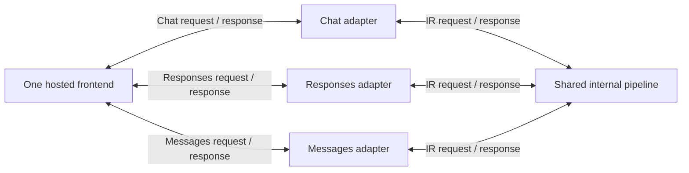

# Frontends with multiple entry points

Status: proposed contract, 2026-10-19. This document records the next graph shape requested for Dynamo. It is not implemented by the current `Frontend` trait.

## Required behavior

One hosted service exposes `/v1/chat/completions`, `/v1/responses`, and `/v1/messages`. Each endpoint accepts its own public request type and returns its own public response stream. Each public request becomes a common internal request. All three paths use one shared internal pipeline. Its common response items return through the adapter for the calling endpoint.

The shared pipeline returns each response to the call that created it. It does not broadcast responses to all adapters. Response routing must preserve the runtime rule: use the returned stream or stream anchor, not a request-ID map.

## Current implementation

`Frontend` has one `Req` type and one `Item` type. Its `serve` method receives one typed `Next<Req, Item>` client. The syntax requires exactly one source. The composer stores one source contract and one nested hop tree.

A frontend can already hide protocol conversion inside its implementation and call a graph with IR types. This does not expose the three public contracts or their adapters in the graph. The requested graph needs those contracts to be visible.

An `Operator` can adapt both directions and retain request-specific state in its response stream. This covers the adapter behavior. The current graph syntax cannot connect three such entry paths to one shared downstream pipeline.

## Proposed representation

These choices need agreement before implementation:

- Represent a frontend instance separately from its named entry points. One listener and one lifecycle own all three entries.
- Give each entry a typed request port and a typed response-item port. Generated service bindings provide one typed graph client per entry.
- Represent the shared internal pipeline once. All entry adapters call that pipeline; code generation must not create three independent copies of its nodes.
- Preserve the caller's response stream through the convergence point. The point joins topology, not request streams or response streams.
- Let the composer show all entry contracts on one source card, with separate adapter paths leading to the shared pipeline.
- Validate each entry-to-pipeline request type and each pipeline-to-entry response type. A mismatch on any entry makes the graph incomplete.
- Apply network placement to each typed edge. Entry ownership follows the hosted service; shared node ownership follows its single placement.

## Open questions

- Should entry names and contracts come from a Rust trait with a generated typed client bundle, or from explicit source declarations in the graph file?
- Should a shared pipeline be a named subgraph that adapters call, or should the topology support converging paths directly?
- Must every declared frontend entry be wired before the service can start, or can configuration disable entries?

## Acceptance evidence for implementation

Tests must cover different public request and response types across all three entries. They must show one constructed shared node instance, correct response types per caller, and concurrent calls without cross-delivery. Cancelling one entry's call must leave the other calls running. Generated placement tests must cover adapters and shared nodes in separate segments. Catalog and composer tests must retain all entry contracts and reject an incomplete path.

## Implementation addendum — 2026-10-19

This addendum supersedes the proposed representation above for the first implementation.

A hosted service implements `gdl::Service`. Its `Clients` type derives `gdl::Endpoints` and declares public `Option<Client<Request, Response>>` fields. Each field names its endpoint path and an enabling graph boolean. The catalog reads these contracts without compiling the service.

Each enabled entry binds one `Operator` adapter through the spec's `[entry]` table. Its upstream ports match the public endpoint. Its downstream ports match the shared graph source. Generated code builds the shared pipeline once and gives each adapter a client to that pipeline. Disabled entries receive `None`. A missing adapter, mismatched port, unknown entry, or configuration for a disabled adapter prevents generation or startup.

The current placement boundary is explicit: entry adapters run in the frontend's segment. The shared internal pipeline uses the existing graph syntax and segment placement. Arbitrary multi-node entry subgraphs and independent placement of entry adapters remain unimplemented. The composer states this restriction next to the source configuration.

`Client` erases the generated pipeline type at the service boundary. It adds one boxed future per public call. Pipeline stages keep their concrete types. This is a construction and API boundary choice, not a performance improvement claim.

### Node configuration

Every `Build::Config` remains a deserializable implementation-owned type. `#[derive(gdl::Config)]` supplies catalog metadata for fields marked `#[gdl(graph, default = ...)]`. A node opts into that metadata with `#[gdl(config = Settings)]`. Unmarked fields never enter the builder's configuration schema.

Graph controls currently support boolean, signed integer, and string fields with explicit literal defaults. The builder validates the overrides and writes resolved values under `[config.NodeName]`. Entry adapter configuration uses the instance name `<Source>_<entry>`. These names cannot collide with pipeline node names.

`gdl::build_node` accepts a Figment and the checked graph values. It fills missing graph values and rejects explicit conflicts before calling `Build::build`. Callers can compose any Figment providers with `merge` and `join`. Generated binaries merge TOML files in argument order, then merge `GDL_` environment variables. A double underscore separates nested keys. Runtime configuration remains under `[node.Name]`, `[frontend]`, or `[adapter.entry]`.

Endpoint flags determine the graph during composition. Runtime providers cannot silently enable an unwired endpoint or disable a wired endpoint. Change the graph configuration and regenerate to change those flags.

### Evidence

The example in `examples/api` serves all three endpoint paths with distinct public request and response types. Its schemas and NDJSON responses demonstrate composition; they are not full implementations of the public provider APIs.

Tests cover graph field visibility, default and override validation, enabled-entry requirements, public and IR type agreement, export, shared clients, and cancellation isolation. HTTP tests cover all entries enabled and chat alone. A generated frontend and engine were also run as separate processes and served all three paths through the shared engine.

Runtime checks on this macOS host use an isolated copy of velo 0.19.0 with its Linux-only socket option guarded. The repository still pins the published dependency. Unpatched builds remain blocked by that dependency's macOS compile error.

*Correction, 2026-10-20:* the repository now pins velo by Git revision, and the suite builds and passes on macOS unpatched. The paragraph above records how the evidence was gathered on 2026-10-19.

## Entry arms and compact workspace — 2026-10-19

This addendum replaces the one-operator entry restriction above. Each `[entry.name]` table now describes a pipeline arm. `forward` and `backward` list implementations in execution order. An `operator` owns a `nested` arm. An arm without an operator joins the shared internal pipeline. Generation checks every edge and the response returned to each caller.

The generated deployment constructs the shared segment once. Each arm reaches it through `gdl::Join`, which retains the concrete pipeline type. Only the public `Client` boundary erases that type. Entry nodes remain in the frontend segment. Independent entry placement and saved pipeline insertion remain unimplemented.

The composer renders compact nodes in a workspace with zoom and pan controls. Each enabled endpoint has a named arm. Request insertion accepts forward nodes and operators whose input matches. Response insertion accepts backward nodes. A response mismatch remains visible and prevents completion until a converter aligns the types. All matching arms join the same shared pipeline.

Configuration annotations accept `label` and `subtext`. These values do not change serialized keys. Doc comments supply help in the settings dialog. Endpoint tiles use the enabling field's label, or its serialized name when no label is declared.

The chat example uses ExtractChat and FormatChat as separate edge nodes. The other two entries use operators. Tests cover these forms, missing response conversion, display metadata, disabled arms, zoom bounds, and pan behavior.

## 2026-10-19 addendum: explicit destinations and shared sinks

This ruling supersedes the mandatory shared pipeline described above. Each entry leaf names a source root through `target`. Missing destinations fail validation. Matching request/response types permit a connection but never create one.

A graph can declare several source roots and one topology per root. Each root retains its own request and response path. A sink reference can occur in several topologies. The sink has one declaration, configuration key, binding, and segment placement. Assembly clones its `Arc`, so each hosting process builds one implementation instance. Other node roles retain their existing topology ownership rules.

Service roots start in the frontend segment. Their downstream nodes can occupy separate segments or share a segment. Multiple roots assemble into a nested tuple; registration visits every root. `Segment::client` selects a typed root and retains the segment's handlers without an additional erased call boundary.

The canvas treats a named pipeline as a compact typed entry, like a public endpoint. It does not draw a pipeline container or an owned sink. Explicit connections can converge on one visible sink. The node picker distinguishes adding a catalog sink from connecting an existing graph sink. Undo snapshots preserve shared node identity and segment placement.

Segments mode shows Round robin and Random router types in the catalog. Selecting one offers the current request-boundary destinations. Responses continue through their initiating stream anchors. Custom router implementations and standalone router services remain future work.

## 2026-10-19 addendum: identity processing stages

Processing stages use built-in identity nodes and operators, rather than a separate adapter class. The user selects message types at the insertion point. A request or response identity has one message type; an identity operator has a request/response pair. Source roots still belong to the frontend, while these executable identity stages can occupy their own segments.

The four-segment example uses an identity operator in `processing-1`, a request identity in `processing-2`, and one shared sink. The first response returns through the operator. The second response bypasses the request identity and returns directly to the frontend. These paths use the existing stream anchors, with no response correlation map.

## 2026-10-19 addendum: endpoint nodes in the deployment graph

This supersedes frontend colocation for composer endpoint adapters. The composer lowers each enabled endpoint into a public typed source root followed by its ordinary graph nodes. Entry specifications bind the service clients directly to those roots. Adapter implementations are constructed by the segment that hosts their graph node, using the existing distributed forward, backward, and operator paths. The compiler and runtime therefore validate and execute the same topology that the cutter displays.

The four-segment validation places ExtractChat alone, ResponsesAdapter alone, and a shared Echo alone, with FormatChat and AnthropicAdapter beside the frontend. The runtime test holds sink responses open and verifies that the request-only segment owns no return anchor while the operator segment does. Generated segment builds verify that the frontend does not construct the remote adapters.

The editor supports selecting a single node or its downstream chain when cutting. It preserves unfinished type-conversion chains and disables deployment until their contracts match. Separate request and response paths remain explicit. Sharing is supported for sink instances; arbitrary shared operators, cyclic flow, and general fan-out/join nodes are not introduced by this change. Service specs that explicitly assemble local entry arms remain available; independently placed adapters are expressed in the graph topology.
