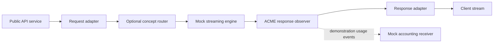

# CUT HERE

Production proposal, 2026-10-22. Audience: Dynamo engineers and leadership. Tone: cinematic, with a few dry jokes. Target: eight minutes, 25 seconds, plus a separate 60–90 second trailer assembled from the same footage.

**Your application is a graph. Your deployment is a choice.**

Creative direction addendum, 2026-10-22: the owner chose a narrated space crawl. Kyle interrupts first, then returns with two technical questions. The six talking heads are Ishan, Alec, John T, Kyle, Graham, and Ryan. All six reference photos are supplied, and their neutral cartoon masters are saved. Expression variants remain pending. The supplied Slack research informs the opening.

Production direction addendum, 2026-10-22: configuration and metrics belong to the nodes. Make this the central proof inside the ACME demonstration. Show one configured node before and after a placement change. The owner also authorized publication of two example crates. Their clean public snapshot is now published in `ryanolson/gdl-demo`, with pinned dependencies on the public GDL core.

Cast direction addendum, 2026-10-22: extend the interruption to 24–80s. Introduce each face and voice with a first-name label and at least one second to register. Ishan uses light Gen Z slang. Ryan asks for a translation exactly once, in the opening. His later lines stay technical and assured. Kyle interrupts with friendly impatience. The revised film has 39 spoken turns across ten scenes and ends at 505s.

Rehearsal addendum, 2026-10-22: the [published demo](https://github.com/ryanolson/gdl-demo/tree/d0d911b4424aa6b6d33b73b164017ba20f304293) contains the reference and ACME crates plus the accounting receiver companion. Its eight tests, formatting, and Clippy pass on Rust 1.93.1. Four local generator tests pass in 7.01 seconds. Actual generated binaries serve the same fixture and emit the expected accounting event and metrics in both distributed and compact placements. The node labels remain stable while the component labels change to match placement. This is fresh-process proof, with fresh counters.

The actual public-spec Compose run fetched node revision `a6c607ba48b4edea33f684699c8701bbdd543207` and generated 22 files under `tools/video/work/deployment`: four Dockerfiles, four Cargo manifests, three runtime configs, seven Rust sources, and four root artifacts. Runtime and hub dependencies pin public GDL core `deefaa92f37ef3f6e4372c7c4c16eb1eccc1ac94`. The generated services are front, engine, accounting, and hub. The prepared public accounting overlay adds ledger. Docker build and apply remain untested. The [evidence ledger](evidence.md) records exact settings, ports, pins, and proof boundaries.

The silent 80-second opening and 33.52-second real-composer tour are ready at 1080p. Voice takes remain at zero, and the portraits have neutral states only. Next, record the native request/accounting/metrics proof, rehearse Docker with the accounting overlay, then capture replication and the edge/backend variant before voice production and final assembly.

## The editorial decision

The demo implementation is published in [draft PR 1](https://github.com/ryanolson/gdl-demo/pull/1). Its exact Git revisions are available for catalog imports and deployment generation.

Make a technical featurette with trailer energy. An eight-minute trailer voice will tire the audience. Open with a cinematic problem, establish the idea, then let working software carry the story.

The opening starts with gold text that recedes into a star field. A narrator reads the same text. Kyle interrupts the crawl with “Wait. Who decides where it runs?” A compiler-paper gag follows in the control room.

The recurring image after the interruption is a graph on a paper blueprint. A request travels through it. Large scissors change the process boundaries. The nodes stay recognizable across the whole film.

Use one complete ACME demonstration as the spine. Use NIM-shaped and Stargate/NVCF-shaped deployments as shorter extensions. Each scene answers a concrete question from an engineer or a leader.

The ACME sequence carries a second visual thread: the node's configuration contract and metric definitions travel with its implementation. Show its declared graph option in the real composer. Show runtime-only values in the Deploy tab's segment TOML. After a placement change, show the same graph value and node metric label in the new process.

The current tools do not move runtime-only TOML between segment cards automatically. Enter the accounting address in the destination segment's TOML explicitly. New segment processes have new identities and fresh counters. The continuity is the node contract and metric definition, not a counter value across restarts.

These are proposed creative choices. The [script](script.md) contains original narration and fictional dialogue. The [graphics brief](graphics.md) defines the six portraits and opening assets. The [history ledger](history.md) preserves selected supplied excerpts. Technical claims and recording limits have separate [evidence](evidence.md).

## What works about the idea

- Dynamo supplies a familiar problem and an existing graph vocabulary. Its pipeline code provides a credible opening image.
- ACME makes extensibility concrete. A catalog entry becomes a useful change to a reference application.
- NIM makes placement concrete. A graph can become one serving process after the required graph edits.
- Stargate makes composition strategic. Public API adapters can live apart from an internal request/response contract.
- Generation closes the loop. The audience sees executable artifacts and a response from the resulting deployment.
- Configuration and metrics make the node boundary concrete. The same node owns its declared options and metric definitions across placements.

The main editorial risk is three architectural talks in one video. Keep ACME as the complete demonstration. Give the other scenarios one transformation and one observable result each.

## The promise we can make

The film demonstrates real GDL tooling with small, executable concept nodes. It does not require a Dynamo port.

Use the persistent label **Concept Dynamo nodes · real GDL execution** on relevant demo footage. Use **Architecture concept** on integrations that do not execute. Reserve **Future integration target** for DGD/operator deployment.

The narration must keep these distinctions clear:

| Topic | Accurate claim |
| --- | --- |
| Catalog | Compose marked GDL packages from supported Rust source, including Git revisions and crates.io versions. |
| Types | Match roles and message identity. A marked re-export can preserve the original identity. Source checks precede Rust compilation. |
| Reference graphs | Customize a starting application by changing nodes and connections. |
| Node configuration | Derives expose graph options in node settings. Resolved values enter the generated graph contract. Runtime-only values enter per-segment TOML. |
| Node metrics | A node declares its metric definitions. The runtime registers them under the node name and adds deployment, segment, and worker identities. |
| Placement | Put suitable nodes into separate segment binaries without changing that logical graph. |
| Scaling | Add replicas of a hub-backed segment. This is independent replication, without an autoscaling claim. |
| Build | Generate segment crates and fetchable image-build bundles. Image publication remains a separate action. |
| Deploy | Generate and run Docker Compose with per-segment runtime TOML today. DGD and ConfigMap rendering remain future integration targets. |
| API contracts | Use small demonstration schemas. A production internal representation needs actual protocol and engine integration work. |

## 8:25 structure

| Time | Scene | The audience sees |
| --- | --- | --- |
| 00:00–00:24 | The graph was already there | A narrated gold perspective crawl establishes the graph, process boundaries, builds, and coordination. |
| 00:24–01:20 | The compiler would like a word | Kyle interrupts. Each cast member gets a voice, name, and hold. Ishan's slang puzzles Ryan once. A paper trait error reaches Alec. |
| 01:20–02:10 | Crates become parts | A real node, configuration and metric derives, graph options, and package provenance. Kyle asks about re-exports. |
| 02:10–02:50 | Types earn their keep | One rejected connection, one valid connection, and the resulting graph. |
| 02:50–03:45 | ACME changes the application | A response observer appears. Set its graph option in the composer and its accounting address in runtime TOML. |
| 03:45–05:15 | Cut, build, run | Generate and run Compose. Show output and actual metrics. Move ACME, retain its graph option, supply destination TOML, and rerun. Then replicate the engine. |
| 05:15–06:00 | The NIM-shaped package | Kyle asks whether the graph or boundaries change. Remove an unnecessary explicit routing stage. Consolidate nodes into one segment and run one serving process. |
| 06:00–07:10 | Move the front door | Public adapters move outward. A concept global router selects a backend. Only internal request/response types cross that boundary. |
| 07:10–07:55 | Show the receipts | Match package provenance, node configuration, accounting events, metric definitions, and process identities to the graph. |
| 07:55–08:25 | The reveal | Three recognizable graph variants. Five claims. A small future-DGD/ConfigMap card. End on a completed request. |

The script word count and scene timecodes need a check after each edit. Reserve time for real actions, readable results, transitions, and pauses. The scene timing is provisional until a scratch narration is recorded. Tighten the full cut if the holds feel slow.

## One demonstration, three arrangements

This diagram describes the proposed demonstration. Its nodes are concept implementations.



Use different visual operations for different changes:

- A graph edit adds, removes, or reconnects a node. Animate the node and its edges.
- A placement edit moves a process boundary around existing nodes. Keep the node positions and connections fixed.
- A deployment operation turns that graph and placement into files, binaries, and running processes.

For ACME, implement a separate package with a response-only `gdl::Backward` node. Carry demonstration usage fields in the response type. Use `gdl::Operator` instead if the observer needs the request itself.

Show one usage event per completed demonstration response. Compare known input/output fixtures. Keep the response unchanged through the observer. The receipt proves the demonstration behavior. It does not establish durable billing, delivery guarantees, or production token accounting.

Use the same ACME node name in both placements. Its demo package declares a graph option, a runtime-only accounting address, and a usage-event counter. The current composer exposes only declared graph options as controls. Show the counter definition in source or catalog data. There is no metrics panel in the composer.

The placement proof has four observable results:

1. The real settings dialog retains the node's resolved graph value.
2. The generated contract retains that graph value. The destination segment's `config.toml` carries its supplied runtime-only values.
3. The same fixture produces an unchanged response, one accounting event, and the expected counter increment in each fresh deployment.
4. The real scrape retains `dynamo_endpoint` as the node name. `dynamo_component`, `worker_id`, and the placement-derived namespace identify the new deployment.

Keep DGD and ConfigMap rendering on a separate future-target card. The present artifact proof ends at the generated Compose bundle and per-segment runtime TOML. Kubernetes output and apply are not implemented.

For the NIM-shaped shot, use one generated segment binary with a fresh directory roster. Generated Compose adds a hub, so it cannot prove a strictly single-process arrangement. A local-composition launcher is another option, but the film must identify it as a launcher around the graph API.

For Stargate, use composer-emitted adapter nodes that permit independent placement. The existing service-spec adapters execute beside their frontend. Build a small routing stand-in if the film needs executable backend selection. Label that component as a concept. Do not imply a working NVCF, Stargate, KV router, or engine integration.

## Graphics and animation

Use original cut-paper characters and props: cartoon portrait heads, flat paper bodies, hinged arms, simple mouth states, hard shadows, and deliberately limited motion. Borrow the handmade visual language of adult cutout animation. Use the team's recognizable likenesses and original dialogue.

The six talking heads are Ishan, Alec, John T, Kyle, Graham, and Ryan. Keep the narrator off screen. Each person gets a brief opening beat and selected later appearances. Keep faces away from code, error details, and output during proof shots. ACME appears as a delivery crate. Process boundaries remain graphic props.

All six reference photos are supplied. Their neutral masters are saved under `agent-docs/video/assets/`, one directory per person. John T wears the requested red Canada cap with a white maple leaf.

Ryan's original reference is grayscale. His active portrait uses artistic warm skin tones and brown hair, following the owner's 2026-10-22 color request. Aligned mouth and blink variants remain pending. The [graphics brief](graphics.md) links the masters and specifies the remaining states.

| Asset | Use |
| --- | --- |
| Star field and gold crawl | The opening's cinematic setup, with the same text spoken by the narrator. |
| Six photo-based cartoon portraits | Recognizable talking heads with aligned neutral, speech, and blink states. |
| Paper control room | The interruption scene and compiler-paper gag. |
| Blueprint graph | The visual anchor across all scenes. |
| Request and response markers | Distinct labeled shapes that travel in opposite directions. |
| Typed ports | Type labels plus stable shapes. Color supports the identity but never supplies it alone. |
| Node continuity card | The same node name, graph value, and metric definition before and after a placement change. |
| Deployment scissors | The process-boundary reveal. |
| ACME crate and receipt | Package provenance, insertion, and accounting payoff. |
| Compiler-paper prop | One opening joke, linked to the supplied account of fearsome errors. |
| Three deployment silhouettes | Distributed service, one-process package, edge plus backend. |

The local browser stage source lives in `tools/video/dist/`. It uses a 1920×1080 composition scaled to the capture viewport. Use HTML, CSS, and SVG for the crawl, bodies, props, and illustrative graphs. Use generated transparent raster images for the photo-based cartoon portraits. Preserve each person's likeness across expression states. `tools/video/README.md` records the local run and rendering procedure.

The stage needs deterministic scene selection, pause, replay, seek, and a clean capture mode. Use an explicit scene clock and cue data. Do not depend on page-load time, network completion, random motion, or live backend latency.

Keep one browser tab for animation and another for the actual composer. Record each shot separately. Match graph positions across the transition so a paper graph can become the real graph without a distracting visual jump.

Capture the actual `gdl-web` catalog, Graph, Segments, and Deploy views. Show real selections, connections, placement edits, and generated artifacts. Synthetic screenshots cannot replace these proof shots. Record terminal output for compilation, deployment, requests, and accounting events.

## Voice and sound

Record a scratch narration before producing voices. Read GDL as “G D L” and NVCF as “N V C F.” Read NIM as “Nim.” Agree on the pronunciation of Stargate and velo during the scratch pass.

Use a restrained narrator for the technical sections. Save the full trailer delivery for the crawl and closing. Keep character dialogue short. Use six distinct character performances. The dialogue is dramatized and does not imply recordings of the historical exchanges.

All 39 spoken turns in the [script](script.md) include ElevenLabs audio tags. The [voice brief](voices.md) specifies the explicit model, speaker assignment, and relative pause cues. Preserve the dialogue words during generation. Remove delivery tags from the visible crawl and captions. Time the exact holds in the edit after selecting the voice takes. No voice takes have been generated.

Use stock cast and narrator voices. Ryan can supply a custom ElevenLabs voice for himself. Each cast introduction reserves at least one second for its name, face, and voice to register.

ElevenLabs supports multi-voice dialogue and timestamped alignment. Generate narration by scene and dialogue by exchange. Keep accepted takes and their timings. The timestamped response can drive mouth cues and captions. See the official [dialogue guide](https://elevenlabs.io/docs/overview/capabilities/text-to-dialogue) and [alignment endpoint](https://elevenlabs.io/docs/api-reference/text-to-dialogue/convert-with-timestamps).

Use broad mouth-open cues rather than phoneme animation. Keep narration, characters, music, and effects on separate tracks. Lower the music under speech. Use a restrained pulse during demos, a short rise before the first successful run, and a quiet ending on the receipt sound.

## Build and recording order

| Stage | Concrete result | Exit condition |
| --- | --- | --- |
| Script and history | This script plus a source ledger for any anecdote. | The narrative and technical claims agree. |
| Demonstration | Small packages, fixture requests, three graph arrangements, and a repeatable run harness. | Real responses and accounting events match expectations. |
| Silent rehearsal | A complete recording of the key workflow without voice or animation. | The ACME path works from catalog through running deployment. |
| Animatic | Rough browser scenes, scratch audio, real footage, and timed holds. | The full cut fits 8:25 and each proof remains readable. |
| Voice and graphics | Selected voice takes, final paper assets, cue timings, and captions. | Names, delivery, and picture timing agree. |
| Capture and edit | Separate animation, composer, terminal, and audio takes. | The exported film has no missing proof or unexplained transition. |

Prepare the portraits and stage while rehearsing the demonstration. Use the exit conditions for final assembly. Do not spend voice-generation credits before the silent rehearsal establishes the demo shots.

### Demonstration work and remaining takes

1. The reference crate now supplies shared demo messages, a deterministic streaming engine, configuration, and metrics. Record these declarations and the actual replica identities.
2. The separate fictional ACME crate now declares its graph options, runtime-only accounting address, and counters. Its fixture tests exercise unchanged responses and known usage events. Record that behavior.
3. The distributed and single-segment arrangements are implemented and pass native tests. Prepare and exercise the edge/backend variant. Keep graph changes distinct from placement changes.
4. Fetchable node revisions and the matching GDL runtime are pinned. The public-spec Compose generation passes. Rehearse the resulting image builds.
5. The recording spec now publishes the frontend port and sets its listener. Use the prepared accounting overlay alongside the generated Compose file.
6. The native harness owns temporary state through `tempfile::TempDir`, bounds readiness waits, and observes readiness before requests. Preserve that standard in the recording harness.
7. Record the first image build honestly. Shorten the wait in the edit with an elapsed-time caption. Preserve the final output and result.
8. Exercise engine replication under hub discovery. Show loaded/ready replicas and request handling, without a speedup claim.
9. Record the tested placement change. Retain the ACME graph values and explicitly supply runtime-only TOML to the destination. Compare real metrics before and after.
10. Git publication and exact package pins are complete. Record a fresh catalog import from those public sources. The composer omits marked message exports, so show ACME's shared identity through source extraction and generated artifacts; the reference's canonical message definitions are at the crate root.

The owner authorized example-crate publication and delegated the destination choice. The two node crates and deployment specs are published in the separate public repository, `ryanolson/gdl-demo`, on `codex/demo-nodes` at `d0d911b4424aa6b6d33b73b164017ba20f304293`. The deployment specs import node packages at exact Git commit `a6c607ba48b4edea33f684699c8701bbdd543207` and pin GDL core `deefaa92f37ef3f6e4372c7c4c16eb1eccc1ac94`. Local development sources remain under `examples/film`. Film assets and Slack history stay outside that public snapshot. This is completed Git publication; crates.io releases remain outside this work.

The current film demo passes native generated-binary tests. Its pinned public Compose bundle still needs an actual Docker image-build and execution rehearsal. Use the prepared accounting companion so the tap can reach `http://ledger:8091/usage`.

### Command shots

These existing entry points describe the earlier API-only preparation. Run them from the repository root. The recording harness supplies `<demo-dir>` through a held `TempDir`. The current film rehearsal and its completed proof are recorded in the dated addendum above.

```bash
cargo run -p gdl-gen -- extract examples/api --catalog <demo-dir>/catalog
cargo run -p gdl-gen -- catalog <demo-dir>/catalog
cargo run -p gdl-gen -- resolve --spec examples/api/gdl.toml
cargo run -p gdl-gen -- generate --spec examples/api/gdl.toml --out <demo-dir>/segments
cargo run -p gdl-web -- --catalog <demo-dir>/catalog --local-root "$PWD" --gdl-path crates/gdl-runtime
```

For the final take, replace the API-only spec with the prepared ACME spec. Use its pinned remote packages for the image and Compose shots. Launch the composer with `--gdl-git`, the rehearsed `--gdl-rev`, and `--docker` for browser apply.

The corresponding CLI shots are:

```bash
cargo run -p gdl-gen -- compose --spec <recording-spec> --out <demo-dir>/deployment
docker compose -p gdl-film -f <demo-dir>/deployment/compose.yaml up --build --detach
docker compose -p gdl-film -f <demo-dir>/deployment/compose.yaml ps
```

After the harness observes readiness, send the fixture request. The existing API example uses this small demonstration schema:

```bash
curl --fail-with-body --max-time 10 -N http://127.0.0.1:8082/v1/chat/completions \
  -H 'Content-Type: application/json' \
  -d '{"messages":["hello graph"]}'
docker compose -p gdl-film -f <demo-dir>/deployment/compose.yaml up --detach --scale engine=3
```

The final demo can use another endpoint or schema. Keep the commands, captions, and fixture assertions consistent with that implementation. Record the response and accounting receiver together. Then show ready replicas and their actual request-handling diagnostic.

### Recording setup

Proposed setup: OBS with three scenes named Animation, Composer, and Terminal. Use 1920×1080 output at 30 fps. Use large terminal text and crop every take to the relevant command, artifact, or result.

The local movie route combines deterministic stage frames with captured composer and terminal clips, then adds a mixed audio track. `tools/video/render.mjs` exports H.264 MP4 at 1920×1080. It uses installed Google Chrome through Playwright and an available `ffmpeg`. Run its preflight to establish the actual prerequisites and clip coverage.

Project-local `ffmpeg-static` supplies the encoder. The silent `tools/video/work/opening.mp4` now covers 0–80s at 1920×1080 and 24 fps. The real film-composer tour at `tools/video/work/media/demo-composer.mp4` runs 33.52 seconds at 1920×1080 and 25 fps. Both are H.264 MP4 takes. They establish the opening and actual UI footage; the complete film remains in production.

Final export requires the recorded demo clips. An explicitly incomplete animatic can retain visible placeholders through `--animatic`. Live composer frames are captured separately and supplied as recordings. They are not reproduced as synthetic UI during export.

The optional `--audio` input is a full-film track aligned to time zero. The renderer encodes that track. It does not generate speech.

```bash
node tools/video/render.mjs --preflight
node tools/video/render.mjs --from 0 --to 80 --out tools/video/work/opening.mp4
node tools/video/render.mjs --audio <full-film-audio> --out tools/video/work/film.mp4
```

These commands describe the production route. The voice recordings and finished movie remain pending.

On supported macOS versions, OBS can capture application audio through its native capture sources. See the official [macOS audio guide](https://obsproject.com/kb/macos-desktop-audio-capture-guide). Record narration separately when practical.

Capture each shot with two seconds of stillness before and after the action. Hide notifications and unrelated windows. Prepare exact commands, but record actual output. Preserve uncut proof takes alongside the edited film.

## Historical anecdotes from Slack

The owner supplied a research summary with transcribed Slack excerpts and permalinks. The links were not opened. The [history ledger](history.md) records selected excerpts and their limits. The opening uses that material and the owner's account.

The excerpts support graph ambitions, typed links, working Rust pipelines, and difficult compiler errors. They also record Graham's eventual success. They do not establish why an approach stopped or why priorities changed.

Use a dramatization label on the cast exchange. A historical quote card needs its author, date, and supplied permalink in the source ledger. Keep broader causal explanations out of the narration unless fuller evidence establishes them.

## The recording is ready when

- A fresh catalog imports the prepared packages and shows their provenance.
- An invalid type connection fails for the intended reason. The valid graph resolves and compiles.
- The generated deployment answers a fixture request. The accounting receiver shows the expected event and unchanged response.
- The same ACME node retains its graph value after a placement change. Its destination runtime TOML contains the accounting address.
- Actual scrapes show the same node metric definition and `dynamo_endpoint`, with the new segment, worker, and placement-derived namespace identities.
- The segmented deployment reaches readiness. Additional engine replicas join and visibly handle requests.
- The single-segment take shows one serving process with no separate hub process.
- The edge/backend take exposes only the intended internal contract across its boundary.
- Every concept scene carries its status label. DGD and ConfigMap rendering remain future targets. Working deployment footage uses Compose and per-segment runtime TOML.
- A scratch-audio cut fits the time budget. Technical text remains readable at the delivery resolution.
- All six portraits match their labeled reference photos and share one visual style. Mouth and blink variants remain aligned.
- The crawl's narrator and visible text agree. The interruption ends at 80s. Each first-name introduction receives at least one second to register.
- Captions, voice, sound, and picture remain synchronized in the exported file.

## Short trailer cut

Use the same footage for a 75-second cut. Use ten seconds for a shortened crawl and interruption. Use fifteen seconds for the catalog and type checks. Use twenty seconds each for ACME execution and deployment transformations. End with ten seconds of the final title. Preserve the concept and dramatization labels. Keep the full featurette as the technical proof.
