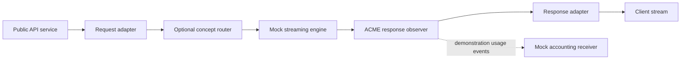

# CUT HERE

Production proposal, 2026-10-22. Audience: Dynamo engineers and leadership. Tone: cinematic, with a few dry jokes. Target: eight minutes, plus a separate 60–90 second trailer assembled from the same footage.

**Your application is a graph. Your deployment is a choice.**

Creative direction addendum, 2026-10-22: the owner chose a narrated space crawl followed by a humorous cut-paper interruption. The six talking heads are Ishan, Alec, John T, Kyle, Graham, and Ryan. Use cartoon portraits based on reference photos. The supplied Slack research now informs the opening.

## The editorial decision

Make a technical featurette with trailer energy. An eight-minute trailer voice will tire the audience. Open with a cinematic problem, establish the idea, then let working software carry the story.

The opening starts with gold text that recedes into a star field. A narrator reads the same text. A compiler-paper gag interrupts the cinematic tone. The recurring image after the interruption is a graph on a paper blueprint. A request travels through it. Large scissors change the process boundaries. The nodes stay recognizable across the whole film.

Use one complete ACME demonstration as the spine. Use NIM-shaped and Stargate/NVCF-shaped deployments as shorter extensions. Each scene answers a concrete question from an engineer or a leader.

These are proposed creative choices. The [script](script.md) contains original narration and fictional dialogue. The [graphics brief](graphics.md) defines the six portraits and opening assets. The [history ledger](history.md) preserves selected supplied excerpts. Technical claims and recording limits have separate [evidence](evidence.md).

## What works about the idea

- Dynamo supplies a familiar problem and an existing graph vocabulary. Its pipeline code provides a credible opening image.
- ACME makes extensibility concrete. A catalog entry becomes a useful change to a reference application.
- NIM makes placement concrete. A graph can become one serving process after the required graph edits.
- Stargate makes composition strategic. Public API adapters can live apart from an internal request/response contract.
- Generation closes the loop. The audience sees executable artifacts and a response from the resulting deployment.

The main editorial risk is three architectural talks in one video. Keep ACME as the complete demonstration. Give the other scenarios one transformation and one observable result each.

## The promise we can make

The film demonstrates real GDL tooling with small, executable concept nodes. It does not require a Dynamo port.

Use the persistent label **Concept Dynamo nodes · real GDL execution** on relevant demo footage. Use **Architecture concept** on integrations that do not execute. Reserve **Future integration target** for DGD/operator deployment.

The narration must keep these distinctions clear:

| Topic | Accurate claim |
| --- | --- |
| Catalog | Compose marked GDL packages from supported Rust source, including Git revisions and crates.io versions. |
| Types | Match roles and message identity. A marked re-export can preserve the original identity. Source checks precede Rust compilation. |
| Reference graphs | Customize a starting application by changing nodes and connections. |
| Placement | Put suitable nodes into separate segment binaries without changing that logical graph. |
| Scaling | Add replicas of a hub-backed segment. This is independent replication, without an autoscaling claim. |
| Build | Generate segment crates and fetchable image-build bundles. Image publication remains a separate action. |
| Deploy | Generate and run Docker Compose today. DGD generation is a future integration target. |
| API contracts | Use small demonstration schemas. A production internal representation needs actual protocol and engine integration work. |

## Eight-minute structure

| Time | Scene | The audience sees |
| --- | --- | --- |
| 00:00–00:24 | The graph was already there | A narrated gold perspective crawl establishes the graph, process boundaries, builds, and coordination. |
| 00:24–00:55 | The compiler would like a word | The six cartoon heads interrupt the epic tone. A paper trait error crosses the room. Alec: “Oh, the humanity.” |
| 00:55–01:45 | Crates become parts | A real node derive, a role implementation, and catalog entries with package provenance. |
| 01:45–02:25 | Types earn their keep | One rejected connection, one valid connection, and the resulting graph. |
| 02:25–03:20 | ACME changes the application | A response observer appears in the reference graph. The request path remains visible. |
| 03:20–04:50 | Cut, build, run | Placement, generated Rust, Dockerfiles, Compose, readiness, a streamed response, accounting output, then engine replication. |
| 04:50–05:35 | The NIM-shaped package | Remove an explicit routing stage where unnecessary. Then consolidate nodes into one segment and run one serving process. |
| 05:35–06:45 | Move the front door | Public adapters move outward. A concept global router selects a backend. Only internal request/response types cross that boundary. |
| 06:45–07:30 | Show the receipts | Return to the real run. Match output, accounting events, segment identity, and replicas to the graph. |
| 07:30–08:00 | The reveal | Three recognizable graph variants. Four claims. A small future-DGD card. End on a completed request. |

The script word count and scene timecodes need a check after each edit. Reserve time for real actions, readable results, transitions, and pauses. The scene timing is provisional until a scratch narration is recorded. Tighten the full cut if the holds feel slow.

## One demonstration, three arrangements

This diagram describes the proposed demonstration. Its nodes are concept implementations.



Use different visual operations for different changes:

- A graph edit adds, removes, or reconnects a node. Animate the node and its edges.
- A placement edit moves a process boundary around existing nodes. Keep the node positions and connections fixed.
- A deployment operation turns that graph and placement into files, binaries, and running processes.

For ACME, implement a separate package with a response-only `gdl::Backward` node. Carry demonstration usage fields in the response type. Use `gdl::Operator` instead if the observer needs the request itself.

Show one usage event per completed demonstration response. Compare known input/output fixtures. Keep the response unchanged through the observer. The receipt proves the demonstration behavior. It does not establish durable billing, delivery guarantees, or production token accounting.

For the NIM-shaped shot, use one generated segment binary with a fresh directory roster. Generated Compose adds a hub, so it cannot prove a strictly single-process arrangement. A local-composition launcher is another option, but the film must identify it as a launcher around the graph API.

For Stargate, use composer-emitted adapter nodes that permit independent placement. The existing service-spec adapters execute beside their frontend. Build a small routing stand-in if the film needs executable backend selection. Label that component as a concept. Do not imply a working NVCF, Stargate, KV router, or engine integration.

## Graphics and animation

Use original cut-paper characters and props: cartoon portrait heads, flat paper bodies, hinged arms, simple mouth states, hard shadows, and deliberately limited motion. Borrow the handmade visual language of adult cutout animation. Use the team's recognizable likenesses and original dialogue.

The six talking heads are Ishan, Alec, John T, Kyle, Graham, and Ryan. Keep the narrator off screen. Each person gets a brief opening beat and selected later appearances. Keep faces away from code, error details, and output during proof shots. ACME appears as a delivery crate. Process boundaries remain graphic props.

Portrait production needs one clear, labeled reference photo per person. The current attachment contains text only. Generate the six portraits in one shared cartoon style, then make aligned mouth and blink variants. The [graphics brief](graphics.md) specifies the asset set and photo inputs.

| Asset | Use |
| --- | --- |
| Star field and gold crawl | The opening's cinematic setup, with the same text spoken by the narrator. |
| Six photo-based cartoon portraits | Recognizable talking heads with aligned neutral, speech, and blink states. |
| Paper control room | The interruption scene and compiler-paper gag. |
| Blueprint graph | The visual anchor across all scenes. |
| Request and response markers | Distinct labeled shapes that travel in opposite directions. |
| Typed ports | Type labels plus stable shapes. Color supports the identity but never supplies it alone. |
| Deployment scissors | The process-boundary reveal. |
| ACME crate and receipt | Package provenance, insertion, and accounting payoff. |
| Compiler-paper prop | One opening joke, linked to the supplied account of fearsome errors. |
| Three deployment silhouettes | Distributed service, one-process package, edge plus backend. |

Build animation as a separate browser stage with a 1920×1080 composition. Scale it to the capture viewport. Use HTML, CSS, and SVG for the crawl, bodies, props, and graphs. Use generated transparent raster images for the photo-based cartoon portraits. Preserve each person's likeness across expression states.

The stage needs deterministic scene selection, pause, replay, seek, and a clean capture mode. Use an explicit scene clock and cue data. Do not depend on page-load time, network completion, random motion, or live backend latency.

Keep one browser tab for animation and another for the actual composer. Record each shot separately. Match graph positions across the transition so a paper graph can become the real graph without a distracting visual jump.

## Voice and sound

Record a scratch narration before producing voices. Read GDL as “G D L” and NVCF as “N V C F.” Read NIM as “Nim.” Agree on the pronunciation of Stargate and velo during the scratch pass.

Use a restrained narrator for the technical sections. Save the full trailer delivery for the crawl and closing. Keep character dialogue short. Use six distinct character performances. The dialogue is dramatized and does not imply recordings of the historical exchanges.

ElevenLabs supports multi-voice dialogue and timestamped alignment. Generate narration by scene and dialogue by exchange. Keep accepted takes and their timings. The timestamped response can drive mouth cues and captions. See the official [dialogue guide](https://elevenlabs.io/docs/overview/capabilities/text-to-dialogue) and [alignment endpoint](https://elevenlabs.io/docs/api-reference/text-to-dialogue/convert-with-timestamps).

Use broad mouth-open cues rather than phoneme animation. Keep narration, characters, music, and effects on separate tracks. Lower the music under speech. Use a restrained pulse during demos, a short rise before the first successful run, and a quiet ending on the receipt sound.

## Build and recording order

| Stage | Concrete result | Exit condition |
| --- | --- | --- |
| Script and history | This script plus a source ledger for any anecdote. | The narrative and technical claims agree. |
| Demonstration | Small packages, fixture requests, three graph arrangements, and a repeatable run harness. | Real responses and accounting events match expectations. |
| Silent rehearsal | A complete recording of the key workflow without voice or animation. | The ACME path works from catalog through running deployment. |
| Animatic | Rough browser scenes, scratch audio, real footage, and timed holds. | The full cut fits eight minutes and each proof remains readable. |
| Voice and graphics | Selected voice takes, final paper assets, cue timings, and captions. | Names, delivery, and picture timing agree. |
| Capture and edit | Separate animation, composer, terminal, and audio takes. | The exported film has no missing proof or unexplained transition. |

Keep production tasks sequential at these gates. Do not spend voice-generation credits before the silent rehearsal establishes the demo shots.

### Demonstration work required

1. Create a small demo protocol package and deterministic streaming engine. Make replica identity observable through a diagnostic or metric.
2. Create a separate fictional ACME package and a small accounting receiver. Exercise response preservation and known usage events with fixtures.
3. Prepare the normal graph, its single-segment arrangement, and the edge/backend variant. Keep graph changes distinct from placement changes.
4. Pin fetchable package revisions and the matching GDL runtime for image builds. Local editing alone cannot supply a Deploy bundle.
5. Add explicit frontend port publication and listener configuration to the recording spec.
6. Make the harness own temporary state through `tempfile::TempDir`. Bound readiness waits and observe readiness before requests.
7. Record the first image build honestly. Shorten the wait in the edit with an elapsed-time caption. Preserve the final output and result.
8. Exercise engine replication under hub discovery. Show loaded/ready replicas and request handling, without a speedup claim.

The fixed Git revision in the current API deployment example must pass an image-build rehearsal before use. The existing API README also records a native macOS dependency problem. Confirm the actual Linux/Docker recording path rather than assuming native execution.

### Command shots

These existing entry points anchor the rehearsal. Run them from the repository root. The recording harness supplies `<demo-dir>` through a held `TempDir`. These commands are a preparation plan, not a record of a successful deployment.

```bash
cargo run -p gdl-gen -- extract examples/api --catalog <demo-dir>/catalog
cargo run -p gdl-gen -- catalog <demo-dir>/catalog
cargo run -p gdl-gen -- resolve --spec examples/api/gdl.toml
cargo run -p gdl-gen -- generate --spec examples/api/gdl.toml --out <demo-dir>/segments
cargo run -p gdl-web -- --catalog <demo-dir>/catalog --local-root "$PWD" --gdl-path crates/gdl-runtime
```

For the final take, replace the API-only spec with the prepared ACME spec. Use its pinned remote packages for the image and Compose shots. Launch the composer with `--gdl-git`, the rehearsed `--gdl-rev`, and `--docker` for browser apply.

The corresponding CLI shots are:

```bash
cargo run -p gdl-gen -- compose --spec <recording-spec> --out <demo-dir>/deployment
docker compose -p gdl-film -f <demo-dir>/deployment/compose.yaml up --build --detach
docker compose -p gdl-film -f <demo-dir>/deployment/compose.yaml ps
```

After the harness observes readiness, send the fixture request. The existing API example uses this small demonstration schema:

```bash
curl --fail-with-body --max-time 10 -N http://127.0.0.1:8082/v1/chat/completions \
  -H 'Content-Type: application/json' \
  -d '{"messages":["hello graph"]}'
docker compose -p gdl-film -f <demo-dir>/deployment/compose.yaml up --detach --scale engine=3
```

The final demo can use another endpoint or schema. Keep the commands, captions, and fixture assertions consistent with that implementation. Record the response and accounting receiver together. Then show ready replicas and their actual request-handling diagnostic.

### Recording setup

Proposed setup: OBS with three scenes named Animation, Composer, and Terminal. Use 1920×1080 output at 30 fps. Use large terminal text and crop every take to the relevant command, artifact, or result.

OBS is not present in the inspected `/Applications` directory. `ffmpeg` and `ffprobe` are not on the inspected shell's PATH. The production stage needs a confirmed capture tool and editor. This planning task does not install them.

On supported macOS versions, OBS can capture application audio through its native capture sources. See the official [macOS audio guide](https://obsproject.com/kb/macos-desktop-audio-capture-guide). Record narration separately when practical.

Capture each shot with two seconds of stillness before and after the action. Hide notifications and unrelated windows. Prepare exact commands, but record actual output. Preserve uncut proof takes alongside the edited film.

## Historical anecdotes from Slack

The owner supplied a research summary with transcribed Slack excerpts and permalinks. The links were not opened. The [history ledger](history.md) records selected excerpts and their limits. The opening uses that material and the owner's account.

The excerpts support graph ambitions, typed links, working Rust pipelines, and difficult compiler errors. They also record Graham's eventual success. They do not establish why an approach stopped or why priorities changed.

Use a dramatization label on the cast exchange. A historical quote card needs its author, date, and supplied permalink in the source ledger. Keep broader causal explanations out of the narration unless fuller evidence establishes them.

## The recording is ready when

- A fresh catalog imports the prepared packages and shows their provenance.
- An invalid type connection fails for the intended reason. The valid graph resolves and compiles.
- The generated deployment answers a fixture request. The accounting receiver shows the expected event and unchanged response.
- The segmented deployment reaches readiness. Additional engine replicas join and visibly handle requests.
- The single-segment take shows one serving process with no separate hub process.
- The edge/backend take exposes only the intended internal contract across its boundary.
- Every concept scene carries its status label. DGD appears only as a future target.
- A scratch-audio cut fits the time budget. Technical text remains readable at the delivery resolution.
- All six portraits match their labeled reference photos and share one visual style. Mouth and blink variants remain aligned.
- The crawl's narrator and visible text agree. The interruption lands within the 55-second opening budget.
- Captions, voice, sound, and picture remain synchronized in the exported file.

## Short trailer cut

Use the same footage for a 75-second cut. Use ten seconds for a shortened crawl and interruption. Use fifteen seconds for the catalog and type checks. Use twenty seconds each for ACME execution and deployment transformations. End with ten seconds of the final title. Preserve the concept and dramatization labels. Keep the eight-minute featurette as the technical proof.
