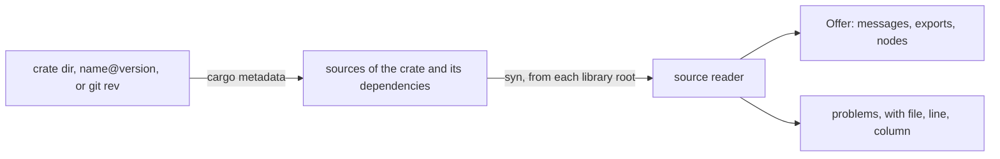

# The catalogue and the source reader

A graph file names messages and nodes by bare names. Something must map each name to one Rust type in one crate. In gdl, that is the source reader, `gdl-extract`. It reads what a crate offers from the crate's source and builds nothing. A crate that needs CUDA to build can still be read on a machine without CUDA. Reading also runs none of the crate's code.

The reader serves three callers. `cargo gdl generate`, `check`, and `resolve` read each crate a spec lists. `cargo gdl extract` prints what one crate offers, or adds it to a working catalogue. The composer's server reads each crate a user imports into its working catalogue. [Catalogue design](../development/catalogue-design.md) explains why the reader reads source, and what was tried first.

## What a crate offers

A crate offers three kinds of entry. Each one comes from a marker in the crate's source. Nothing else is written by hand. It also offers its cell policies, which need no marker.

| Marker | On | Offers |
|---|---|---|
| `#[derive(Message)]` | a struct or enum | a message, at its definition path |
| `#[export]` | a `pub use` of messages | each message under this crate's own path |
| `#[export]` | a `pub type` that names an instantiation of a generic message or node | that instantiation, under the alias's name |
| `#[derive(Node)]` | a struct | a node, with the role and ports of the one role trait impl the crate has for the type |

Each marker has two spellings. A protocols crate depends on `gdl-message` alone and writes `gdl_message::Message` and `gdl_message::export`. A node crate depends on `gdl` and writes `gdl::Message`, `gdl::export`, and `gdl::Node`. Both spellings are the same macro. A proc macro has no `$crate`, so each spelling names its own crate in its expansion.

A node's name is its type's name. Its role is the role trait the type implements: `Sink`, `Forward`, `Backward`, `Operator`, or, for a source, `Frontend` or `Service`. Its ports are that trait's associated types. Each port must name a marked message, `()`, or `gdl::Streamed<H, T>` of those. [Write nodes](../guides/write-nodes.md) gives the rules a node type must follow.

A cell policy is a type that implements `gdl::CellPolicy` and that the crate's root reaches by its name. The reader follows the impl's trait path to its definition, through `use`s, renames, and globs, as it follows a port's type, and takes only gdl's `CellPolicy`. The offer holds the policy's type and its `Head`: a message, `()`, `gdl::Encoded`, or `gdl::Projected<P>` with the message that `P`'s `derive(Projection)` names in `#[gdl(of = ...)]`. The reader leaves out a generic policy and one that the root does not reach, and says why to a spec that names it. A spec's `[cell_policy.<name>]` table names one ([Write a cell policy](../guides/write-a-cell-policy.md)).

The offer also holds, for each node, the graph-visible fields of its `derive(Config)` type, the metrics of its `derive(Metrics)` type, and, for a `Service`, each endpoint of its `derive(Endpoints)` bundle. The reader takes all of these from the derives' attributes. This is why `gdl::ConfigSchema` and `gdl::Metrics` can be implemented only by their derives.

## How the reader reads



1. `cargo metadata` resolves the crate and its dependencies, and downloads their sources. It runs no build script and no proc macro. A `name@version` is fetched through a scratch manifest under the target directory that depends on `name = "=version"`. A Git crate is fetched the same way at a commit.
2. The reader parses each library with `syn`, from its root through its module tree: `mod` items, `#[path]`, and `cfg` evaluated for the host with the package's enabled features.
3. It finds the markers, and resolves only the paths that they need. A port type, or the target of an export, is followed through `use` declarations, globs, re-exports, type aliases, `crate`, `self`, and `super`, and into dependencies by the names Cargo gives them. Paths follow the Rust 2018 rules.
4. A path that does not end at a marked definition is a problem that names the port and the path. The reader never guesses. A crate read with problems gives no entry.

The reader does not see items that a macro makes, other than through the markers. It does not see code that a build script generates, or `cfg` that depends on compiler flags. [Known limitations](../operations/limitations.md) lists each case that it misreads, and what to do.

Reading is linear in the source. One extraction reads at most 16 MiB of source in total, and 16 MiB per file. [Source reader cost](../operations/reader-cost.md) has the measurements.

## Wire capability from source

A message is a wire type when it implements `Serialize` and `Deserialize`. Only a wire type can cross between segments. The reader decides this from source. It takes `derive(Serialize, Deserialize)`, or serde impls that it finds in the crate for the type. It also reads the encoding from `#[gdl(codec = ...)]`, which [Messages and encodings](messages.md) describes.

For an instantiation of a generic message, the reader judges each direction of serde on its own. It reads the bounds that serde's derive infers, or the bounds of a hand-written impl. It takes the instantiation for a wire type only where it can show it. Anything it cannot judge makes the instantiation local. A wrong "local" refuses a crossing that would work. A wrong "wire" fails the segment's build, never a running graph: each generated segment asserts at compile time that every message it sends or receives across a cut is a wire type. The error reads `` `T` crosses between segments but is not a wire type ``.

## Resolution

A message's identity is its origin: the defining package's name, version, and source (a registry, a Git commit, or a path), and its definition path. [Messages and encodings](messages.md) defines identity, including an instantiation's. A spec's `[messages] crates` lists the crates that names resolve against. A listed crate offers what it defines and what it exports.

- A name must resolve to exactly one origin. A crate that defines a message and a crate that exports it offer one message, so the two are not ambiguous.
- A name that resolves to two origins is an error that lists them. `[messages] pin = { Name = "crate::path" }` chooses one. Search order never decides.
- A message must have a public path: the item and every module above it are `pub`. A message in a private module needs an `#[export]`. Resolution reports this from source, before anything is generated.
- The generated contract names each message by a public path through a listed crate. The defining crate's own export comes first, then another listed crate's export, then the definition path. A crate that exports a type from a private module has chosen that path as its public one.

Nodes bind the same way through `[nodes] crates`. Each graph node binds to the one offered node of its name, or to a `[nodes] pin`. The generator checks the node's role, and the origin at each port, against what the graph's names resolve to. A same-named message of another package or version at a port is a mismatch, reported with both origins. [Split, generate, and draw](../guides/split-and-generate.md) shows a spec with both tables.

## The working catalogue

A working catalogue is a directory with one file per crate version:

```text
<catalogue>/<name>/<version>.toml    the offer, when it was added, and the registry checksum
```

`cargo gdl extract <crate> --catalog <dir>` adds an entry, and the composer's server adds one for each import. `cargo gdl catalog <dir>` prints the index: each entry, each message name with the messages of that name, and each node with the messages at its ports.

- A published version never changes, so its entry is written once. Adding it again keeps the file. The same version from another source is an error that names both sources.
- A crate from a directory changes as it is edited, so it has one entry. Adding it again replaces the entry, and removes the entry of its earlier version.
- The time is RFC 3339 UTC, to the second. The checksum is the one Cargo locked for a registry crate. A path or Git crate has none.
- Loading reads every file. No unified index is stored. A file that does not hold the entry its path names is refused.

An entry written before messages carried an encoding does not load. The load error names the file to remove and re-add.

## `--verify`: the backstop

`cargo gdl extract <crate> --verify` reads the crate, then builds a program that links it and prints what the markers registered at compile time. Each marker also registers its entry in a link-time list (`linkme`). The command keeps the entries whose build directory is the crate's own, and fails on each difference from what the reader found. The program also links what the crate's dependencies register, another version of the crate itself among them, and those entries are left out. The program starts from the lock file of the crate's workspace, so it builds the versions that the reader read, and Cargo reads no registry index for them. It takes the crate and the `gdl-message` nearest to it in its dependencies from the sources that lock names: a path, a registry version, or a Git repository under the same branch, tag, or revision. Under any other Git reference, Cargo would see a second source and link a second `gdl-message`. It also takes the workspace's `[patch]` tables, since Cargo applies a patch only from a manifest. A crate that does not depend on `gdl-message` registers nothing, and `--verify` says so without building it. A message that a macro makes shows up here. So does a wire capability that the reader judged wrong.

`--verify` runs third-party build scripts, so it is for a crate's own CI. The composer never runs it. An alias that the reader leaves out on purpose is no difference. `--verify` prints it on stderr with the reason. It compares an instantiation by its path, not by the packages of its arguments, which a build cannot name.

Three checks stand behind the reader even without `--verify`. `derive(Node)` checks its type when the node crate compiles. Each segment build type-checks every binding. Each segment asserts that what crosses its cuts is a wire type. A wrong read fails a build, and never runs.
