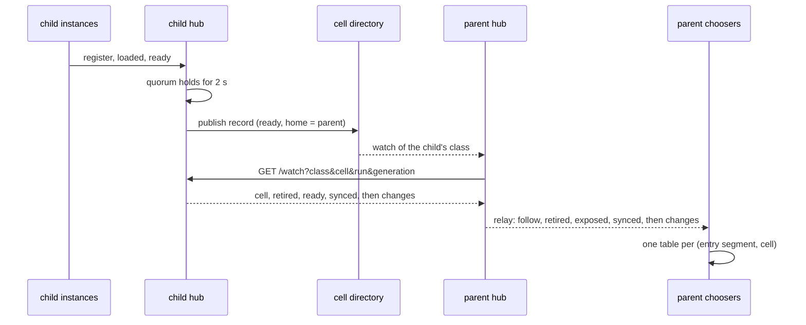

# Following and choosing cells

A parent cell sends work to its child cells. This chapter covers how the parent's hub finds and follows its children, how the parent's choosers pick a cell for each attempt, and how retirement and drain work across a class boundary. [Classes and cells](cells.md) defines classes, cells, quorum, and the cell's watch. Read it first. The route and event tables are in [Cell hub routes and watch events](../appendix/hub-api.md). The reasons behind each rule are in [Cells design](../development/cells-design.md).

## Who follows whom

A hub follows only its children. A child is a cell whose record names the hub's own cell as its `home`, has the same contract and placement hashes, and is `ready` or `degraded`. Region plays no part in following. A child in another region is followed. A cell in the hub's region whose parent is another cell is not followed.

Cells of layouts that place nodes differently have different placement hashes, so they never follow or offer to each other. A cell with other hashes is ignored, not an error. A hub follows children only for the classes its own class sends to. A cell of a class that sends to no class follows nothing.

## Two links

A parent's hub learns about a child over two links with different jobs.

| Link | Carries | If it fails |
|---|---|---|
| The cell directory | which cells exist: name, class, region, parent, hashes, state, epoch, hub address | no new child is found; a child already followed stays followed |
| The follow link: the parent's hub watches the child's hub (`GET /v1/ext/gdl-cell/watch`) | the child's state and epoch, its load summary each period, and its entry instances, ready and retired, with their velo `PeerInfo` | the follow is not offered from that moment: this is the liveness signal |

The directory is off the routing path. A record that expires or is withdrawn ends no follow and does not change whether a follow is offered. A newer epoch in the directory ends the follow of the hub it replaces.

## The follow and its generation

Each time a hub follows a cell, it starts a new generation of that follow, with new tables. Instance ids seen in an earlier generation carry nothing into the new one.

A hub follows a cell again after its link ended, as a new generation, if the cell's record still makes it a child that takes work. The first wait is 125 to 250 ms. Each failed link doubles the wait, up to 2.5 to 5 s. A link that ran for 30 s after its snapshot returns the wait to the first step. A record of a new epoch is followed at once. A follow that the hub closed is followed again only after a later write of the cell's record.

A follow whose link ended is kept, with its instances, beside the cell's later generations, until it closes as described below.

## The relay

The parent's hub relays what it follows to its own instances on `GET /v1/ext/gdl-cell/follows`. The relay starts with a snapshot. For each followed cell it sends `follow`, then the cell's retired entry instances, then the ready ones it exposes, then one `synced` for the whole snapshot. After that it sends each change. Every event except `synced` names its cell by class and name, and names the follow's generation.

A cell's instances are exposed only while the state it last sent is `ready` or `degraded`. A state that exposes nothing hides them all. A state that exposes them again sends each one again.

`GET /v1/ext/gdl-cell/follows/{class}/{cell}` watches one cell's follows alone. A chooser uses it to read one cell again after an event it does not know (see [unknown events](#an-event-of-an-unknown-kind)).

## Offered and not offered

A follow is offered to the hub's choosers while its link lives and the state it last sent is `ready` or `degraded`. Each change between offered and not offered is the follow's next revision. The relay sends it as `offering`, with the revision and whether the follow is offered. A follow starts offered at revision 1. A snapshot shows `offering` only for a follow that is not offered.

Not offered is not a retirement. No instance is marked retired, and no instance's routing table changes. Marking the follow offered again undoes it at once.

## Closing a follow

A follow closes only when no chooser can still hold an offer to it. The hub learns this by acknowledgement, not by a timer.

1. A chooser says to its hub that it runs a follower of the relay (`POST /instances/{id}/chooser`). It does this before it first watches the relay. Only then does the hub wait for its acknowledgements. An instance without `[cell]` runs no follower, never offers to another cell, and is not waited for.
2. Each offer to a cell takes a lease on the cell's follow. The lease is one count, held until the response stream ends or is dropped, as a selector's lease is.
3. When a chooser applies a not-offered revision, it stops offering to that follow. A choice already in flight is checked again when it returns, so it cannot complete an offer to the follow.
4. Once the chooser holds no lease on the follow, it acknowledges that revision (`POST /instances/{id}/unoffered`, a `gdl_watch::Unoffered`). It looks for such a follow every 50 ms, and sends an acknowledgement that its hub did not take again 500 ms later.
5. The follow closes once every chooser of its class among the hub's members has acknowledged the current revision, or left, and that revision is still a not-offered one. An acknowledgement of any other revision counts for nothing.
6. The hub sends `dropped` on the relay, ends the link, and releases the child's watch (`POST /release`).

A request can run for a long time. Its lease keeps the follow open for as long as it runs. That costs one watch.

If the link is lost, the follow is not offered from that moment. It closes by the same acknowledgements, so the chooser keeps the child's instances registered with velo until no lease is held. Unregistering a peer fails what is in flight to it. A live instance finishes what it holds. A dead one fails its streams through velo's own detection or through their deadlines.

## The chooser's tables

A chooser is an instance in a cell, under a hub, whose segment holds the outer end of a hop into another class. It opens one watch of its own hub's relay for its whole life. After a watch ends it watches again from a fresh snapshot, and keeps its tables meanwhile. The wait starts at 50 to 100 ms and doubles up to 0.5 to 1 s while watches keep failing.

For each entry segment its hops enter, and each followed cell, the chooser keeps a table of the cell's current generation:

- the cell's state and region;
- its load summary, with the time it arrived on the chooser's clock (`FollowedCell::load`, `load_age`);
- whether it is offered, and at which revision (`FollowedCell::offered`, `revision`);
- its exposed entry instances;
- its retired entry instances, which are never routed to again.

A newer generation replaces a cell's table at once. The older generation keeps its instances until the hub drops it. `Launch::cells` reads the tables (`gdl_runtime::Cells`).

Each entry instance is registered with the chooser's velo node before a table holds it. It is unregistered `drain_ms` after no follow holds it, unless the chooser's own membership still routes to it or is still draining it. The membership, in turn, does not unregister a peer that a table holds. So a velo peer in both is unregistered by whichever lets go of it last.

## Choosing a cell

Each hand-off of a hop into another class goes to a cell, then to an instance of that cell:

1. The class's cell policy (`[cells.<class>] policy`) chooses a cell for this attempt.
2. The hop's own router (`[routing]`, see [Routing, selectors, and offers](routing.md)) chooses an entry instance among that cell's eligible instances only. A round robin keeps its turn per entry segment and cell.

If the chosen instance leaves the cell's table while a selector waits, or the cell stops taking work, both choices are made again. With no cell to choose, the request fails at once with `Routing`, naming the class. It never waits for a cell to appear.

gdl provides two policies, `round_robin` and `home_first`. A deployment can register others by name ([Write a cell policy](../guides/write-a-cell-policy.md)). A chooser whose placement names a policy that nothing registers and gdl does not have refuses to launch, and names the policy and the class.

### `round_robin`

`round_robin` is the default. Each attempt takes the next cell in the chooser's table, ordered by class and cell. A cell is eligible while it is `ready` or `degraded`, has an entry instance to route to, and has not declined this request. `ready` cells take every turn while any is eligible. `degraded` cells take turns only when no `ready` cell is eligible. It reads no load summary, so a cell can be chosen from the moment it is followed. Region plays no part.

### `home_first`

`home_first` chooses by each cell's load summary. A cell is not eligible if it is `unavailable` or `draining`, has no entry instance to route to, declined this request, or has no summary younger than three of its periods. A cell is saturated when its admitted roots reach its admission limit, or its last period had refusals. Of the eligible cells, `home_first` takes the first tier that is not empty:

| Tier | Cells |
|---|---|
| 1 | `ready` home cells (the chooser's own `[cell] region`) that are not saturated |
| 2 | `ready` cells in another region that report no refusals and whose admitted roots are under 80% of their limit |
| 3 | saturated `ready` home cells |
| 4 to 6 | the `degraded` cells, in the same three tiers |

Within the tier it draws two cells at random and takes the one with the lower ratio of admitted roots to limit. A cell in another region that reports a refusal, or is at or over 80%, is never chosen. Admission counts roots, not engine work, so this is an admission heuristic. The thresholds are constants of the policy.

### A registered policy

A registered policy implements `gdl::CellPolicy`. It runs in the chooser, once per attempt: for the first offer, and again after each decline. It is not `async`. It gets:

- the request's context, and its head as the policy's `Head` reads it: the edge's type, `gdl::Encoded` bytes, or a `gdl::Projected` part that decodes only the fields it declares;
- the class's followed cells: each cell's name, region, state, load summary, and number of entry instances;
- the chooser's region, the clock, the cells that declined this request, and the cells the chooser damps;
- the attempt's turn, and a random draw made from it when the policy asks.

It returns the index of a cell, or none, which fails the request with `Routing`. The head is read once per attempt, from the bytes the sender encoded. A head the policy cannot read fails the request with `Codec`, and no cell is offered it. When the segment starts, the runtime checks the policy's `Head` against the edge, as for a selector. A projection must name the edge's type, and its edge must not be encoded as `msgpack_array`.

The inputs are plain `gdl` types (`Cell`, `CellRequest`, `Damped`, `Load`), so a policy crate builds them in its own tests, with no hub or runtime. `home_first` and `round_robin` (`gdl::HomeFirst`, `gdl::RoundRobin`) implement the same trait, and take the same inputs.

### Damping

Under every policy, the chooser damps a cell that declined a request. `round_robin` and `home_first` pass a damped cell over as this section says. A registered policy sees the damped cells and decides for itself. It is not chosen for 1 s. Each further decline after its window has passed doubles the window, up to 30 s. An offer it accepts ends the damping. A decline that lands while a window lasts belongs to the event that began it and does not extend the window.

At most half of the otherwise eligible cells, rounded down, are damped at once. When more are, the cells whose windows end soonest are chosen as if they were not damped. So a lone cell is never damped out.

## A hand-off is an offer

A child cell may decline the hand-off. The chooser then offers the request to another cell in the same call. Nothing of a declined offer is sent again: the entry started no work and holds nothing, and a streamed request's input goes only to the cell that accepts it. A selector's lease and metadata from a declined choice are released before the next choice.

| What happens | Outcome |
|---|---|
| The entry answers `Overloaded` before it takes the request: admission or egress refused, or the instance retired | another cell is offered the request |
| The entry answers `Placement`: the hand-off is not of its deployment | another cell is offered the request |
| velo refuses the send before it leaves: the instance is not registered, or its handshake fails | another cell is offered the request |
| No answer within the setup timeout, or the send fails after velo took it | the request fails at once with `OutcomeUnknown`; no other cell is offered it |
| The entry accepted, then failed | the request's error; a retry is the operator's |

The chooser offers to at most `[runtime] cell_failovers` more cells (2 by default). With 0, each request is offered to one cell. When every offered cell declines, the request fails with the last refusal, so a full fleet answers `Overloaded`. A refusal is not remembered past its request, except through damping.

## Entry retirement across cells

An entry instance is an instance of a segment that a hop from another class enters. When one retires, the cells that follow its cell must stop choosing it.

1. The child's hub sends `retired` on its cell's watch. Each parent hub applies it to its relay.
2. The parent hub waits for each chooser whose hops enter the instance's segment. Each chooser says that it avoids the instance once its tables hold it retired (`POST /instances/{id}/avoids`). It resends one its hub did not take every 500 ms. A chooser that leaves counts as one that avoids it.
3. The parent hub then tells the child's hub once, for its whole cell (`POST /avoided`). A follow that closes first is released instead, which counts the same.
4. Once every cell that followed the child when the instance retired has done so, the child's hub sends `retired` again with `acknowledged: true`.

The retiree waits for that, or for at most the setup timeout plus twice `summary_ms` after it retired. Then it waits the setup timeout, as any retiring instance does (see [Segment lifecycle](lifecycle.md)). With no cell following its cell, the first `retired` already says `acknowledged`. A watch lost without a release never counts, so the retiree then waits out its bound. A follow opened after the retirement is not waited for, since its snapshot shows the instance retired.

Avoiding a retiree promises nothing about hand-offs sent to it before. The instance's setup timeout covers those. A chooser that still picks it after it stops taking work gets `Overloaded` and offers the request to another cell.

## Draining a cell

`POST /v1/ext/gdl-cell/drain` on the hub's control listener drains a whole cell. It is for a cell of a class that another class sends to. [Classes and cells](cells.md#the-drain-request) describes the request and the record. Across cells:

1. The cell is `draining` on its health endpoint, record, and watch. Each parent hub marks its follow not offered at the next revision.
2. Each entry instance learns of the drain from its own cell's watch. It keeps taking new work, stays ready, and keeps reporting its load for a bound: the setup timeout plus twice `summary_ms`. This lets an offer from a chooser with a stale view land.
3. The bound ends early when the cell's hub says that no other cell follows it: the cell's watch sends `state` again with `unfollowed: true`. A parent's hub releases the cell only once its follow has closed, so no offer from another cell is still on its way.
4. Then the entry instance declines offers from other cells, which choosers take as a decline. It finishes the requests it holds and announces that it has drained. It still takes hand-offs inside the cell until every entry instance has drained or left. Then it closes and leaves. It does not retire: the cell's state already keeps choosers away.
5. An interior instance serves until every entry instance of the cell has drained or left, then drains as after a stop. While its cell drains, the entry instances are its drain sources, whatever stopped it. The sources outside the cell are not members of its hub, so it cannot see them.
6. Once no instance of the cell's class is a member, the hub writes a last draining record, withdraws it, and ends the cell's watches. From then it refuses every registration with 409. To serve the cell again, start its hub again.

A drain cannot be cancelled.

## When a cell fails

| Event | Effect |
|---|---|
| A segment falls below its quorum, but every segment has a usable instance | the cell is `degraded`: chosen only when no `ready` cell is eligible |
| A segment has no usable instance | the cell is `unavailable`: never chosen; its instances are hidden |
| The child's hub is lost | the follow link drops, so every parent stops offering to the cell at once; in-flight requests finish or fail by their deadlines. Each instance of that cell loses its hub lease and stops, so the cell must be started again |

## An event of an unknown kind

A reader ignores a field it does not know in a known event. An event of a kind it does not know makes it fail closed for the cell that the event names, until it has read that cell again.

- **A parent's hub** withholds the cell. The relay shows it `unavailable` at once, which hides its instances and keeps it out of the `requires` count, and not offered at the follow's next revision. The follow does not close while the cell is withheld. The hub reads the cell again from a new watch of the child's hub. If the new watch's snapshot also has an unknown event, the cell stays withheld, and the hub tries again after the refollow wait.
- **A chooser** leaves the cell unread (`FollowedCell::unread`). The cell is not offered, its tables show none of its instances, and its follow refuses new leases. The chooser opens `GET /v1/ext/gdl-cell/follows/{class}/{cell}` at once and reads the cell from it until its next relay watch. The relay watch and every other cell go on. Being unread is not acknowledged to the hub: it has no revision.
- An unknown relay event that names no cell, an event that is not JSON, or a known event whose fields do not parse, ends the watch.

`gdl_hub::CellReadiness::unknown_events`, `gdl_watch::CellWatcher::unknown_events`, and `Cells::unknown_events` count such events.
