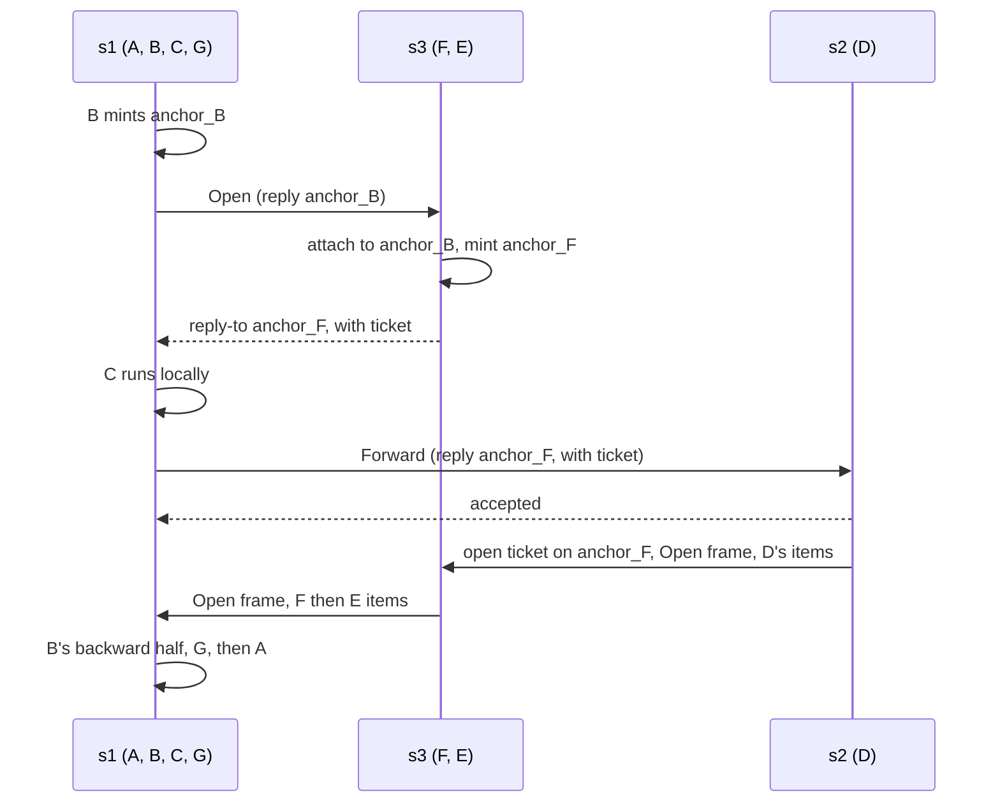

# Crossing segments

A crossing is an edge whose two ends are in different segments. This chapter describes how one hop runs when its stages are split across segments: who prepares each part, how the parts activate, who may write to a stream, and what crosses the wire. [Runtime design](../development/runtime-design.md) gives the reasons and the rejected alternatives. [Crossing performance](../operations/crossing-performance.md) has the measured cost.

In summary:

- **Responses** go to an anchor that their consumer minted. No table maps a response to a request. See [No correlation map](#no-correlation-map).
- **Stop and cancel** reach the remote producer, also when the consumer holds the stream and does not read it. See [Requests, attempts, and deadlines](requests.md).
- **Deadlines** cross as wall-clock time with a skew allowance. See [Requests, attempts, and deadlines](requests.md#deadlines-across-segments).
- **Admission and egress** limit what one instance takes. See [Admission and egress](admission.md).
- **Failure**: an error item ends a stream, and a stream that ends without its producer's finish ends with `Truncated`. See [The graph model](model.md#streams-and-errors).
- **Streamed requests** send their items into an anchor that the receiving stage minted. See [Streamed requests](streamed-requests.md).

## Inside a segment

A hop whose stages all sit in the outer end's segment is a nested call. The outer end applies the forward chain, calls the inner end, and wraps its stream in the backward chain. There is no anchor, no map, and no lock. Values pass between nodes without encoding.

## Runs

A run is a longest sequence of consecutive stages of one direction that sit in one segment. A placement splits each hop's forward path and backward path into runs. The runtime is generic over the graph and its bindings, so inside a run every call is static. At each stage boundary it checks the placement once: same segment, call the next stage; other segment, encode with the edge's codec and leave.

## The sequence across segments

The outer end O of a hop owns the attempt. When any stage of the hop is outside O's segment, the attempt runs these steps:

1. O mints `anchor_k`, the anchor for the last backward run (the one in O's segment). It starts a watcher for the attempt at once. The watcher forwards a stop, and at the deadline or cancel drops the anchor.
2. O provisions each intermediate backward run, from the one nearest O outward. For a run in another segment, O sends an `Open` request to an instance of it, with the reply-to of the run after it. That instance admits the request, attaches to the reply, mints the run's input anchor, and returns its reply-to. For a run in O's own segment (the backward path comes back), O opens it by a direct call.
3. O runs its local forward stages, then hands the request to the first segment that its forward path enters, with a `Forward` envelope.
4. Each forward run executes its local stages. It then either hands the request on, or, at the inner end, attaches to its reply, starts the inner end, and pumps the output.
5. O waits for the `Open` frame on `anchor_k`, then returns the stream wrapped in its local backward nodes.

A provisioned run is prepared, not active. It waits for an `Open` frame from its producer before it calls its first backward node. The inner end sends `Open` only after its node returns a stream. Each backward run forwards it, and O waits for it. So a setup failure is the call's error, as in local composition.

Activation needs its own signal for two reasons. A backward node may ignore its input and end at once. If a provisioned run started before its producer attached, it could finish and remove its anchor while O was still provisioning, and the next attach would fail. Activation also must not wait for data, because an upstream stream may stay pending forever while a backward node that ignores it ends at once. `a_pending_upstream_still_activates_the_backward_runs` covers this.

The reference placement `{A,B,C,G} {D} {F,E}` runs hop 1 like this:

## Ownership

- **One writer per anchor.** velo's exclusive attach decides it. The stage that wins an attach owns the stream. A stage that loses exits silently and cancels its own work.
- **Who may write an error.** A stage that holds the request, and has not handed it on with an acknowledged send, owns the reply. If an onward send fails, it attaches to its reply and writes the failure. If the acknowledgement was lost but the next stage accepted, both race to attach, and the rule above settles it.
- **Setup failure.** O provisions every intermediate run itself, so a failed `Open` request returns to O as an error. O's anchor then goes away, and the cancel reaches every run already provisioned through its attached sender. Each of those cancels its own input anchor.
- **Bounded setup.** Every hand-off, opening, attach, egress wait, and failure delivery in another segment runs under the request's deadline and cancel, and under `setup_timeout`, whichever ends first.
- **Failure delivery is bounded.** A stage tries to deliver its terminal failure for at most 100 ms after it attaches. A consumer that does not read then sees the stream break instead.

A receiver acknowledges a hand-off only after it has checked the deployment and the deadline, and taken admission and egress. Every refusal returns before the request's task starts. A hand-off that goes unanswered fails with `OutcomeUnknown`, because the receiver may have taken it. An opening that goes unanswered fails with `Transport`. [Routing, selectors, and offers](routing.md) describes which refusals the sender offers to another instance.

## Tickets

- A producer on another worker gets a ticket when velo can mint one for the anchor. It opens the stream with the ticket and skips the attach round trip.
- A producer on the anchor's own worker always attaches. velo rejects a ticket for that case, and a local attach needs no network.
- No ticket means attach. An open can fail at once or later: a successful open means only local staging. A rejection by the consumer can arrive as a sender cancel or a send failure, even before the first item. The producer watches its cancel token, and treats each of these as a failed attach.

## Reply renewal

velo removes an anchor that no producer attaches to within its reservation lifetime: 120 s for an ordinary anchor and 180 s for a prebound one, by default. A forward run can hold its reply for longer before anything attaches, for example while a slow forward node runs. So a segment that holds a reply reservation, before downstream acceptance or failure, registers it with the runtime's renewal task. One task per runtime renews every held reservation in one batch each `reservation_renew_interval` (30 s by default), and bounds each renewal call by that interval. `anchor_timeout` overrides the ordinary lifetime. Renewal does not extend a request's deadline, and it does not replace the heartbeat of an attached stream. [Segment settings](../operations/configuration.md) lists both settings.

## What crosses the wire

Request envelopes and their replies are MessagePack, sent through velo's raw-bytes unary call:

| Message | Carries |
|---|---|
| `Forward` | envelope version, deployment identity (contract hash and placement hash), hop, the position of the first stage to run, the context's wire part (id, metadata, wall-clock deadline), reply-to, and the payload |
| its acknowledgement | nothing, or for a streamed request the reply-to of the input anchor that the receiver minted |
| its refusal | the error, then, when an entry declines an offer from another cell as gone, the string `gone` as a second value, which a build without it does not read ([A cell that is gone](cell-routing.md#a-cell-that-is-gone)) |
| `Open` | envelope version, deployment identity, hop, the position of the run's first stage, the context's wire part, and reply-to |

A receiver refuses an envelope of another version, and one whose identity differs from its own, with `Placement`. So an instance built from another contract or placement cannot misread a request. [Specs, segments, and layouts](placement.md) describes the identity hashes.

Stream items cross on velo's byte path: each is one velo frame whose payload is a byte string. The producer sends with `StreamSender::send_bytes`, and the consumer reads with `StreamAnchor::poll_next_bytes`, which hands on the payload as a view of the frame it arrived in.

- **Open:** an empty item. The producer's stream exists. It is sent before any item.
- **Item:** the item's bytes from the edge's codec. The edge decode reads them in the buffer velo received them in, with no copy.
- **Fail:** velo's sender error, carrying the `gdl::Error` as JSON. It is a terminal failure for gdl. velo does not end the stream on it, so the producer finalizes right after it, and the consumer stops reading.

No encoding writes zero bytes for a value, so an empty item is only Open. A hand-written `Serialize` could write nothing. The sending stage fails such an item with `Codec` instead of sending it. Envelope version 4 carries items this way. A segment of version 3 framed each item a second time, and the two refuse each other's envelopes. Each message type chooses its own encoding. [Messages and encodings](messages.md) describes the codecs.

## The codec rule

Every crossing edge needs a codec. So does every edge whose items travel through an anchor. When a hop's forward path leaves O's segment, the type that enters `anchor_k` needs a codec even if every backward stage is in O's segment. For example, in `{A,B,D,F,E,G} {C}` the forward path leaves at C and comes back for D, so D's output returns to B through an anchor. The placement check reports this as `NotWire` with reason `AnchorCarried`, and a crossing edge as `NotWire` with reason `Crossing`. The placement check and the generated segments' crossing assertions read one list of these edges, so they cannot disagree.

Encoding happens only when a message leaves its segment. `crates/gdl-runtime/tests/crossings.rs` counts encodes: none in a local graph or inside one segment, and one per message per crossing.

## No correlation map

gdl never maps a response to its consumer. Each response goes to an anchor that its consumer minted, and the reply-to travels with the request. The runtime keeps per-request tables only for limits and for reply renewal: the admission ledger, the attempt counts, and the held reply reservations. velo's own registries hold the anchors and senders.
