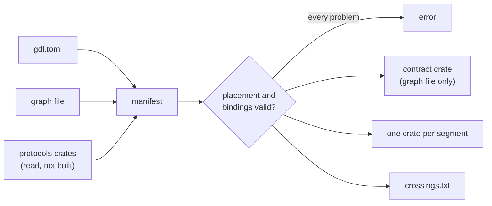

# Code generation

The generator turns a graph and a placement into crates. It writes a contract crate when the graph is a file, and one crate per segment. [Split, generate, and draw](../guides/split-and-generate.md) gives the commands. [Generation design](../development/generation-design.md) says why it works this way.



## The contract

A contract holds the graph's message types and one `gdl_runtime::graph!` invocation. `graph!` checks the topology at compile time, so an implementation with the wrong role or types fails to build at the setter named for its node. The macro generates:

- `nodes`: one marker type per node, with the node's port types.
- `Bindings`: one typestate slot per node that needs an implementation, filled with `Bindings::new().engine(...)`. A node's setter is its name in snake case. The macro refuses a name that cannot name a method, one that `Bindings` already uses, and two nodes with one binding name.
- `local(bindings)`: the whole graph as nested calls in one process.
- `assemble(&deployment, bindings)`: the part one segment runs. It fails if the deployment was made for another contract, or if a hosted node has no binding.
- `manifest()`: the graph as data, with each edge's message, wire capability, and encoding. `manifest().contract_hash()` is the contract hash. There is no hash constant.
- `SourceReq` and `SourceItem`: the source's request and item types. A graph with several roots has no one source, so it has neither.

The expansion names gdl only through the path that `graph!` passes as `$crate`, so a contract can depend on gdl under another name. Every name it introduces starts with `__gdl`, and every other path is rooted.

## Two kinds of spec

| | Contract spec | Graph spec |
|---|---|---|
| Graph written as | `graph!` in a crate the user writes | a graph file of message names |
| Spec tables | `[contract]`, `[bind.<Node>]` | `[graph]`, `[messages]`, `[nodes]` |
| Manifest comes from | building and running a throwaway program that depends on the contract and prints `manifest()` | the graph file and what the source reader found |
| Contract crate | the user's | generated, in `contract/` under `--out` |

A graph spec compiles nothing. The manifest comes from the graph file, the resolution of each name, and each message's wire capability and encoding as the reader found them. A crate whose build needs a toolkit that is not installed, CUDA for example, can therefore compose on a machine without it. A contract spec compiles only the contract crate. The program that reads its manifest starts from the lock file of the contract's workspace, so it builds the versions that workspace builds, and Cargo reads no registry index for them. The program holds a lock file in the target directory from writing the program until it has run.

The manifest builder, the placement checks, the layouts, and the diagrams live in `gdl-model` and `gdl-syntax`. Neither links the runtime, and both build for `wasm32-unknown-unknown`. The generator and the composer therefore apply one copy of each rule. The model spells a type as a rooted path (`:: chat_protocols :: Words`), because the contract hash covers that spelling. A test holds the model's manifest equal to the compiled contract's, hash included, on the chat example and two fixtures.

The generated contract writes each message by a rooted public path through a listed crate. [Messages and encodings](messages.md) says how a name becomes that path.

## Segment crates

For each segment the generator writes a crate named `<graph>-<segment>`. Its dependencies are the gdl runtime, the contract, and the implementation crates of the nodes it hosts, and nothing else of the graph's.

- A library. Its `lib.rs` is one `gdl_runtime::segment!` call, which holds what the generator computed for the segment, and the macro writes the code. It holds the segment's name, every segment's name, and the placement it was generated for as TOML. `start(node, roster, config, nodes)` deploys the segment inside a program. `Nodes` holds the hosted implementations. `Binary` implements `gdl_runtime::SegmentBinary` with what differs between segments: the settings tables, how the hosted implementations are built, their readiness, and what the segment serves.
- A binary. Its `main` is `gdl_runtime::segment_main::<Binary>()`. The lifecycle every segment shares is the runtime's function, so it is compiled and tested once, and not emitted into each crate. [Segment lifecycle](lifecycle.md) describes it. A segment binary takes its settings from TOML files and `GDL_` variables: [Segment settings](../operations/configuration.md). The binary also installs a log subscriber that writes to stderr at the level `RUST_LOG` sets, `warn` by default: [Logs](../operations/observability.md#logs). It sets the global allocator the spec's `[binary] allocator` chooses, or none for the system's: [Binary](../appendix/spec-reference.md#binary).
- A source segment with a pinned `Frontend` builds and runs that service. Without a pin, its binary reads one JSON request per line on stdin and writes the items as JSON lines, if the source's request and item types both implement `Serialize` and `Deserialize` and the request is not streamed. Otherwise the binary serves until it is stopped, and the user's own program calls the graph through the generated library. [Hosted frontends](../guides/frontends.md) covers the frontend.
- A hub client. The crate asks gdl-runtime for its `hub` feature only when the spec has a `[deployment]` table or the command is `compose`. An export without one carries no hub client.
- A `crossings.txt` for each layout: [the crossing report](placement.md#runs-hops-and-the-crossing-report).

Each crate depends on gdl by `path`, `version`, or `git` with `rev`, as `[gdl]` says. A `path` must name the package `gdl-runtime`, and not the definitions crate `gdl` beside it. The revision must be one with the `segment!` the generator writes for: its input is not a stable interface, so the generator and the runtime come from one revision of gdl.

```rust
gdl_runtime::segment! {
    contract: ::chat_contract;
    package: "chat-front";
    segment: "front";
    segments: ["engine", "front", "post"];
    placement: r#"..."#;
    graph_config: "...";
    roots: [Frontend];
    crossings: [
        crosses Truncate_to_Engine = Engine SinkDecl Req;
        crosses Format_to_Preprocess = Preprocess OperatorDecl DownItem;
    ];
    feeds: [reads_json, writes_json];
    nodes: [
        Preprocess preprocess = ::chat_front_nodes::Preprocess;
        Truncate truncate = ::chat_front_nodes::Truncate;
        Number number = ::chat_front_nodes::Number;
    ];
    policies: [];
    serve: json_lines;
}
```

`serve` is `json_lines`, `none`, `frontend <Node> = <type>` for a pinned frontend, or `service { ... }` for one with typed entries.

### The crossing assertions

The generator decides a message is a wire type from what the source reader found. A reader that is wrong must not reach a running graph. Each generated segment therefore asserts, at compile time, that every message it sends or receives across a cut is a wire type. Each crossing in the `segment!` call names a type alias for the crossing, `Truncate_to_Engine`, and the macro checks the alias with the span of that name, so that the error points at the crossing's line in the call:

```text
error[E0277]: `T` crosses between segments but is not a wire type
  --> front/src/lib.rs:26:17
   |
26 |         crosses Truncate_to_Engine = Engine SinkDecl Req;
   |                 ^^^^^^^^^^^^^^^^^^ this crossing carries `T`
```

A streamed port crosses as its head and its item, `Gateway_to_Resample_head` and `_item`, each checked apart.

A response that returns through an anchor inside one segment, because its hop leaves the segment and comes back, is asserted the same way. Its error says `returns through an anchor`. Both assertions read the same list of edges as the placement check, so the two cannot disagree. The source's segment also asserts the request and item types its binary reads and writes as JSON lines, unless a crossing already asserts them. Their errors point at `reads_json` or `writes_json` in the call's `feeds`.

A wrong "wire" from the reader fails the segment's build with one error that names the message and the crossing. A wrong "local" makes the generator refuse a cut that would work. `cargo gdl extract --verify` finds both.

## The output directory belongs to the generator

Every generated file starts with a do-not-edit marker and the command that regenerates it. Rust files are formatted by rustfmt with the generator's own config, so the output does not depend on where the generator runs. rustfmt leaves the body of a `segment!` call alone, so the generator lays the call out itself, one item to a line.

- `generate` replaces generated files and removes marked files it no longer produces. It refuses to run over a file in a segment crate that it did not write.
- `generate --check` writes nothing. It fails if a generated file is missing, changed, or stale (marked, but no longer produced), or if a segment crate holds a file the generator did not write. A Cargo build directory is recognized by its `CACHEDIR.TAG` and is not drift.
- A graph spec writes nothing in the output while it checks or draws: the manifest is built in memory, or, for a contract spec, from a copy of the contract in the target directory, named by its content.

## The build workspace

`cargo gdl build` renders what `generate` renders, into a directory of the target directory, and builds it there. The source tree is never written.

```text
<target-dir>/gdl/build.lock              one build at a time in this target directory
<target-dir>/gdl/<graph>/<spec stem>/
  workspace/                             the generated crates, as one Cargo workspace
  bin/<profile>/                         the binaries, unless --out names another directory
  binaries.toml  seed.lock  lock-inputs  what the next run compares with
```

- The directory is named for the graph and the spec's file stem, so specs of one graph, such as `examples/film/gdl.toml` and `compact.toml`, build apart.
- The workspace's root manifest lists each generated crate as a member, by name. It holds the release profile, one codegen unit and fat LTO, and the `[patch]` tables, since Cargo reads both only at a workspace's root. The members carry neither, as `generate` writes them.
- The members name your node, message, and policy crates by relative path. They are not members, and Cargo reads their `workspace = true` keys from their own workspaces.
- The root carries the `[patch]` entries of each workspace that a generated crate reaches by path, as `compose --local` does, so that the build takes the copies your own builds take. With `[gdl] path`, it also patches each gdl package that a node crate takes from another source, so that the build links one copy of gdl. Two workspaces that patch one package differently are refused.
- The lock starts from the lock of the workspace that holds the spec, so the build takes the versions your crates are built and tested with. With none, it starts from gdl's workspace lock. It starts again only when that lock changes. Otherwise Cargo keeps the lock it wrote.
- Each run renders every file and writes only the files whose text changed. Cargo rebuilds a crate when one of its files changes, so a run rebuilds and relinks only the segments that a change reaches.
- A generated file that is no longer produced is removed, and so is a directory that this leaves empty. The generator removes only files that carry its marker. A file it did not write, in a crate it still produces, fails the run, as for `generate`. A `workspace/` that holds files but not the generator's stamp, `.gdl-generated`, is refused, and so is a symbolic link in it or above it in the target directory, which the generator never makes.
- Cargo builds the whole workspace once, in the spec's directory, so the Cargo configuration there applies. It is the Cargo that runs `cargo gdl`, with its toolchain. Each segment's binary is copied out when it differs from the copy. `binaries.toml` records each copy's size and time, by destination. The build writes over or removes a copy only while it still matches that record. It refuses any other file at that name, and keeps a copy that someone replaced. A file that someone put there with the same bytes is left as it is, and stays theirs.
- One build runs at a time in a target directory. Two specs can make packages of one name, and Cargo puts both binaries at one path, so a build holds `gdl/build.lock` from the render to the copy. A build that waits says so.

One build unifies features across the segments, which `export` and `compose` images do not: [Known limitations](../operations/limitations.md#cargo-gdl-build-unifies-features-across-segments).

## Export and images

`cargo gdl export` renders what `generate` renders, in memory, as one `.tar.gz` under a directory named for the graph, plus a `README.md` and `build-all.sh`. Each crate in the archive is its own Cargo workspace, so each segment's build resolves only its own dependencies. The builds share one target directory.

- A dependency outside the archive is named as the spec gives it: a version or a git revision stays so, and a directory becomes an absolute path on the machine that wrote the archive. The archive then builds on that machine. A crate named by a version or a revision builds anywhere.
- Entries are sorted, with zero times and owners, and the gzip header has no time. Two exports of one spec are the same bytes.
- Each manifest has an empty `[workspace]`, so an archive expanded inside another workspace still builds. The archive holds no `Cargo.lock`.
- Each segment's manifest also sets `[profile.release]` to one codegen unit and fat LTO, the profile its image ships with, because Cargo reads a profile only at a workspace's root. `compose` writes the same. `generate` writes none: its crates are members of the user's workspace, whose root profile applies ([Where a profile applies](../operations/benchmarking.md#where-a-profile-applies)).
- When every crate comes from crates.io or git, the archive also holds a `Dockerfile` for each segment and `build-images.sh`. Each Dockerfile is a multi-stage build from the archive's root: the Rust image builds the segment, and `debian:bookworm-slim` runs its binary. The script tags each image with the segment's package name after `GDL_IMAGE_PREFIX`. A segment whose image name Docker would refuse, such as a name that ends in `-`, is an export error that names the segment. Nothing is pushed.
- The tests check the generated image text, and no test builds an image.

A spec that is a composer draft, given as text, is also stored in the archive with its graph file, so the archive can export itself again.
