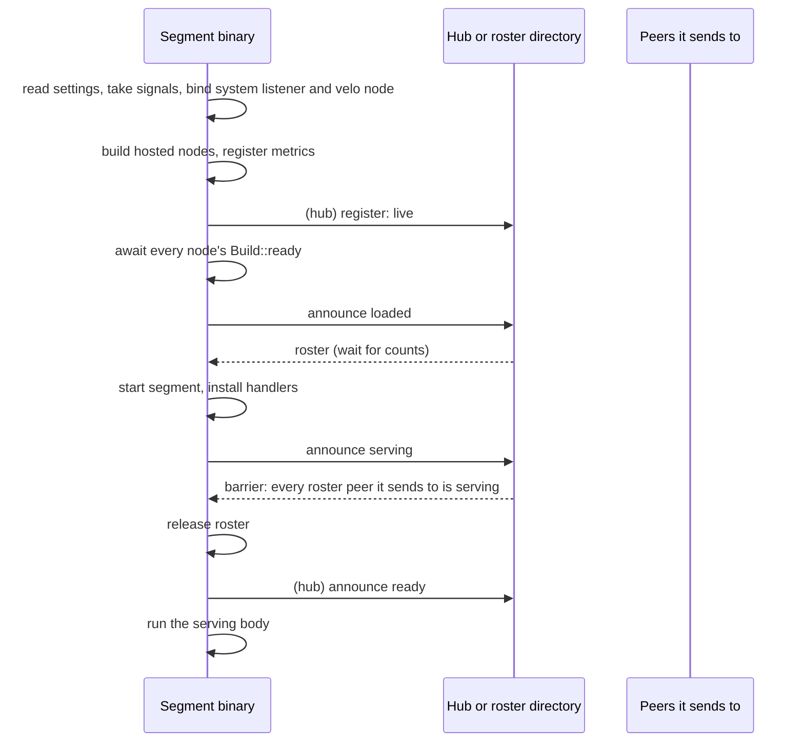
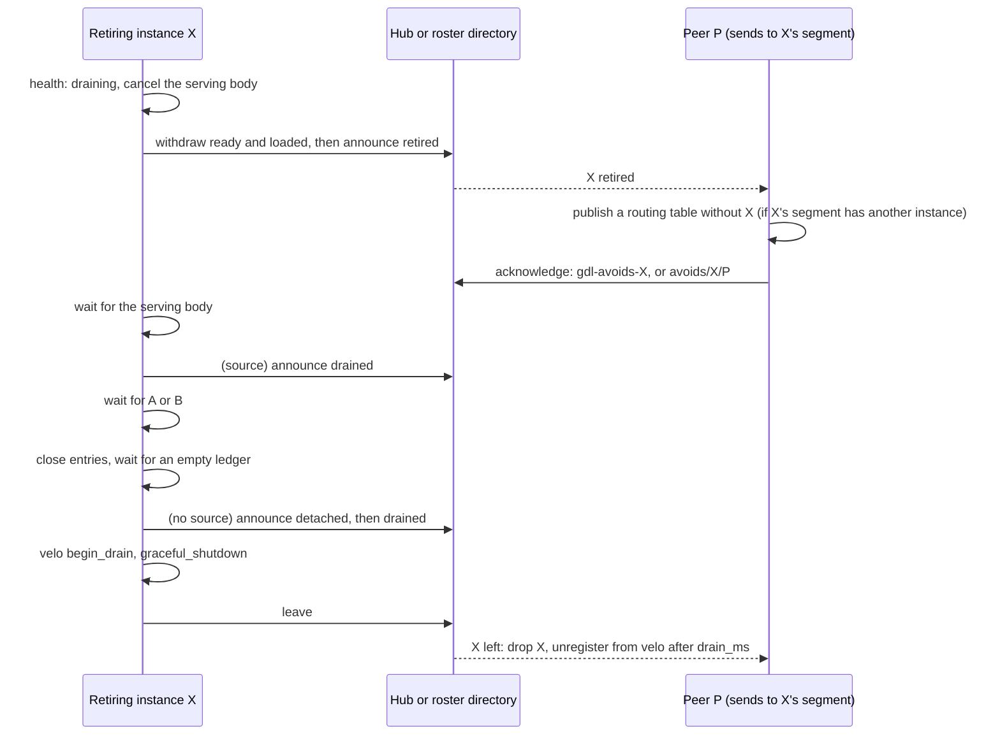
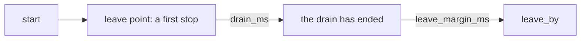
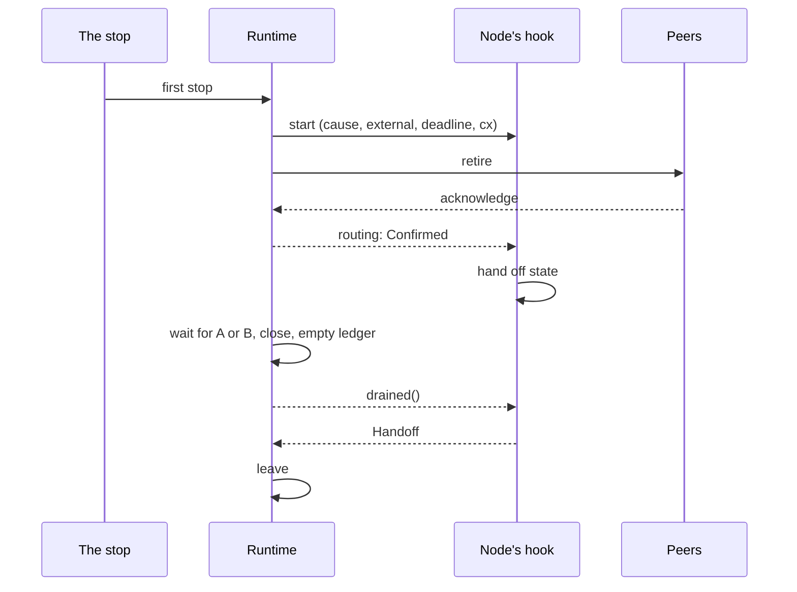
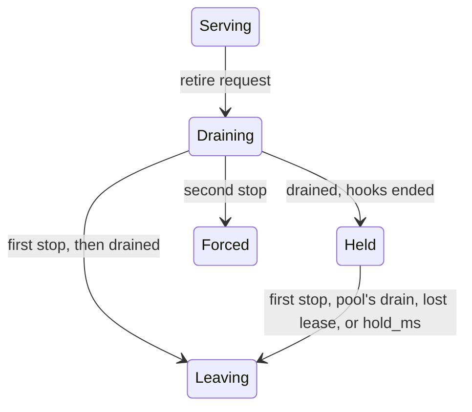

# Segment lifecycle

A segment instance is one process that runs one segment of a placement. This chapter describes its life: how it starts, when it is ready, how it joins a running deployment, and how it stops. [Discovery: rosters and the hub](hub.md) describes how instances find each other. [Lifecycle design](../development/lifecycle-design.md) explains why each step works the way it does.

The runtime holds the whole lifecycle. A generated segment crate implements `gdl_runtime::SegmentBinary` with the parts that differ between segments: what the segment hosts, how it builds its nodes, and what it serves. Its `main` is `gdl_runtime::segment_main::<Binary>()`, which calls `gdl_runtime::run_segment`. [Code generation](generation.md) describes the generated crate.

## Phases

An instance passes through these phases. Each phase is a fact that the instance announces to its peers, either as a hub service or as a file in a roster directory.

| Phase | Meaning | Under a hub | In a roster directory |
|---|---|---|---|
| live | the process is running | registration with the hub | none |
| loaded | every hosted node is ready to work | `gdl-loaded-<segment>` | a file in the directory itself |
| serving | the instance's handlers are installed | `gdl-serving-<segment>` | `serving/<segment>.<id>` |
| ready | the barrier passed and the instance routes | `gdl-ready-<segment>` | none |
| retired | the instance was stopped | `gdl-retired-<segment>` | `retired/<segment>.<id>` |
| leaving | the instance's leave hooks run, from the stop | none | none |
| drained | a source instance has finished its requests, or any other instance has closed and holds no request | `gdl-drained-<segment>` | `drained/<segment>.<id>` |
| detached | an instance will send no more work into its pool | `gdl-detach-<segment>` | none |
| held | an instance retired on request has drained and stays until something ends the hold | none | none |
| left | the instance has gone | unregistration | `left/<segment>.<id>` |

`<segment>` in a hub service name is the segment's name in hex. A roster directory has no `ready` phase, because nothing joins a roster directory. It has no `detached` phase either, because only a pool under a hub drains.

## Start

The steps, in order:

1. **Settings.** The binary reads its settings files and `GDL_` variables. [Segment settings](../operations/configuration.md) lists every key.
2. **Signals and the system listener.** The binary takes SIGINT and SIGTERM and binds its system listener before it builds anything. A stop while the nodes load ends the launch with "stopped while starting" and exit code 1. It does not kill the process the default way. `live` answers from here on ([Health and metrics](../operations/observability.md)).
3. **Build.** Each hosted node is built through `gdl::Build` with its settings table and its metrics. A bad table fails here, before any peer waits for this instance.
4. **Register.** Under a hub, the instance registers now, so the hub knows that it is live while its nodes load. The hub admits only a binary built for its graph and placement. A hub that is not up yet, one that cannot be reached or answers that it is starting or busy, is asked again after a wait that doubles from 100 ms to 2 s, with jitter, for up to `hub_wait_ms` (5 minutes by default). From the first attempt until the wait ends, admitted, refused, out of time, or cut short by a stop, the health probe says it waits for the hub, and answers 503. When the wait runs out, the launch fails with the hub's address and the last error. An attempt whose answer was lost, behind a proxy that broke the connection or answered 502, 503, or 504, may still have been recorded by the hub. The hub then refuses the next attempt as unauthorized until that registration's lease lapses, after the hub's TTL and at most one prune interval (30 s and 10 s by default). The start waits that out too, within `hub_wait_ms`, and logs it once. Any other answer, such as the hub refusing the registration, or refusing it as unauthorized with no lost answer before, fails the launch at once, since asking again would not change it. The wait exists because on Kubernetes every pod of a pool starts at once: a segment that exited before its hub answered would be restarted, with a longer delay each time.
5. **Loaded.** The instance waits for `Build::ready` of every hosted node. That is immediate by default. A node that loads data after construction resolves it when the data is loaded. Then the instance announces `loaded`.
6. **Roster.** The instance waits for enough loaded instances of each segment. Under a hub that is at least `[min_replicas]` of each (1 by default), not counting retired ones. In a roster directory it is exactly `[instances]` of each (1 by default). These instances are its roster: the instances it routes to.
7. **Serving.** The instance starts its segment, installs its handlers, and announces `serving`.
8. **Barrier.** The instance waits until every instance in its roster of the segments it sends to has announced `serving`. A segment whose nodes call a unary service in another segment sends to that segment, which registers its `gdl.call` handler before it announces `serving`. Then it releases the roster.
9. **Ready.** Under a hub, the instance announces `ready`. The instances already serving add it to their routing then. The health probe answers 200 from here.

Each wait (the roster, the barrier, and the `ready` announcement) is bounded by `rendezvous_ms`. A roster wait or a barrier that runs out ends the launch with an error that names what is missing. A `ready` announcement that the hub does not take is printed, and the instance serves on. Instances already serving then never add it.

### The held roster

The roster is held from the launch until the barrier passes. A request that reaches the instance in that time waits at the held roster, bounded by the runtime's `setup_timeout`. It does not leave for a peer whose handlers are not installed yet. So rosters do not have to agree: a peer's `serving` announcement is enough to route to it, whatever roster that peer holds.

An instance announces `serving` before it waits. A forward path that leaves a segment and comes back makes two segments send to each other, and neither may wait for the other first. [Lifecycle design](../development/lifecycle-design.md) records the order that was tried first and deadlocked.

### An instance in a pool

An instance with a `[pool]` table waits only for the segments of its own class, at the roster and at the barrier. `[instances]` and `[min_replicas]` may name no other segment. [Classes and pools](pools.md) describes pools.

## Joining

An instance that starts while the others serve joins. Joining works only under a hub. A roster directory has exact counts, and an extra instance fails its launch.

A joiner launches as any instance does. Its roster is the hub's `loaded` instances that have not retired. Its barrier follows live membership: an instance that leaves during the barrier is dropped from the wait. The barrier fails only when a segment it sends to has no instance left.

Peers add a joiner when it announces `ready`, not `serving`. A joiner's peers already send requests. A request routed to a joiner before its barrier would wait at its held roster.

## Membership while serving

Each instance runs one follower task from just before it announces `loaded` until it leaves. The follower applies membership to the instance's routing:

- **Under a hub**, it watches the hub's services. A `ready` instance is registered with velo, then added to the routing table. A `retired` instance of a segment this instance sends to is marked retired. An instance removed from `serving` has left: it is dropped from routing at once.
- **In a roster directory**, it reads `retired/` and `left/` every 50 ms.

An instance that left is unregistered from velo only after the drain bound. Its lease may have been lost while it still drains, and velo unregisters only an idle peer.

The follower also acknowledges retirements, as the next section describes. [Routing, selectors, and offers](routing.md) describes how a router picks from the routing table.

## Stopping

The first stop retires the instance. A stop is SIGINT, SIGTERM, or `Process::stop`. A second stop ends the drain at once.

A controller can also ask an instance's pool hub to retire it, as the operator's `retire: request` mode does. That retires the instance as a first stop does, and the instance then holds ([Retired on request](#retired-on-request)).

The steps, in order:

1. **Retire.** The health phase becomes `draining`, and the serving body's context is cancelled. Meanwhile, the instance withdraws `ready` and `loaded`, and announces `retired` once the hub has confirmed both. A roster read after the withdrawals leaves it out. If the hub does not confirm them in time, the instance prints a line and does not announce `retired`.
2. **Peers avoid it.** A peer that sees the retirement stops routing to the instance, but only while the segment has another instance that is not retired. Then the peer acknowledges. The acknowledgement is a promise: the peer never routes to that instance again.
3. **The body ends.** A frontend drains the requests it holds. A JSON-lines source stops reading lines, and finishes the answer it is writing.
4. **A source says `drained`.** A source instance announces `drained` before it waits further. So source segments that route to each other never wait for each other. An entry instance of a pool is the exception: it announces `drained` only once it holds no request ([An interior instance's stop](pool-routing.md#an-interior-instances-stop)).
5. **Wait for A or B.** The instance waits for whichever holds first:
   - **(A)** every instance of the segments that send to it has acknowledged or left, and then `setup_timeout` has passed. A hand-off sent just before the promise may still be on its way. A segment that nothing sends to has (A) at once, with no wait.
   - **(B)** every instance of the source segments whose requests can reach it has drained or left.
6. **Close.** The instance refuses new hand-offs, run openings, and calls to the unary services it hosts with `Overloaded` ("the instance has retired and takes no new work"). The sender's router treats that as a declined offer and chooses again ([Routing, selectors, and offers](routing.md)), and a caller tries the next instance ([Unary services](unary.md#a-call-to-another-segment)). Until it closes, a retiring instance serves calls as it takes hand-offs, so a request whose only service instance is retiring still gets its calls.
7. **Empty ledger.** The instance waits until it holds no request and no call. A call it accepted holds its permit until velo sends its reply, or for at most its bound plus `call_reply_grace` ([Admission and egress](admission.md#calls-from-other-segments)), so no caller holds the close open longer. A stream holds its request's admission share until velo reports that its output has left the node ([Admission and egress](admission.md)). `/metrics` shows the wait's progress from outside: `instance_phase` at `draining`, and the ledger's roots, the egress permits, and the call permits (`call_permits_held`) falling to 0. Only the exit, or the `drained` of an instance that hosts no source, says that the drain is complete ([Reading a drain](../operations/observability.md#reading-a-drain)).
8. **Any other instance says `drained`.** An instance that hosts no source announces `detached`, then `drained`, and only with its entries closed and its ledger empty. So a reader of its `drained` knows that it holds nothing and will send nothing on. A drain cut at its bound with a request left says neither. The two are tried for at most 1 s together, since a hub that does not answer must not hold up the exit. A roster directory has no `detached`, so the instance only writes `drained/`.
9. **Leave.** The instance stops velo with `begin_drain` and `graceful_shutdown`, unregisters from the hub or writes `left/`, and exits.

Every exit after a successful launch announces `left`. A launch that fails at its roster wait leaves no `left/` file, and under a hub its registration lapses with its lease. An instance that crashes leaves nothing. Under a hub its lease lapses, after about 30 s. In a roster directory nothing marks it, and a drain that waits for it runs to its bound.

### Stopping every instance

A deployment-wide stop, such as `docker compose down`, takes the same path. Once every instance of a segment has retired, peers keep routing to those instances, since nothing else serves. Their drains then end by (B), when the sources have drained. The same holds for the last instance of a segment that is stopped alone.

### The bound

The drain bound is `[runtime] drain_ms`, which defaults to the runtime's `default_deadline` (600 s). It bounds every wait: the serving body, the wait for (A) and its `setup_timeout`, (B), and the ledger. The retirement waits for its hub for at most a quarter of the bound, and at most 5 s, so a hub that does not answer leaves the drain the rest. A request whose own deadline is longer than the bound is cut at the bound. The exit can pass the bound by up to about 8.5 s. velo's shutdown gets what is left of the bound, but at least 1 s, to finish its requests. Then velo closes its TCP connections: up to 1.5 s to write what is already queued, and up to 1 s to close its listener. Leaving a hub that does not answer takes up to 5 s. An idle node whose hub answers stops at once.

A stop during the barrier retires the instance too, without running the serving body. The instance has already said that it serves, so peers may route to it. Its leave hooks start as at any other stop.

### A lost lease

Under a hub, a lost lease stops the instance as a stop does. It skips (A) and (B), because the hub that would answer them is gone. It still waits for its own ledger. The process exits with the lease's error, and the deployment must start it again. [Discovery: rosters and the hub](hub.md) describes the lease.

### A known leave time

An instance that knows when it will be stopped, such as one in a batch job with a walltime, sets `[runtime] leave_by`, in milliseconds since the Unix epoch (`GDL_RUNTIME__LEAVE_BY`). It then stops itself early enough to drain before that time.

- **The leave point.** At its start, the instance maps `leave_by` onto its monotonic clock as it maps a deadline from another segment: less `clock_skew_ms`. The leave point is that time less `drain_ms` and `leave_margin_ms` (30 s by default). The margin covers the exit after the drain: velo's shutdown and leaving the hub can take up to about 8.5 s past the drain's bound ([The bound](#the-bound)), which the default covers. A start with no time left before the leave point is refused before anything binds, in one line that names `leave_by`, `drain_ms`, and the margin.
- **One path.** At the leave point, the instance stops as a first SIGTERM stops it: the same retirement, drain, leave hooks (with the cause `Stop`), and exit. Before the instance serves, the leave point ends its start, as a stop while starting does.
- **A first stop, never a second.** A signal before the leave point leaves it nothing to do. A signal after it, such as the batch system's own SIGTERM, is the first signal, and does not cut the drain. A second signal does. The leave point also ends a hold ([Retired on request](#retired-on-request)), as a stop does.
- **No drain past it.** No stop runs past the end of the leave point's drain, `leave_by` less the margin: not its drain, and not its leave hooks. A stop the instance takes after the leave point, as when its serving body starts late, has only the time left before then. An interior instance that its pool's drain stopped counts its bound from when the pool's entry instances have drained ([Pools](#pools)). With a leave time, it is cut off at that end too, whatever the entry instances still hold.
- **Listed, not routed.** Under a hub, the registration carries `leave_by`. The pool's hub lists it in `GET /instances`, and on the `ready` of an entry instance on its pool's watch ([Hub API](../appendix/hub-api.md)). Nothing routes by it: `/v1/ext/gdl/members`, which instances route from, and the relay that choosers read do not carry it. A registration that carries it needs a hub at least as new as the segment, since an earlier hub refuses a field it does not know: roll the hub first. Unset, the registration is sent as before.

The instance reads `leave_by` once, at its start. A walltime that the batch system extends later, as `scontrol` can, only makes the instance leave early, which costs capacity, not correctness. A pool's hub has a leave time of its own ([Draining when the hub stops](pools.md#draining-when-the-hub-stops)).

### Leaving

A node can register a leave hook ([Write nodes](../guides/write-nodes.md#run-code-when-the-instance-leaves)). Every hook starts at the stop, on every way to it, and runs beside the serving body's shutdown, the retirement, and the drain. The process exits only when the hooks and the drain are done or out of time. The first `Launch::serve` call closes registration. A stop before that, while the nodes load or the instances meet, starts no hook: the instance has served nothing. A barrier that fails is not a stop, and exits as a crash does.

A hook gets a `gdl::Leave`:

| Part | Meaning |
|---|---|
| `cause()` | what stopped the instance: `Stop`, `PoolDrain`, or `LeaseLost` |
| `external()` | whether the segment hosts a source: a frontend, a service entry, or a JSON-lines source |
| `routing()` | a watch: `Pending`, then one other value, once |
| `deadline()` | when the hook's time ends |
| `cx()` | a context, cancelled at the deadline or on a forced stop |
| `drained()` | resolves when the instance has closed and holds no request |
| `fence()` | the instance's id and its registration's epoch, which effects outside the process carry |

`routing()` says how sure the runtime is that no new routing decision picks this instance:

| It reads | When |
|---|---|
| `Confirmed` | the instance retired, its hub confirmed that it withdrew `ready` and `loaded`, every sender has acknowledged, and an entry instance's following pools said that they avoid it. Also: nothing in gdl sends here, at once |
| `SourcesDone` | (B) holds |
| `Unconfirmed(ParentTimeout)` | an entry instance's following pools did not answer within their bound, or its pool's drain reached its bound with another pool still following. A chooser with a stale view can still offer, and the entry declines. After a drain, it declines before the hook starts |
| `Unconfirmed(LeaseLost)` | the lease was lost, at any point in the stop |
| `Unconfirmed(NotWithdrawn)` | none of these came by the fallback time, and the hub did not confirm the withdrawals: later rosters may still hold the instance |
| `Unconfirmed(Bound)` | none of these came by the fallback time: the last instance of a segment, a last interior instance reached from another class, or an entry instance that its pool's drain stopped |

The fallback time is the earlier of `leave_after_ms` after the retirement and half of `drain_ms` after the stop. So a late retirement cannot push it past the drain's bound.

`Confirmed` says that no sender will pick the instance, now or later. Only a confirmed withdrawal fences a sender that has yet to join, so nothing else can confirm. An entry instance that its pool's drain stops does not retire, so it never reads `Confirmed`. It reads `SourcesDone` or `Unconfirmed`. That its senders detached ends an interior instance's wait, and does not confirm it. `Confirmed` does not say that the instance is quiet. A hand-off sent before a peer's promise can still arrive. `external` is apart from `routing()`, because a sender's promise says nothing of a Service, a load balancer, or an open connection. A segment can read `Confirmed` with `external` true. A hook must do nothing destructive until `routing()` reads `Confirmed` or `SourcesDone` with `external` false, or until `drained()` resolves.

A hook's deadline is `leave_ms` after the stop, and at most the drain's bound. At the deadline, the runtime cancels `cx()`, records `timed_out`, and goes on without waiting for the hook. A second stop ends everything at once, as it does the drain. A crash skips the hooks, so a hook is never relied on. Each hook runs once per process.

Each hook's outcome is on `/metrics` as `leave_outcome{hook,outcome}`, and in one log line ([Reading a drain](../operations/observability.md#reading-a-drain)).

An instance with no hook starts no task for this, and its stop runs as this chapter describes without it.

### Retired on request

A controller retires an instance through its pool's hub, so that it can read the instance's `drained` and its hooks' outcomes before it removes the instance ([Retiring an instance on request](pools.md#retiring-an-instance-on-request)). The instance hears the request on its pool's watch. Every instance in a `[pool]` follows that watch.

The request retires the instance exactly as a first stop does, and runs its leave hooks with the cause `Stop`. It is not a stop: it does not count toward the second stop that ends a drain. A repeated request does nothing, and neither does a request after a stop. A request heard before the instance serves stops it as a stop at the barrier does.

Once it has drained and its hooks have ended, the instance holds. It keeps its lease and its velo node, and its follower still acknowledges retirements, so its peers' drains do not wait for it. It takes no work: its entries are closed. A hub lists it `drained`, and `/health` answers as it does in a drain.

These end a hold:

| What | What happens |
|---|---|
| A stop, while the instance drains | The instance does not hold. It exits once it has drained. Only the next stop ends the drain |
| A stop, while it holds | It exits at once. An idle velo node stops at once, and velo gets at least 1 s |
| Its pool's drain | It exits at once. The hub's drain ends only once no member is left |
| A lost lease | It exits with the lease's error |
| `[runtime] hold_ms` after the request | It exits ([Segment settings](../operations/configuration.md)) |

A drain cut at its bound with a request left does not exit. The instance holds without `drained`, and announces `detached` and `drained` if its ledger empties later. On Kubernetes, an exit only restarts the container, and the new process would serve until the controller noticed.

Under a hub, an instance that hosts a source says `drained` when its serving body ends, as at any stop, before its ledger is empty. A controller that reads it may remove the instance then. Its stop then only ends the hold: the instance still drains, inside its grace.

The request names an incarnation of the instance's registration. The instance reads its own from the hub's list once a request names it, and acts when the request's is at or below its own. A later incarnation of an id is the same process, because each process draws a new velo id.

### Pools

Under a hub, an instance in a pool also stops when its pool drains, once no more work can reach it. An entry instance of a pool also waits until the pools that follow its pool avoid it, before its `setup_timeout`. Outside its pool's drain, an instance that a source of another class reaches never counts (B), because that source's instances are members of another hub. So the last interior instance of a segment, stopped alone, waits for its drain's bound. [Following and choosing pools](pool-routing.md) describes all three.

## Limits

[Known limitations](../operations/limitations.md) lists the limits of this lifecycle: only a hub lets an instance join, a retirement takes at least `setup_timeout`, a request the hub does not answer holds back the instance's later requests to it, and a hub that does not confirm the withdrawals is not told of the retirement, the last instance of a segment is not avoided, a leave hook does not run on a crash, a held instance's `drained` does not cover a source's ledger, a crashed instance holds a roster-directory drain until its bound, and a drain cut short can lose output that velo still holds.
