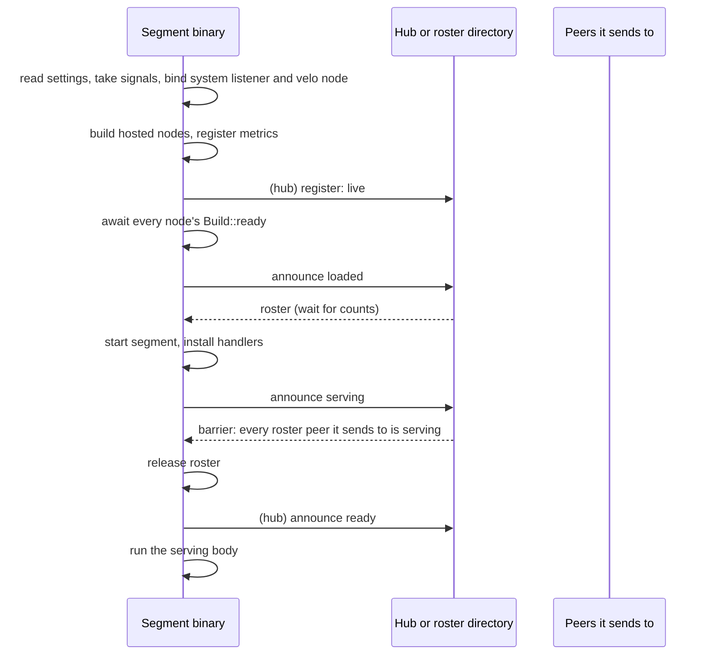
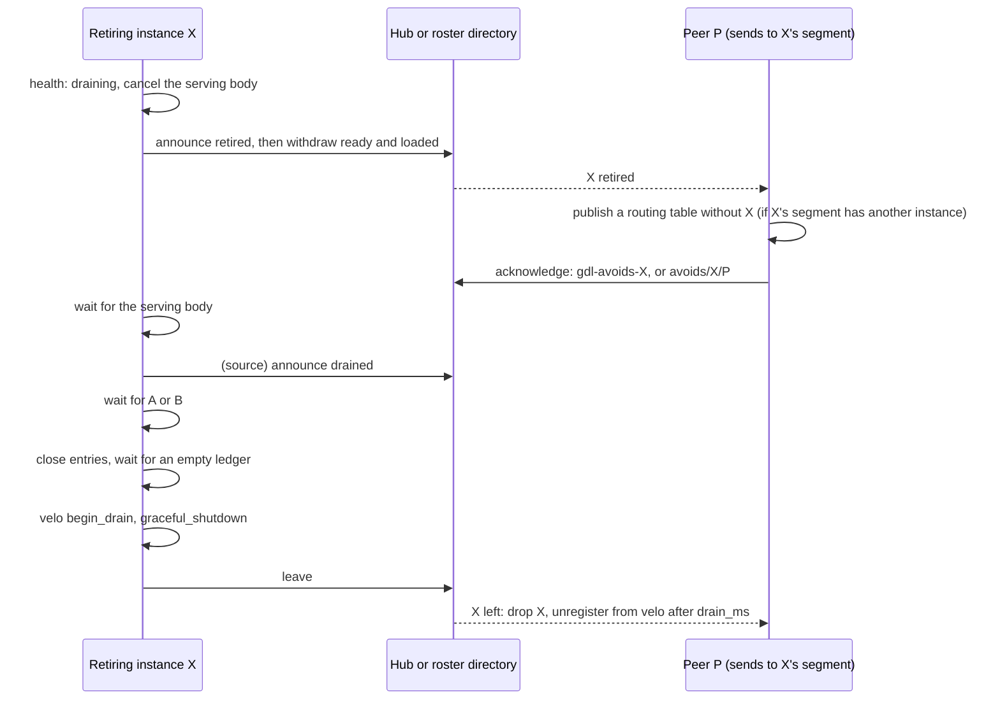

# Segment lifecycle

A segment instance is one process that runs one segment of a placement. This chapter describes its life: how it starts, when it is ready, how it joins a running deployment, and how it stops. [Discovery: rosters and the hub](hub.md) describes how instances find each other. [Lifecycle design](../development/lifecycle-design.md) explains why each step works the way it does.

The runtime holds the whole lifecycle. A generated segment crate implements `gdl_runtime::SegmentBinary` with the parts that differ between segments: what the segment hosts, how it builds its nodes, and what it serves. Its `main` is `gdl_runtime::segment_main::<Binary>()`, which calls `gdl_runtime::run_segment`. [Code generation](generation.md) describes the generated crate.

## Phases

An instance passes through these phases. Each phase is a fact that the instance announces to its peers, either as a hub service or as a file in a roster directory.

| Phase | Meaning | Under a hub | In a roster directory |
|---|---|---|---|
| live | the process is running | registration with the hub | none |
| loaded | every hosted node is ready to work | `gdl-loaded-<segment>` | a file in the directory itself |
| serving | the instance's handlers are installed | `gdl-serving-<segment>` | `serving/<segment>.<id>` |
| ready | the barrier passed and the instance routes | `gdl-ready-<segment>` | none |
| retired | the instance was stopped | `gdl-retired-<segment>` | `retired/<segment>.<id>` |
| drained | a source instance has finished its requests | `gdl-drained-<segment>` | `drained/<segment>.<id>` |
| detached | an instance of a draining pool will send no more work into the pool | `gdl-detach-<segment>` | none |
| left | the instance has gone | unregistration | `left/<segment>.<id>` |

`<segment>` in a hub service name is the segment's name in hex. A roster directory has no `ready` phase, because nothing joins a roster directory. It has no `detached` phase either, because only a pool under a hub drains.

## Start

The steps, in order:

1. **Settings.** The binary reads its settings files and `GDL_` variables. [Segment settings](../operations/configuration.md) lists every key.
2. **Signals and the system listener.** The binary takes SIGINT and SIGTERM and binds its system listener before it builds anything. A stop while the nodes load ends the launch with "stopped while starting" and exit code 1. It does not kill the process the default way. `live` answers from here on ([Health and metrics](../operations/observability.md)).
3. **Build.** Each hosted node is built through `gdl::Build` with its settings table and its metrics. A bad table fails here, before any peer waits for this instance.
4. **Register.** Under a hub, the instance registers now, so the hub knows that it is live while its nodes load. The hub admits only a binary built for its graph and placement.
5. **Loaded.** The instance waits for `Build::ready` of every hosted node. That is immediate by default. A node that loads a model after construction resolves it when the model is loaded. Then the instance announces `loaded`.
6. **Roster.** The instance waits for enough loaded instances of each segment. Under a hub that is at least `[min_replicas]` of each (1 by default), not counting retired ones. In a roster directory it is exactly `[instances]` of each (1 by default). These instances are its roster: the instances it routes to.
7. **Serving.** The instance starts its segment, installs its handlers, and announces `serving`.
8. **Barrier.** The instance waits until every instance in its roster of the segments it sends to has announced `serving`. Then it releases the roster.
9. **Ready.** Under a hub, the instance announces `ready`. The instances already serving add it to their routing then. The health probe answers 200 from here.

Each wait (the roster, the barrier, and the `ready` announcement) is bounded by `rendezvous_ms`. A roster wait or a barrier that runs out ends the launch with an error that names what is missing. A `ready` announcement that the hub does not take is printed, and the instance serves on. Instances already serving then never add it.

### The held roster

The roster is held from the launch until the barrier passes. A request that reaches the instance in that time waits at the held roster, bounded by the runtime's `setup_timeout`. It does not leave for a peer whose handlers are not installed yet. So rosters do not have to agree: a peer's `serving` announcement is enough to route to it, whatever roster that peer holds.

An instance announces `serving` before it waits. A forward path that leaves a segment and comes back makes two segments send to each other, and neither may wait for the other first. [Lifecycle design](../development/lifecycle-design.md) records the order that was tried first and deadlocked.

### An instance in a pool

An instance with a `[pool]` table waits only for the segments of its own class, at the roster and at the barrier. `[instances]` and `[min_replicas]` may name no other segment. [Classes and pools](pools.md) describes pools.

## Joining

An instance that starts while the others serve joins. Joining works only under a hub. A roster directory has exact counts, and an extra instance fails its launch.

A joiner launches as any instance does. Its roster is the hub's `loaded` instances that have not retired. Its barrier follows live membership: an instance that leaves during the barrier is dropped from the wait. The barrier fails only when a segment it sends to has no instance left.

Peers add a joiner when it announces `ready`, not `serving`. A joiner's peers already send requests. A request routed to a joiner before its barrier would wait at its held roster.

## Membership while serving

Each instance runs one follower task from just before it announces `loaded` until it leaves. The follower applies membership to the instance's routing:

- **Under a hub**, it watches the hub's services. A `ready` instance is registered with velo, then added to the routing table. A `retired` instance of a segment this instance sends to is marked retired. An instance removed from `serving` has left: it is dropped from routing at once.
- **In a roster directory**, it reads `retired/` and `left/` every 50 ms.

An instance that left is unregistered from velo only after the drain bound. Its lease may have been lost while it still drains, and velo unregisters only an idle peer.

The follower also acknowledges retirements, as the next section describes. [Routing, selectors, and offers](routing.md) describes how a router picks from the routing table.

## Stopping

The first stop retires the instance. A stop is SIGINT, SIGTERM, or `Process::stop`. A second stop ends the drain at once.

The steps, in order:

1. **Retire.** The health phase becomes `draining`, and the serving body's context is cancelled. Meanwhile, the instance announces `retired`, then withdraws `ready` and `loaded`. A roster read after that leaves it out.
2. **Peers avoid it.** A peer that sees the retirement stops routing to the instance, but only while the segment has another instance that is not retired. Then the peer acknowledges. The acknowledgement is a promise: the peer never routes to that instance again.
3. **The body ends.** A frontend drains the requests it holds. A JSON-lines source stops reading lines, and finishes the answer it is writing.
4. **Drained.** A source instance announces `drained` before it waits further. So source segments that route to each other never wait for each other. An entry instance of a pool is the exception: it announces `drained` only once it holds no request ([An interior instance's stop](pool-routing.md#an-interior-instances-stop)).
5. **Wait for A or B.** The instance waits for whichever holds first:
   - **(A)** every instance of the segments that send to it has acknowledged or left, and then `setup_timeout` has passed. A hand-off sent just before the promise may still be on its way. A segment that nothing sends to has (A) at once, with no wait.
   - **(B)** every instance of the source segments whose requests can reach it has drained or left.
6. **Close.** The instance refuses new hand-offs and run openings with `Overloaded` ("the instance has retired and takes no new work"). The sender's router treats that as a declined offer and chooses again ([Routing, selectors, and offers](routing.md)).
7. **Empty ledger.** The instance waits until it holds no request. A stream holds its request's admission share until velo reports that its output has left the node ([Admission and egress](admission.md)).
8. **Leave.** The instance stops velo with `begin_drain` and `graceful_shutdown`, unregisters from the hub or writes `left/`, and exits.

Every exit after a successful launch announces `left`. A launch that fails at its roster wait leaves no `left/` file, and under a hub its registration lapses with its lease. An instance that crashes leaves nothing. Under a hub its lease lapses, after about 30 s. In a roster directory nothing marks it, and a drain that waits for it runs to its bound.

### Stopping every instance

A deployment-wide stop, such as `docker compose down`, takes the same path. Once every instance of a segment has retired, peers keep routing to those instances, since nothing else serves. Their drains then end by (B), when the sources have drained. The same holds for the last instance of a segment that is stopped alone.

### The bound

The drain bound is `[runtime] drain_ms`, which defaults to the runtime's `default_deadline` (600 s). It bounds every wait: the serving body, the wait for (A) and its `setup_timeout`, (B), and the ledger. A request whose own deadline is longer than the bound is cut at the bound. The exit can pass the bound by up to about 8.5 s. velo's shutdown gets what is left of the bound, but at least 1 s, to finish its requests. Then velo closes its TCP connections: up to 1.5 s to write what is already queued, and up to 1 s to close its listener. Leaving a hub that does not answer takes up to 5 s. An idle node whose hub answers stops at once.

A stop during the barrier retires the instance too, without running the serving body. The instance has already said that it serves, so peers may route to it.

### A lost lease

Under a hub, a lost lease stops the instance as a stop does. It skips (A) and (B), because the hub that would answer them is gone. It still waits for its own ledger. The process exits with the lease's error, and the deployment must start it again. [Discovery: rosters and the hub](hub.md) describes the lease.

### Pools

Under a hub, an instance in a pool also stops when its pool drains, once no more work can reach it. An entry instance of a pool also waits until the pools that follow its pool avoid it, before its `setup_timeout`. Outside its pool's drain, an instance that a source of another class reaches never counts (B), because that source's instances are members of another hub. So the last interior instance of a segment, stopped alone, waits for its drain's bound. [Following and choosing pools](pool-routing.md) describes all three.

## Limits

[Known limitations](../operations/limitations.md) lists the limits of this lifecycle: only a hub lets an instance join, a retirement takes at least `setup_timeout`, the last instance of a segment is not avoided, a crashed instance holds a roster-directory drain until its bound, and a drain cut short can lose output that velo still holds.
