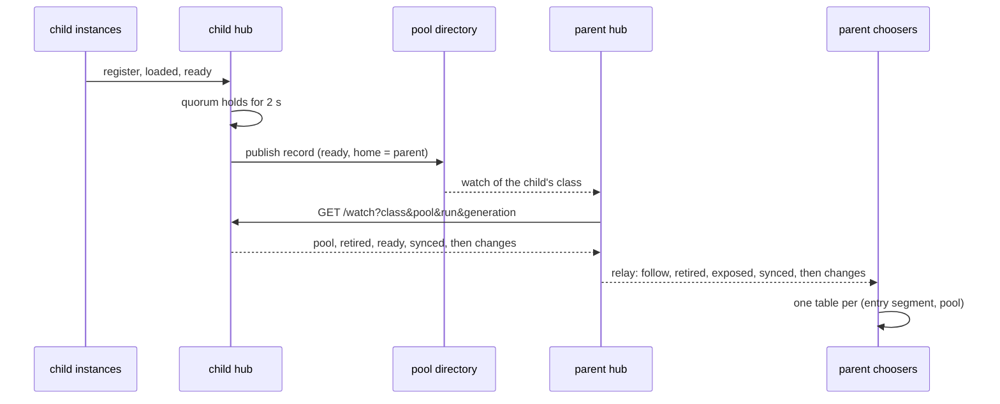

# Following and choosing pools

A parent pool sends work to its child pools. This chapter covers how the parent's hub finds and follows its children, how the parent's choosers pick a pool for each attempt, and how retirement and drain work across a class boundary. [Classes and pools](pools.md) defines classes, pools, quorum, and the pool's watch. Read it first. The route and event tables are in [Pool hub routes and watch events](../appendix/hub-api.md). The reasons behind each rule are in [Pools design](../development/pools-design.md).

## Who follows whom

A hub follows only its children. A child is a pool whose record names the hub's own pool as its `home`, has the same contract and placement hashes, is `ready` or `degraded`, and is `serving`, not scaled to 0 ([Presence](pools.md#presence)). A record that says a followed pool is scaled to 0 ends its follow. Region plays no part in following. A child in another region is followed. A pool in the hub's region whose parent is another pool is not followed.

Pools of layouts that place nodes differently have different placement hashes, so they never follow or offer to each other. A pool with other hashes is ignored, not an error. A hub follows children only for the classes its own class sends to. A pool of a class that sends to no class follows nothing.

## Two links

A parent's hub learns about a child over two links with different jobs.

| Link | Carries | If it fails |
|---|---|---|
| The pool directory | which pools exist: name, class, region, parent, hashes, state, epoch, hub address, presence, models | no new child is found; a child already followed stays followed |
| The follow link: the parent's hub watches the child's hub (`GET /v1/ext/gdl-pool/watch`) | the child's state and epoch, its load summary each period, its models when they change, and its entry instances, ready and retired, with their velo `PeerInfo` | the follow is not offered from that moment: this is the liveness signal |

The directory is off the routing path. A record that expires or is withdrawn ends no follow and does not change whether a follow is offered. A newer epoch in the directory ends the follow of the hub it replaces.



## The follow and its generation

Each time a hub follows a pool, it starts a new generation of that follow, with new tables. Instance ids seen in an earlier generation carry nothing into the new one.

A hub follows a pool again after its link ended, as a new generation, if the pool's record still makes it a child that takes work. The first wait is 125 to 250 ms. Each failed link doubles the wait, up to 2.5 to 5 s. A link that ran for 30 s after its snapshot returns the wait to the first step. A record of a new epoch is followed at once. A follow that the hub closed is followed again only after a later write of the pool's record.

A follow whose link ended is kept, with its instances, beside the pool's later generations, until it closes as described below.

## The relay

The parent's hub relays what it follows to its own instances on `GET /v1/ext/gdl-pool/follows`. The relay starts with a snapshot. For each followed pool it sends `follow`, then the pool's retired entry instances, then the ready ones it exposes, then one `synced` for the whole snapshot. After that it sends each change. Every event except `synced` names its pool by class and name, and names the follow's generation.

A pool's instances are exposed only while the state it last sent is `ready` or `degraded`. A state that exposes nothing hides them all. A state that exposes them again sends each one again.

When the hub's watch of the pool directory shows that a pool it followed withdrew its record, the relay sends `withdrawn`, naming the pool's latest follow. It may come after that follow's `dropped`. Only an explicit withdrawal sends it: a record that expires, a link that fails, and a directory snapshot that no longer holds the record send nothing. A snapshot of the relay holds no `withdrawn`.

The relay also lists every pool whose record the hub has read, followed or not, for the choosers' model index ([The model index](#the-model-index)). The snapshot gives a followed pool's listing on its `follow`, and sends a `listed` event for each other pool before `synced`. After that it sends `listed` for each change. `synced` says whether the hub's watch of the directory had read its first snapshot of every class the hub sends to.

`GET /v1/ext/gdl-pool/follows/{class}/{pool}` watches one pool's follows alone. It sends no `listed` event. A chooser uses it to read one pool again after an event it does not know (see [unknown events](#an-event-of-an-unknown-kind)).

## Offered and not offered

A follow is offered to the hub's choosers while its link lives and the state it last sent is `ready` or `degraded`. Each change between offered and not offered is the follow's next revision. The relay sends it as `offering`, with the revision and whether the follow is offered. A follow starts offered at revision 1. A snapshot shows `offering` only for a follow that is not offered.

Not offered is not a retirement. No instance is marked retired, and no instance's routing table changes. Marking the follow offered again undoes it at once.

## Closing a follow

A follow closes only when no chooser can still hold an offer to it. The hub learns this by acknowledgement, not by a timer. The one timer is for a chooser that cannot answer (step 6).

1. A chooser says to its hub that it runs a follower of the relay (`POST /instances/{id}/chooser`). It does this before it first watches the relay. Only then does the hub wait for its acknowledgements. An instance without `[pool]` runs no follower, never offers to another pool, and is not waited for.
2. Each offer to a pool takes a lease on the pool's follow. The lease is one count, held until the response stream ends or is dropped, as a selector's lease is.
3. When a chooser applies a not-offered revision, it stops offering to that follow. A choice already in flight is checked again when it returns, so it cannot complete an offer to the follow.
4. Once the chooser holds no lease on the follow, it acknowledges that revision (`POST /instances/{id}/unoffered`, a `gdl_watch::Unoffered`). It looks for such a follow every 50 ms, and sends an acknowledgement that its hub did not take again 500 ms later.
5. The follow closes once every chooser of its class among the hub's members has acknowledged the current revision, or left, and that revision is still a not-offered one. An acknowledgement of any other revision counts for nothing.
6. A chooser names itself in its watch of the relay (`GET /follows?instance=<id>`). The hub stops waiting for a chooser that has had no such watch open for `[pool] lost_chooser_ms`, 30 s by default. The time runs from when its last watch closed. The hub sees a watch close when its connection closes, or when a write to it fails. For a connection that dies without a close, that can take as long as TCP's retransmission timeout. For a chooser that never got a watch open, for example one refused at the relay's cap, it runs from step 1. A chooser that watches again is waited for again.
7. The hub sends `dropped` on the relay, ends the link, and releases the child's watch (`POST /release`).

A request can run for a long time. Its lease keeps the follow open for as long as it runs, if its chooser still watches the relay. That costs one watch.

A chooser that the hub stopped waiting for keeps its offers. It cannot see `dropped` either, so it keeps the child's instances registered with velo, and a draining entry instance finishes what it holds before it leaves. If the chooser watches again, its new snapshot no longer shows the follow. The chooser then stops offering to the follow, but keeps the child's instances registered until its last lease on the follow ends. It unregisters them `[runtime] drain_ms` after that. A chooser that sees `dropped` while it holds a lease does the same. The default 30 s matches velo-hub's default registration lease: a chooser that loses its hub altogether is removed at about the same time.

If the link is lost, the follow is not offered from that moment. It closes by the same acknowledgements, so the chooser keeps the child's instances registered with velo until no lease is held. Unregistering a peer fails what is in flight to it. A live instance finishes what it holds. A dead one fails its streams through velo's own detection or through their deadlines.

## The chooser's tables

A chooser is an instance in a pool, under a hub, whose segment holds the outer end of a hop into another class. It opens one watch of its own hub's relay for its whole life. After a watch ends it watches again from a fresh snapshot, and keeps its tables meanwhile. The wait starts at 50 to 100 ms and doubles up to 0.5 to 1 s while watches keep failing.

For each entry segment its hops enter, and each followed pool, the chooser keeps a table of the pool's current generation:

- the pool's state and region;
- its load summary, with the time it reached the chooser's hub, on the chooser's clock (`FollowedPool::load`, `load_age`);
- whether it is offered, and at which revision (`FollowedPool::offered`, `revision`);
- its exposed entry instances;
- its retired entry instances, which are never routed to again.

Beside the pools, each table holds the class's model index ([The model index](#the-model-index)), which every table of the class shares.

A newer generation replaces a pool's table at once. The older generation keeps its instances until the hub drops it. `Launch::pools` reads the tables (`gdl_runtime::Pools`).

A summary keeps its age when the chooser watches the relay again. The snapshot of a new watch sends each summary with `load_age_ms`, the time since the hub received it, and the chooser dates the summary back by that age. So a summary that the hub has held for a while, for example while its link to the pool is silent, is just as old on the next watch, and a stale summary stays stale. The hub sends an age, not an instant, since the hub and the chooser can run on different hosts with different clocks. A summary from a hub that sends no age dates from when the chooser read it.

Beside the pools, each table keeps the class's withdrawn pools: those the relay sent `withdrawn` for. A withdrawal is kept when the chooser watches the relay again, since a snapshot holds none. It ends when a later generation of the pool is shown. A hub follows a withdrawn pool again only from a newer record, so that follow is the pool started again. The same generation shown again by a new watch does not end it. Generations only grow while a chooser runs, since a chooser stops when its hub restarts.

## What a node reads

A node in a chooser's segment reads the same tables, through a `gdl::FollowedPools` handle. A model gate in front of a set router is the case it serves: the gate answers 404 for a model whose sets were all drained on purpose, and the router answers 503 when no set takes work. If they read different sources, they can disagree. A node that reads the chooser's tables cannot.

```rust,ignore
impl gdl::Build for Gate {
    type Config = GateConfig;
    type Metrics = ();

    async fn build(config: GateConfig, (): ()) -> gdl::Result<Self> {
        Ok(Self { sets: config.sets, followed: gdl::FollowedPools::current() })
    }
}

// Per request: one load of the class's table, and one of the gone marks.
let answer = self.followed.read("model_x", |pools| {
    let routed = |set: &&str| {
        pools.pool(set).is_some_and(gdl::Pool::takes_work) && !pools.is_gone(set)
    };
    if sets.iter().any(routed) {
        Pass
    } else if sets.iter().all(|set| pools.is_withdrawn(set)) {
        NotFound // 404: every set drained on purpose
    } else {
        Unavailable // 503
    }
});
```

- `FollowedPools::current()` gives the handle of the segment being built. Call it in `build`. Outside a build it gives a handle that is never bound.
- The launch binds the handle once the chooser's follower starts, after the nodes are built. Until then, and in a segment that sends into no other class or runs without a hub, `read` gives `None`. `is_bound` tells the cases apart.
- `read(class, ..)` loads the class's table once and passes a `ClassPools`. `pools()` are the `gdl::Pool`s the class's pool policy chooses from, in the same order, so the node and the policy see one value. `pool(name)` finds one. `is_gone(name)` says whether the chooser holds the pool gone, so that no choice takes it whatever its state and entries say ([A pool that is gone](#a-pool-that-is-gone)). `is_withdrawn(name)` says whether the relay said that the pool withdrew its record. A pool can be both followed and withdrawn until its follow is dropped.
- A gone mark shows in the next read after the chooser writes it. The read loads the chooser's damping beside the table; no table is rebuilt for it. The two loads are not one moment, but a mark holds the follow it was made in, so a table newer than the mark reads the pool as not gone, as a choice from that table would.
- The read takes no lock and allocates nothing. It costs about 69 ns on a quiet host, and 76 ns with `is_gone` (see [Feature costs](../operations/feature-costs.md#reading-the-followed-pools)). Keep the closure short: the table and the damping are held while it runs.
- A class has one table per entry segment that the chooser's hops enter. They list the same pools, but each counts its own entry instances, so whether a pool takes work can differ between them. When the chooser enters the class at one entry segment, `read(class, ..)` reads its table. When it enters at several, `read` gives `None`, and the node names the entry segment of the hop it guards with `read_entry(class, entry, ..)`.
- A test of a node builds a handle with `FollowedPools::fixed(pools, withdrawn)`, with no hub or runtime, or with `FollowedPools::fixed_with_gone(pools, withdrawn, gone)` to hold some pools gone.

How a drained pool reads, from the chooser's view:

| Moment | `pool(name)` | `is_withdrawn(name)` |
|---|---|---|
| followed, `ready` | `Some`, `ready` | `false` |
| the pool drains | `Some`, `draining`, until every chooser has acknowledged and the follow is dropped | `false` |
| the follow is dropped | `None` | `false` |
| its instances have left, and its hub withdrew its record | `None` | `true` |
| its hub is gone, and an operator withdrew it on this pool's hub | `None` | `true` |
| the pool's hub stops without a drain, or its link fails, or its lease expires | `None` once dropped | `false` |
| this chooser never saw the pool, or started after the withdrawal | `None` | `false` |

Silence is never a decommission. A pool's record is withdrawn only by its own hub after a drain, or by an operator on its parent's hub when its hub is gone ([A pool whose hub is gone](pools.md#a-pool-whose-hub-is-gone)). A pool that this chooser cannot see reads as not available, so a gate answers 503 for it, not 404. Two choosers can then answer differently for a while: one that saw the withdrawal reads it, and one that started after it does not. [Limitations](../operations/limitations.md) lists this.

Each entry instance is registered with the chooser's velo node before a table holds it. It is unregistered `drain_ms` after no follow holds it, unless the chooser's own membership still routes to it or is still draining it. The membership, in turn, does not unregister a peer that a table holds. So a velo peer in both is unregistered by whichever lets go of it last.

## The model index

The model index says, for each model and routing key, which pools of the class list it in their records. A model gate in front of a set router reads it to answer 404 for a model that no pool lists, and 503 for a model whose pools cannot take work now. The router reads the same index from the same table, so the two never disagree.

### What the hub lists

The parent's hub lists every record of each class it sends to, a child or not, in any region, if the record has the hub's contract and placement hashes. For each pool it keeps the region, the condition, and the models. A pool stays listed until it withdraws its record. Nothing else removes it: not a lease that passes, not a directory snapshot that no longer holds the record, and not a lost link.

| Condition | When |
|---|---|
| `live` | the record is `serving` and fresh, and the pool's follow, if the hub follows it, has not lost its link |
| `scaled_to_zero` | the record says the pool was scaled to 0 on purpose ([Presence](pools.md#presence)). It never lapses |
| `missing` | the record is `serving`, and its lease passed without a new write, or the follow's link ended and no later follow is installed yet |

The hub learns a followed pool's models from its record and from the follow link. The child's hub sends its list in the `pool` event of its watch's snapshot, and a `models` event each time the list changes. The parent keeps the list with the higher `models_version`, since the two paths race. The version never goes down, also across a restart of the child's hub.

A hub reads a record's lease on its own clock, from when it first saw the record's `seq`. So a new hub reads a silent pool as `live` for up to one lease, then as `missing`.

A `missing` listing also says how long the pool has been silent, in `missing_age_ms`. The silence begins at the record's last write, once its lease has passed, or when the follow's link was lost, whichever came first, on the hub's clock. The hub sends it as an age at the moment it sends the listing, never as an instant, since the hub and the chooser can run on different hosts with different clocks. So a pool whose last write came 40 s ago, with a lease of 30 s, is listed as missing with an age of 40 s. A new watch's snapshot sends the age again, older.

### The relay's marker

Until the hub's watch of the directory has read its first snapshot of every class the hub sends to, the listings are not whole: a record the hub has not read may still list a model. The relay's `synced` says so with `listed`. A watch of the relay that begins before then waits up to 2 s for it. A watch whose snapshot still says `listed: false` is ended once the listings are whole, so its reader learns it from its next snapshot. A hub of an earlier build sends no `listed`, so its choosers read the index as not synced.

### What the chooser builds

The chooser keeps the listings of its current relay watch. A new snapshot replaces them whole. When a missing pool's listing arrives, the chooser dates its silence back by the age, once, to an instant on its own clock. For each class it builds a `gdl::ModelIndex` from the listings and its own follows: each model's state in each pool, the pool's condition, since when a missing pool has been silent, and whether the chooser offers the pool work. It builds the index again only when a listing or a follow's offered state changes. A pool's load summary arrives each period, and does not rebuild it.

```rust,ignore
// Per request, in a gate: one load of the class's table.
let answer = self.followed.read("model_x", |pools| {
    let index = pools.models();
    let Some(sets) = index.sets(model, None) else {
        // No pool lists it. Unknown only once the directory was read.
        return if index.is_synced() { NotFound } else { Unavailable };
    };
    let routed = |set: &gdl::ModelSet| {
        set.state() == gdl::ModelState::Ready
            && set.is_offered()
            && pools.pool(set.pool()).is_some_and(gdl::Pool::takes_work)
            && !pools.is_gone(set.pool())
    };
    if sets.iter().any(routed) { Pass } else { Unavailable }
});
```

- `ClassPools::models()` gives the index of the table the read loaded. A pool policy reads the same index with `PoolRequest::models()`.
- `ModelIndex::sets(model, routing_key)` gives the pools that list the model, by name, or `None` when no pool does. It is one binary search, with no lock and no allocation.
- `ModelIndex::is_synced()` tells a model that is not known yet from one that no pool lists.
- `ModelSet::missing_since()` gives the instant a missing pool went silent, on the chooser's clock. A gate takes `Instant::now()` once and subtracts, to say "no heartbeat for 40 s". It is `None` for a pool that is not missing, and for one whose hub, of an earlier build, sends no age.
- A pool of another parent, or in a region the chooser does not follow, is listed and not offered. So a model that only another region serves is listed, and the gate answers 503 until this pool may route there.
- A model that moves from one pool to another shows both: the old pool's `drained` entry and the new pool's `starting` entry.
- A model an operator revoked on a pool is not in that pool's list ([Revoking a model](pools.md#revoking-a-model)), so the index does not list the pool for it. With no other pool, the model is unknown. An operator's withdrawal of a pool unlists it, as the pool's own withdrawal does.
- A test of a node builds a handle with `FollowedPools::fixed_with_models`, with a `ModelIndex::new` for each class.
- A gate's read of the index, a model looked up among 100 and one of its pools checked, costs about 81 ns on a quiet host (see [Feature costs](../operations/feature-costs.md#reading-the-followed-pools)).

## Choosing a pool

Each hand-off of a hop into another class goes to a pool, then to an instance of that pool:

1. The class's pool policy (`[pools.<class>] policy`) chooses a pool for this attempt.
2. The hop's own router (`[routing]`, see [Routing, selectors, and offers](routing.md)) chooses an entry instance among that pool's eligible instances only. A round robin keeps its turn per entry segment and pool.

If the chosen instance leaves the pool's table while a selector waits, or the pool stops taking work, both choices are made again. With no pool to choose, the request fails at once with `Routing`, naming the class and the entry segment, and the policy's reason if it gave one. It never waits for a pool to appear.

gdl provides two policies, `round_robin` and `home_first`. A spec can bind others by name to their crates, and a program can register them ([Write a pool policy](../guides/write-a-pool-policy.md)). A chooser whose placement names a policy that nothing registers and gdl does not have refuses to launch, and names the policy and the class.

### `round_robin`

`round_robin` is the default. Each attempt takes the next pool in the chooser's table, ordered by class and pool. A pool is eligible while it is `ready` or `degraded`, has an entry instance to route to, and has not declined this request. `ready` pools take every turn while any is eligible. `degraded` pools take turns only when no `ready` pool is eligible. It reads no load summary, so a pool can be chosen from the moment it is followed. Region plays no part.

### `home_first`

`home_first` chooses by each pool's load summary. A pool is not eligible if it is `unavailable` or `draining`, has no entry instance to route to, declined this request, or has no fresh summary: one that reached the chooser's hub within three of its periods, by default (`[runtime] pool_fresh_periods`). A pool is saturated when its admitted roots reach its admission limit, by default (`[runtime] home_first_saturated_percent`, 100), or its last period had refusals. Of the eligible pools, `home_first` takes the first tier that is not empty:

| Tier | Pools |
|---|---|
| 1 | `ready` home pools (the chooser's own `[pool] region`) that are not saturated |
| 2 | `ready` pools in another region that are not saturated and whose admitted roots are under the spill bound, 80% of their limit by default (`[runtime] home_first_spill_percent`) |
| 3 | saturated `ready` home pools |
| 4 to 6 | the `degraded` pools, in the same three tiers |

Within the tier it draws two pools at random and takes the one with the lower ratio of admitted roots to limit. A pool in another region that is saturated, or at or over the spill bound, is never chosen. A spill bound of 0 keeps every request in the chooser's region. Admission counts roots, not engine work, so this is an admission heuristic. The chooser's `[runtime]` settings give the thresholds of its own `home_first`. A registered policy that runs `HomeFirst` chooses at the defaults; one that runs `HomeFirstAt` chooses at the thresholds it gives.

### A registered policy

A registered policy implements `gdl::PoolPolicy`. It runs in the chooser, once per attempt: for the first offer, and again after each decline but an instance's own ([An instance that cannot serve the request](#an-instance-that-cannot-serve-the-request)). It is not `async`. It gets:

- the request's context, and its head as the policy's `Head` reads it: the edge's type, `gdl::Encoded` bytes, or a `gdl::Projected` part that decodes only the fields it declares;
- the class's followed pools: each pool's name, region, state, load summary, and number of entry instances;
- the chooser's region, the clock, the pools that declined this request, and the pools the chooser damps or holds gone;
- the attempt's turn, and a random draw made from it when the policy asks.

It returns a choice of one pool, by its index, or a `gdl::NoPool`, which fails the request with `Routing`. A `NoPool` may carry a short reason, such as the model that no pool serves, and the error then gives it after the policy's name, the class, and the entry segment. Only the first attempt's reason reaches the error: a request that a pool declined fails with the last refusal, which names that pool. The exception is a request whose every declining pool the chooser now holds gone, when the policy then chooses no other pool: it fails with `Routing` and the reason, as the requests after it do ([A pool that is gone](#a-pool-that-is-gone)). A choice may carry a lease (`gdl::ChoiceLease`), which learns whether that pool took the request. The runtime calls the lease's `accepted` when the pool accepts the offer, and holds the lease while it holds the request. It drops the lease without telling it when the pool declines, when the offer never left, and when the outcome is unknown. It also drops it when the choice is the check after every declining pool is gone, which offers that pool nothing. An instance's own decline is not the pool's: the lease passes to the offer to the pool's next instance, and learns of its acceptance. A choice without a lease allocates nothing. The head is read once per attempt, from the bytes the sender encoded. A head the policy cannot read fails the request with `Codec`, and no pool is offered it. When the segment starts, the runtime checks the policy's `Head` against the edge, as for a selector. A projection must name the edge's type, and its edge must not be encoded as `msgpack_array`. Its fields are checked against the edge type before the segment starts: their Rust names and types when it builds, and the names each type's `Deserialize` reads when the policy is registered ([Write a pool policy](../guides/write-a-pool-policy.md#1-read-only-what-you-route-by)).

The inputs are plain `gdl` types (`Pool`, `PoolRequest`, `Damped`, `Load`), so a policy crate builds them in its own tests, with no hub or runtime. `home_first` and `round_robin` (`gdl::HomeFirst`, `gdl::RoundRobin`) implement the same trait, and take the same inputs.

A registered policy can run either of them over only the pools it keeps, with `choose_where`: for example, the pools that serve the request's model. The choice is the one the policy would make over a copy of those pools, and its index is into all of them. Nothing is allocated. Their tiers, turns, and damping cap count only the kept pools. A policy that chooses as `home_first` does should also check a pool with `HomeFirst::eligible`.

### Damping

Under every policy, the chooser damps a pool that declined a request as full. `round_robin` and `home_first` pass a damped pool over as this section says. A registered policy sees the damped pools and decides for itself. It is not chosen for the first window, 1 s by default (`[runtime] pool_damping_first_ms`). Each further decline after its window has passed doubles the window, up to the longest, 30 s by default (`pool_damping_max_ms`). An offer it accepts ends the damping. A decline that lands while a window lasts belongs to the event that began it and does not extend the window.

At most half of the otherwise eligible pools, rounded down, are damped at once. When more are, the pools whose windows end soonest are chosen as if they were not damped. So a lone pool is never damped out.

### A pool that is gone

An entry's refusal says why: its pool is full, its pool is gone, or the instance cannot serve the request ([below](#an-instance-that-cannot-serve-the-request)). A full pool is damped, as above. A gone pool is passed over until the relay changes its follow: a new generation, a new state, or a new offered state. Time alone does not end it, and neither does a new load summary. An offer the pool accepts ends it too. A draining pool's entry says gone ([Draining a pool](#draining-a-pool)). So does a segment that declines as gone by its own policy ([A pool's own refusal](#a-pools-own-refusal)). Every other refusal says full: admission or egress full, a retired instance, or a hand-off of another deployment.

- `round_robin` and `home_first` never choose a gone pool, and a gone pool does not count in the cap on damping. So a lone gone pool is not chosen, and a request with no other pool fails with `Routing`, not `Overloaded`. That holds also for the request that hears the last gone refusal: when the chooser holds every pool it was offered gone, and the pool policy chooses no other pool, it fails with the `Routing` error the next request gets. The marks and that choice read one table and one damping view, so they are of one moment. This holds also when `pool_failovers` is used up. A request that a pool refused as full still fails with `Overloaded`, since that pool takes work again once it has room.
- A registered policy sees gone pools through `request.is_excluded(pool)`, which is true for them, and `request.damped().is_gone(pool)`. `choose_where` skips them.
- The mark holds the follow as the chooser's table shows it when the refusal lands, and only while that table is of the follow the offer was made under. A refusal of an offer made under an earlier generation damps the pool instead. A full refusal that lands after the mark, from an offer made before it, leaves the pool gone. A refusal that read an earlier table never replaces a gone mark of a later one.
- An entry that declines offers says gone also when admission refuses the offer first.
- The follower counts the relay's changes to a follow's state and offered state. A pool that leaves a state and comes back to it has changed, so it is not gone again. A new watch of the relay also ends every mark: its snapshot cannot show what changed while no watch was open. Such a pool is offered one more request, and is marked again if it still refuses.
- `FollowedPool::gone` shows the mark. A node that reads `gdl::FollowedPools` sees it through `ClassPools::is_gone(name)` ([What a node reads](#what-a-node-reads)), so a gate in front of the chooser can answer a gone pool as not ready while the chooser passes it over. A damped pool is not gone: a node sees it by its state and entries alone.

The reason crosses in the entry's reply, after the refusal. A build without it reads the refusal and stops there, so it takes every refusal as a full pool's, and so does this build for a reply that carries no reason, or a reason it does not know.

### An instance that cannot serve the request

An entry instance can decline an offer as its own: it cannot serve this request, and another entry instance of its pool may. For example, it does not have the request's model. The chooser then offers the request to the pool's other entry instances, each once, before it offers it to another pool.

- The other instances are offered it in the order of the pool's table when the decline landed, from the instance after the one that declined, around to the one before it. The chooser keeps only its place in that order and a count, so the walk allocates nothing, whatever the pool's size. An instance that joined the pool after the decline is not offered the request.
- Each instance is offered it only while the chooser's current table still offers it, and the pool policy still takes the pool (`PoolPolicy::eligible`). The pool policy does not choose again, since the pool is still its choice. Its lease on the choice passes to the offer to the next instance.
- Under a selector, the selector is asked for each instance, with that instance alone to choose from. So it holds its lease, and gives its metadata, for the instance the request is offered to. It does not rank the instances that are left.
- A walk's offers use none of `pool_failovers`. When every instance declines as its own, the request leaves the pool and the chooser offers it to another pool. Any other miss from an instance, full, gone, or a send that never left, leaves the pool at once, as it does for the first offer.
- The pool is neither damped nor held gone, and the instance's load report does not count the decline as a refusal, which `home_first` would read as a saturated pool. The decline says nothing of the pool's room, and its other instances still serve requests they can.

A chooser built before this reason reads it as unknown, so as full: it damps the pool for one window, and offers the request to another pool. That is the old behaviour, so a fleet can roll its choosers in any order.

## A hand-off is an offer

A child pool may decline the hand-off. The chooser then offers the request to another pool in the same call. Nothing of a declined offer is sent again: the entry started no work and holds nothing, and a streamed request's input goes only to the pool that accepts it. A selector's lease and metadata from a declined choice are released before the next choice.

| What happens | Outcome |
|---|---|
| The entry answers `Overloaded` before it takes the request: admission or egress refused, the instance retired, or the pool declines offers (a drain, or its own policy) | another pool is offered the request |
| The entry answers `Overloaded` as its own decline: it cannot serve the request | the pool's next entry instance is offered the request, then another pool |
| The entry answers `Placement`: the hand-off is not of its deployment | another pool is offered the request |
| velo refuses the send before it leaves: the instance is not registered, or its handshake fails | another pool is offered the request |
| No answer within the setup timeout, or the send fails after velo took it | the request fails at once with `OutcomeUnknown`; no other pool is offered it |
| The entry accepted, then failed | the request's error; a retry is the operator's |

The chooser offers to at most `[runtime] pool_failovers` more pools (2 by default). With 0, each request is offered to one pool, and to each of that pool's entry instances when they decline as their own. When every offered pool declines, the request fails with the last refusal, so a full fleet answers `Overloaded`. When the chooser holds every offered pool gone and the pool policy chooses no other pool, it fails with `Routing` instead, as the requests after it do. A refusal is not remembered past its request, except through damping.

A chooser that records metrics counts each offer under its pool and the row of this table it ended in, and each offer after a request's first as a failover ([A chooser's pool families](../appendix/metrics.md#a-choosers-pool-families)). The counts are kept by the pool's name, so a new generation of the pool goes on counting into the same series.

## Entry retirement across pools

An entry instance is an instance of a segment that a hop from another class enters. When one retires, the pools that follow its pool must stop choosing it.

1. The child's hub sends `retired` on its pool's watch. Each parent hub applies it to its relay.
2. The parent hub waits for each chooser whose hops enter the instance's segment. Each chooser says that it avoids the instance once its tables hold it retired (`POST /instances/{id}/avoids`). It resends one its hub did not take every 500 ms. A chooser that leaves counts as one that avoids it.
3. The parent hub then tells the child's hub once, for its whole pool (`POST /avoided`). A follow that closes first is released instead, which counts the same.
4. Once every pool that followed the child when the instance retired has done so, the child's hub sends `retired` again with `acknowledged: true`.

The retiree waits for that, or for at most the setup timeout plus twice `summary_ms` after it retired. Then it waits the setup timeout, as any retiring instance does (see [Segment lifecycle](lifecycle.md)). With no pool following its pool, the first `retired` already says `acknowledged`. A watch lost without a release never counts, so the retiree then waits out its bound. A follow opened after the retirement is not waited for, since its snapshot shows the instance retired.

Avoiding a retiree promises nothing about hand-offs sent to it before. The instance's setup timeout covers those. A chooser that still picks it after it stops taking work gets `Overloaded` and offers the request to another pool.

### An interior instance's stop

An interior instance is an instance of a segment of the pool's class that no hop from another class enters. Its sources are in another class, so they are not members of its hub, and it cannot see them drain. When it is stopped outside its pool's drain, it never counts them as drained. It waits until every instance of the segments of its class that send to it has promised to avoid it or has left, and then for the setup timeout ([Segment lifecycle](lifecycle.md)). So a request that an entry instance holds still reaches it. It waits for no pool outside its own. If it learns of its pool's drain while it waits, it also stops waiting once no more work can reach it, as in step 5 of [Draining a pool](#draining-a-pool).

An entry instance that also hosts a source says `drained` only once it holds no request, also when it is stopped outside its pool's drain. A source elsewhere says it once its serving body ends. Every instance of a draining pool reads an entry's `drained` as "this entry holds no request". So a stopped entry, then a pool drain, does not close an interior instance that a request the entry holds still needs.

An entry instance stopped outside its pool's drain that then learns of the drain follows the drain's rule from then, as in step 4 of [Draining a pool](#draining-a-pool). Once its bound has passed, or no other pool follows the pool, it declines offers, and it says `drained` as soon as it holds no request, while it still waits. So on a path that leaves the entry and comes back, the segment that sends back to the entry can leave, and then the entry leaves too.

A peer avoids a retired instance only while the segment has another instance. So the last interior instance of a segment waits until its senders leave, or for its drain's bound (`drain_ms`). In the chat graph, with `front` the entry of a pool's class, an operator who stops the only `engine` instance while `front` keeps serving sees `engine` take requests until `drain_ms` passes.

## Draining a pool

`POST /v1/ext/gdl-pool/drain` on the hub's control listener drains a whole pool. It is for a pool of a class that another class sends to. [Classes and pools](pools.md#the-drain-request) describes the request and the record. Across pools:

1. The pool is `draining` on its health endpoint, record, and watch. Each parent hub marks its follow not offered at the next revision.
2. Each entry instance learns of the drain from its own pool's watch. It keeps taking new work, stays ready, and keeps reporting its load for a bound: the setup timeout plus twice `summary_ms`. This lets an offer from a chooser with a stale view land.
3. The bound ends early when the pool's hub says that no other pool follows it: the pool's watch sends `state` again with `unfollowed: true`. A parent's hub releases the pool only once its follow has closed, so no offer from another pool is still on its way. A chooser that lost its watch of its own hub's relay holds the follow open for at most `lost_chooser_ms` ([Closing a follow](#closing-a-follow)). A response it still holds is finished in step 4.
4. Then the entry instance declines offers from other pools as gone. A chooser whose view is stale offers the request to another pool, and offers this pool no more work until the relay changes its follow ([A pool that is gone](#a-pool-that-is-gone)). Once no request it holds can send work into the pool, it announces that it has detached (below). It finishes the requests it holds and announces that it has drained. It still takes hand-offs inside the pool until every entry instance has drained or left. Then it closes and leaves. It does not retire: the pool's state already keeps choosers away.
5. An interior instance serves until no more work can reach it: every entry instance, and every instance of the segments of its class that send to it, has detached or left. An entry instance's `drained` counts as detached. Then it drains as after a stop: it closes, announces that it has detached once no request it holds can send work onward, waits until it holds no request, and leaves. Its drain's bound (`drain_ms`) counts from when every entry instance has drained or left, as before, so a response is not cut sooner than it was. As before an instance could detach, it also drains once every entry instance of the pool has drained or left. While its pool drains, those are its drain sources, whatever stopped it. The sources outside the pool are not members of its hub, so it cannot see them.
6. Once no instance of the pool's class is a member, the hub writes a last draining record, withdraws it, and ends the pool's watches. From then it refuses every registration with 409. To serve the pool again, start its hub again.
7. Each parent hub that sees the withdrawal in the directory sends `withdrawn` on its relay, and its choosers keep the pool as withdrawn ([What a node reads](#what-a-node-reads)).

A drain cannot be cancelled.

### Each segment leaves when its own part is done

An instance has detached (`gdl-detach-<segment>`) when it takes no more work and no request it holds can send work to another segment. It counts the requests that can: a hand-off it has not yet handed on or run to its inner end's stream, and each `next` an operator holds, with every clone of it. An operator that keeps its `next` may start another attempt at any time, so it counts until it drops that `next`. An entry instance counts from when it declines offers, and only once the segments of its class that send to it have detached. An interior instance counts once it has closed.

So in the chat graph, with `front` the entry of a pool's class and `Truncate` placed alone, a drain goes like this:

| Segment | Leaves when |
|---|---|
| `Truncate` alone (only passes the request on) | the entry has detached and it has handed on what it holds |
| `engine` (the sink) | the entry and `Truncate` have detached and its responses have ended |
| `post` (`Detokenize`, `Format`) | the entry has detached and its own responses have ended |
| `front` (the entry) | it holds no request, as in step 4; it leaves last |

A segment whose responses end first leaves first, so the sink usually leaves before the entry. Every response that started before the drain ends: an instance leaves only once it holds no request, and nothing can send it more work.

An entry of an earlier build never says that it detached. Each interior instance then waits for the entry instances to drain or leave, as before. A path that leaves a segment and comes back makes two segments wait for each other to detach, and they drain as before too.

## A pool's own refusal

A segment can decline offers from other pools by its own policy, before it admits them. The program that runs the segment calls `Segment::decline_offers_as(Decline::Gone)`, `Segment::decline_offers_as(Decline::Full)`, or `Segment::decline_offers_as(Decline::Instance)` on its running segment, and `Segment::take_offers()` to take offers again. It works on an entry segment: the hand-offs inside the pool are still taken. Each offer reads the refusal in the one atomic load it already makes, so the request path gains no allocation and no lock.

- `Decline::Gone` says that this pool takes no work from other pools until its state changes: for example, when it cannot serve the model its class serves. Each chooser that hears it passes the whole pool over, every entry instance of it, until the relay changes its follow. `take_offers` does not bring them back. Call it on every entry instance, for a reason that holds for the pool.
- `Decline::Full` says that the pool has no room now. Choosers damp the pool, and offer it work again after the window.
- `Decline::Instance` says that this instance cannot serve work from other pools now, and the pool's other entry instances may. Choosers offer each request it declines to the pool's other entry instances ([An instance that cannot serve the request](#an-instance-that-cannot-serve-the-request)), and the pool is not damped. It is one switch for the instance, not a choice per request.
- A drain's refusal (`Segment::decline_offers`) outlasts the segment's own. `decline_offers_as` does not replace it, and `take_offers` does not end it.

## When a pool fails

| Event | Effect |
|---|---|
| A segment falls below its quorum, but every segment has a usable instance | the pool is `degraded`: chosen only when no `ready` pool is eligible |
| A segment has no usable instance | the pool is `unavailable`: never chosen; its instances are hidden |
| The child's hub is lost | the follow link drops, so every parent stops offering to the pool at once; in-flight requests finish or fail by their deadlines. Each instance of that pool loses its hub lease and stops, so the pool must be started again |

## An event of an unknown kind

A reader ignores a field it does not know in a known event. An event of a kind it does not know makes it fail closed for the pool that the event names, until it has read that pool again.

- **A parent's hub** withholds the pool. The relay shows it `unavailable` at once, which hides its instances and keeps it out of the `requires` count, and not offered at the follow's next revision. The follow does not close while the pool is withheld. The hub reads the pool again from a new watch of the child's hub. If the new watch's snapshot also has an unknown event, the pool stays withheld, and the hub tries again after the refollow wait.
- A parent's hub of an earlier build does not know `models`, so it withholds the pool until it reads it again. The new snapshot carries the models as a field of `pool`, which it ignores.
- A chooser of an earlier build does not know `listed`. It leaves the pool unread, and reads it again from the watch of its follow alone, which sends no `listed`.
- **A chooser** leaves the pool unread (`FollowedPool::unread`). The pool is not offered, its tables show none of its instances, and its follow refuses new leases. The chooser opens `GET /v1/ext/gdl-pool/follows/{class}/{pool}` at once and reads the pool from it until its next relay watch. Meanwhile it still applies a `withdrawn` for the pool from the relay watch, since no snapshot carries one. The relay watch and every other pool go on. Being unread is not acknowledged to the hub: it has no revision.
- An unknown relay event that names no pool, an event that is not JSON, or a known event whose fields do not parse, ends the watch.

`gdl_hub::PoolReadiness::unknown_events`, `gdl_watch::PoolWatcher::unknown_events`, and `Pools::unknown_events` count such events.
