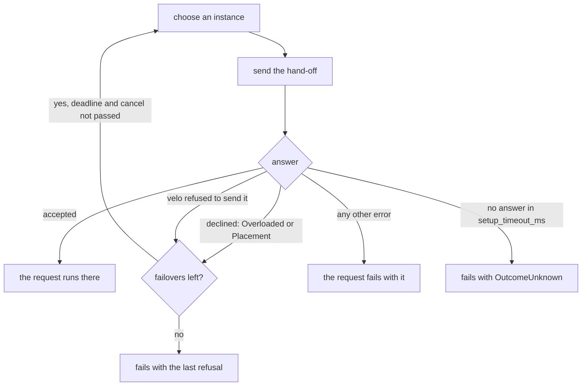

# Routing, selectors, and offers

When a request crosses into another segment, the sending segment chooses one instance of the destination segment. That choice is routing. This chapter covers the routers a crossing can name, the routing table they choose from, selectors, and the offer that every routed hand-off makes. [Routing design](../development/routing-design.md) records why it works this way.

## Where routing happens

Routing chooses where a forward hand-off goes: the first node of a remote forward run. Responses do not need it. They return through the stream anchors the request carries, so no router chooses their destination. A request's input stream, for a streamed request, stays with the instance its head went to.

The placement's `[routing]` table names a router for each crossing, keyed by the node where the remote forward run begins:

```toml
[routing]
Engine = "random"
Tokenizer = { selector = "least_loaded" }
```

A crossing that `[routing]` does not name uses `round_robin`. A key must be a node that starts a remote forward run: a local node or a response-only boundary cannot have a router. The router is part of the placement's identity. [Spec and fleet reference](../appendix/spec-reference.md) has the key's rules. The composer sets it on a cut request connection ([Compose in the browser](../guides/composer.md)).

The opening of a backward run does not use the crossing's router. It always takes its own round robin, with a sequence apart from the requests' sequence, so openings do not move the requests' turns.

## The routing table

Each segment instance keeps a routing table: for each segment, the instances it may route to. The table is immutable and swapped whole when membership changes. A segment's eligible instances are those added to routing that have not left and are not retired. When every one is retired, they are the ones whose retirement is not yet acknowledged. [Segment lifecycle](lifecycle.md) explains joining, retiring, and acknowledgements.

Every router chooses from the eligible instances of one table. An instance that the table excludes is never chosen.

## The built-in policies

- `round_robin` cycles through the eligible instances.
- `random` chooses an instance for each hand-off, by hashing a sequence number.

Each sending process keeps its own sequence for each destination segment. A pick costs one load of the table, one counter increment, and one modulo: no lock, no allocation, and no dynamic call.

## Selectors

A crossing can name a selector instead: `{ selector = "<name>" }`. A selector is a type that implements `gdl::Selector`. It runs in the sending segment, once for each choice. It sees:

- the request's context: its id, metadata, and deadline (`request.cx()`);
- the request's head, as its own type (`request.head()`), as a part of it that decodes only the fields it declares (`gdl::Projected`), or only the head's bytes (`request.bytes()`) when its `Head` is `gdl::Encoded`;
- the instances that declined this request so far (`request.declined()`);
- the destination segment's eligible instances (`Instances`), never empty.

When the segment starts, the runtime checks the selector's `Head` against the head type of the edge that crosses there. For a streamed edge `Streamed<H, T>`, the head type is `H`. A mismatch fails the start and names the selector, the crossing, and both types. `gdl::Encoded` fits any edge and costs no decode. A `gdl::Projected<P>` must name the edge's type as `P::Of`, and its edge must not be encoded as `msgpack_array`, which carries no field names. A cell policy's `Head` is checked the same way ([Choosing a cell](cell-routing.md#a-registered-policy)).

A selector returns a `Choice` made from one of the `Instance`s it was given. Neither type has a public constructor, so a selector cannot name an instance outside the table. A choice can carry two things:

- **A lease** (`Choice::with_lease`), any owned value. The sending segment holds it while it holds the request, then drops it. Where the response returns through the sender (a hop's outer end), that is when the response stream ends or is dropped. A relay of a streamed request holds it until it has sent its input on. A forward run that hands on, with nothing of the response passing it, holds it until the hand-off is acknowledged.
- **Metadata** (`Choice::with_meta`), which the receiving segment sees in `cx.meta()`.

A selector may wait, for an index or for room on an instance. The request's deadline and cancel bound the wait, not `setup_timeout_ms`. A request that ends while its selector chooses is not handed on, and the choice's lease is dropped. Because the table can change while a selector waits, the runtime checks the choice when it returns. If the table changed and the instance is no longer eligible, the runtime drops the lease and asks again. It asks at most 8 times in all, then fails with `Routing`.

Errors from routing:

| Error | When |
|---|---|
| the selector's own | The selector returned it: the request fails with it, raised in the sending segment. A selector that cannot choose returns `Error::routing`. One with no room returns `Overloaded`. |
| `Routing` | The table changed under the selector on all 8 asks. |
| `Codec` | The head did not decode as the selector's `Head`. |
| `Placement`, at start | The name resolves to no selector, or the head type does not match. |

### gdl's selectors

Two selectors come with gdl. A crossing can name them with nothing registered.

- `affinity` sends requests with the same key to the same instance, from every sender. The key is the value of the metadata entry that `[selector.affinity] key` names, when the request carries it, and the head's bytes otherwise. It uses rendezvous hashing over the eligible instances, so a join or a retirement moves only the keys of the instance that came or went.
- `least_loaded` sends each request to the instance where this sender holds the fewest leases. Equal counts take turns. It sees only its own sender's requests. Where the lease ends at the acknowledgement, the counts stay near zero, and it takes turns as `round_robin` does.

After instances decline a request, each one chooses among those that have not declined it: `affinity` the key's next instance, the same from every sender, and `least_loaded` the least loaded one. When every instance has declined, each chooses from all of them again.

A sending process builds one selector per name. Every crossing that names it shares it, so a selector that routes two hops into one segment keeps one view of its load. [Write a selector](../guides/write-a-selector.md) shows how to write and register one.

## Every hand-off is an offer

A routed forward hand-off is an offer. The chosen instance may decline it. Then the router chooses again in the same call.



- An instance declines with `Overloaded` (it has no room, or it is retiring) or `Placement` (the hand-off is not of its deployment). It gives either answer only before the request's work starts. An admission share it took is released before the refusal returns.
- A hand-off velo refused to send never left, so it is offered again too.
- The router chooses again at most `[runtime] instance_failovers` more times, 2 by default. `0` makes a refusal final. The request's deadline and cancel are checked before each choice.
- Nothing is excluded. The router may choose an instance that declined, since a decline can come from a state that its view did not show yet.
- A declined choice's lease is dropped, and its metadata discarded, before the next choice.
- When every offer misses, the request fails with the last refusal. When no instance refused it, it fails with the last error of a hand-off that never left.

Any other answer is the request's own and is never offered again. No answer within `setup_timeout_ms` fails with `OutcomeUnknown`, because the instance may have run the request. A hand-off to an instance that the sender completed a handshake with and can no longer connect to also fails with `OutcomeUnknown`: velo reports that only after it took the frame. See [Known limitations](../operations/limitations.md).

The first offer costs what a hand-off costs: the failover's state is made only after a miss.

A chooser's hand-off into another class is the exception. It offers the request to another cell, at most `[runtime] cell_failovers` times, and its selector sees nothing declined. An entry instance that declines as its own leaves the request in its cell: the cell's other entry instances are offered it first, one at a time. [Following and choosing cells](cell-routing.md) covers it.
