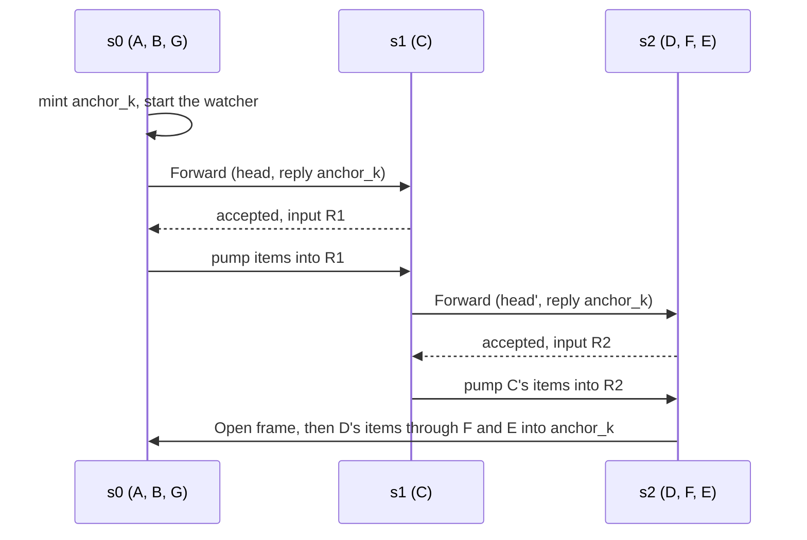

# Streamed requests

A request can carry a stream of items as well as a head value. Its response streams back while the request still streams in. This chapter describes the type, the syntax, how the items cross segments, and how the input ends and stops. [Runtime design](../development/runtime-design.md#streamed-requests) gives the reasons and the rejected alternatives.

## The type

`gdl::Streamed<H, T>` holds a public `head: H` and private items. A pure stream has `H = ()`.

- `Streamed::new(head, items)` builds one. It ends the items after their first `Err`.
- `into_parts` takes it apart into the head and the items.
- `map_head` changes only the head and keeps the items as they are.

`Streamed` is an ordinary request type. The role traits, the placeholder for a node that is not hosted, and local composition are the same for it. A forward node on a streamed edge can map the head and wrap the items. Streaming is a property of each forward edge, so a forward node can also turn a value into a stream, or a stream into a value.

`Streamed` is not `Clone`: its items can be read once. An operator that retries, hedges, or migrates a streamed request keeps its own copy of the items it needs.

## Syntax

A request position takes `Head + stream Item`, or `stream Item` for a head of `()`:

```text
sink     D: Pre + stream Frame -> stream Raw;
forward  C: Pre + stream Frame -> Pre + stream Frame;
operator B: (Req + stream Audio -> stream Chunk) over (Pre + stream Frame -> stream Out);
```

The port type is `Streamed<Pre, Frame>`. Both ends of a forward edge must agree on whether it is streamed. A response type cannot be streamed. The manifest records the item type of a streamed edge, and the contract hash covers it.

## The codec

The graph macro picks a forward edge's codec from the syntax. A streamed edge gets `stream_codec!(H, T)`, which exists only when both the head and the item are wire types. Any other edge gets `wire_codec!(T)`. A `Streamed` named through a type alias is an ordinary type with no codec, so it cannot cross. The head and the items choose their encodings separately. [Messages and encodings](messages.md) describes the encodings.

## Across segments

The response direction is the same as for any request ([Crossing segments](crossings.md)). On the request direction, the stage that reads the items mints their anchor, because velo reads an anchor only in the process that minted it:

1. The outer end O walks its forward stages and leaves at the first crossing. It takes an egress permit for its input pump.
2. O sends the hand-off with the head as its payload.
3. The receiver R checks and admits it, takes egress, and mints the input anchor last, after everything that can refuse. It starts its run and acknowledges with the input anchor's reply-to.
4. O starts its input pump as soon as the acknowledgement arrives, then waits for `Open` on its response anchor. The pump starts first because a sink may read its input before it returns its stream, and `Open` follows that return.
5. R's run joins the head with the items of the input anchor. It then calls the inner end, or runs its forward stages and relays.

A relay is a forward run that hands a streamed request on. It reads its input anchor, runs its forward stages, hands the head on, and pumps the changed items into the next receiver's input anchor. For placement `{A,B,G} {C} {D,F,E}` with a streamed hop 1:



At the end, s0 finalizes R1, s1 then finalizes R2, D ends, and s2 finalizes `anchor_k` and retires R2. If D ends first, s2 retires R2. s1's pump sees the cancel and cancels R1, and s0's pump stops.

Nothing on the request side is provisioned ahead, so the request side sends no `Open` frame. The receiver exists before its producer, and the acknowledgement is the signal that it is ready.

## Input lifecycle

| Event | What happens |
|---|---|
| The input ends | Its pump finalizes the input anchor. The node sees a clean end, and the response goes on (half-close). |
| The input yields `Err` | The pump sends `Fail`, then finalizes. The node sees that `Err` as its input's last item. |
| The input's producer dies, or its stream ends without a finish | The node's input ends with `Err(Truncated)`, `Transport`, or `Codec`, never with a clean end. |
| The receiving run ends, for any reason | It retires its input anchor. The sender's pump sees the cancel and stops without writing anything. |
| The sender's attempt is cancelled or passes its deadline | Its pump sends `Fail` with the reason, finalizes, and stops. |
| The acknowledgement is lost | The sender never attaches. The receiver's run ends by its response or by its deadline, and retires the anchor then. |
| An attach, open, or send on an input anchor fails | The pump ends silently and cancels what feeds it. The response decides the request's outcome. |

Retiring the input when the run ends is what bounds an input anchor that no sender attached to, and input that a node holds unread.

## Stop and the input

A stop does not end the input, as in local composition. An application that wants a stop to end its input ends it from its own context, for example with `take_until(cx.stopping())`.

A stop travels on these routes:

- **From the caller.** It reaches the inner end on the response side, as for any request. A receiving run whose context is stopping then asks velo to stop its input anchor. The sender's pump turns that into a stop of its own context and of the anchor it reads, so the stop goes on up the request path. At the outer end, the input pump passes it to the attempt itself. velo carries the stop as a control message, so data credit does not hold it back.
- **From a node.** A stop that a node asks for on its own context takes the same routes from where it starts. A receiving run with an input anchor has a watcher task that waits for its context to stop and forwards the stop to the input anchor. The watcher is not polled with the run's items.

The pump keeps sending after a stop. velo does not end a stream on a stop, and the producer decides whether to finish.

Two cases are out of reach, and the deadline ends the request in both:

- **A relay that asks for a stop after its own input has ended, or just before its run ends.** Its stop travels only up through its input, and only while its run lives. After the input ends, no stage is left upstream to carry it. When the run ends right after the stop, retiring the input cancels the sender, and velo fires the sender's stop token with that cancel, so the sender takes both for the receiver leaving. velo gives a producer no way to signal its consumer outside the data. `a_stop_a_relay_asks_for_after_its_input_ended_waits_for_the_deadline` and `a_stop_a_relay_asks_for_as_it_finishes_waits_for_the_deadline` pin both cases.
- **A forward node in another segment that waits for a stop inside `forward`**, before it hands the request on. A cancel does not reach it either ([Requests, attempts, and deadlines](requests.md#stop-cancel-deadline-and-failure)).

## Admission, egress, and deadlock

An input pump is a producer. The sender takes its egress permit before it sends the hand-off, so a refused permit never leaves a receiver waiting for input. A receiving inner end holds its admission share and its egress permit until its stream retires. A relay takes egress before it acknowledges, and keeps its admission share until it has sent all of its input on. [Admission and egress](admission.md) gives the general rules.

The two anchors of one call have separate credit, and velo detects no deadlock between them. Each input pump runs on its own task, and reading the response never drives it, so the runtime adds no coupling. A deadlock that the application builds (a sink that waits for its output to be read while its caller waits for input credit) is bounded only by the deadline.
