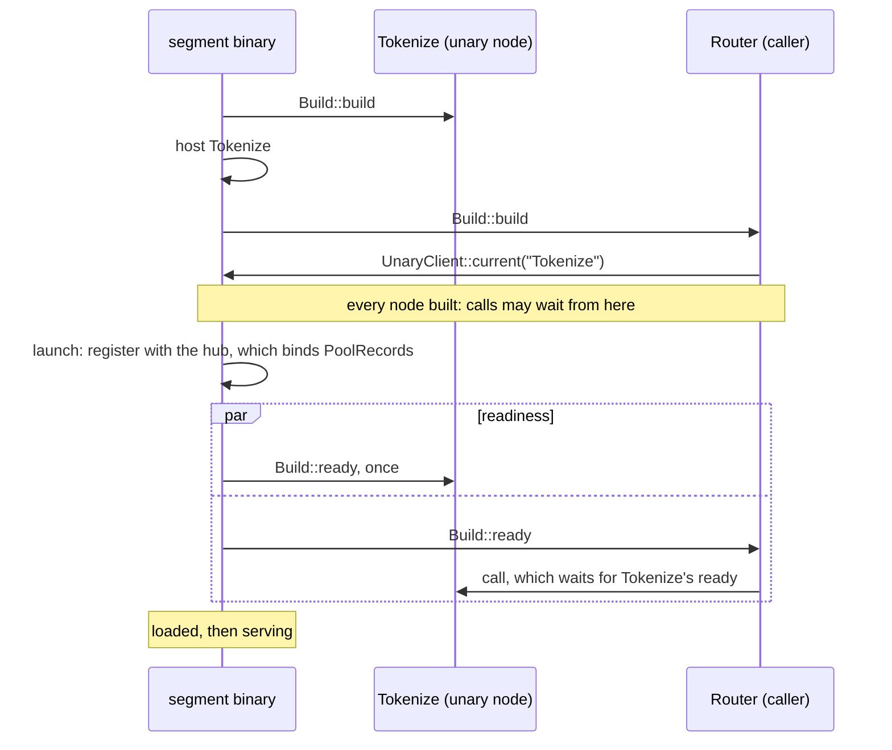

# Unary services

A unary node takes one request and returns one response. It is not on a hop. The graph declares it with `unary`, and each node that calls it says so with `calls` ([Declare unary nodes](../guides/define-a-graph.md#declare-unary-nodes)). A node calls it through a `gdl::UnaryClient<Req, Resp>`. The node code is the same wherever the placement puts the service.

```rust,ignore
// In Build::build, once:
let tokenize = UnaryClient::<Text, Tokens>::current("Tokenize")?;
// Per request:
let tokens = self.tokenize.call(&cx, text).await?;
```

[The graph model](model.md#unary-services) describes the client and the call. This chapter describes how a segment builds its services, how a node gets its client, and when a call may be made.

## How a node gets its client

A node takes its client once, in `Build::build`, with `UnaryClient::current`, and keeps it. The call names the service as the graph does.

- **The node's `calls` must name the service.** A build that takes a client of a service its `calls` does not name fails with `Placement`, naming the node and the service. So does a build that takes the client with other types than the service's, naming both.
- **The segment's own copy, when it has one.** A node in a segment that lists the service gets a client of that copy. A call to it is a direct call in the caller's task. It needs no transport, no encoding, and no admission: it runs inside its caller's request, which was admitted.
- **Otherwise, a link to the segment that hosts it.** A node in a segment that does not list the service gets a client of the runtime's link to the one other segment that does ([Specs, segments, and layouts](placement.md#unary-nodes)). The segment binary makes the link before it builds its nodes, and the deployment binds it when it starts ([A call to another segment](#a-call-to-another-segment)).
- **Outside a build there is no client.** `current` fails outside a build that the runtime runs. Code that composes nodes by hand gives each caller `UnaryClient::local(service)`, or takes a link with `RuntimeConfig::calls`.

## Build order and readiness



- **A segment builds its unary nodes first**, each after the services it calls, then its other nodes. So every client a build takes is of a service that is already built. `calls` has no cycle, so the order always exists.
- **No call during the build.** A call made from `Build::build` fails at once with `Routing` and the message "called during build". The service is built, but it is not ready: its `ready` may need what the launch binds.
- **A service's `ready` runs once, in the readiness phase.** That is after the build and after the instance has registered with its pool's hub, which binds `PoolRecords`. The segment takes requests only once every node is ready, its services included.
- **A call from another node's `ready` waits for the service's `ready`**, then is made. If the service's `ready` fails, the call fails with the same error, and so does the launch. It cannot deadlock: `calls` has no cycle.
- **Once the service is ready, a call reads one flag** and goes straight to the service.
- **A call to another segment before the segment has started fails at once with `Routing`**, "called before the segment launched". The link binds only when the segment starts, and the launch waits for every node's `ready`, so a call from `ready` that waited for the link would never end.
A service's `ready` run during the build was rejected. A `ready` that reads `PoolRecords` would fail there, because the records are bound only once the instance has registered with its hub. A call from the build that waited for the service's `ready` was rejected for the same reason.

## What a call costs in the caller's segment

The client of a service the segment hosts reads the service's readiness once per call, then builds the service's future inside the call's own, as `UnaryClient::local` does. It makes no allocation of its own for a service future of 256 bytes or less, aligned to 8 or less. The read costs about 6 instructions over a local client ([Feature costs](../operations/feature-costs.md#a-local-unary-call)). The client also counts each call, about 53 instructions with no allocation, and, while the segment records its figures, times it, about 186 more ([Counting a call](../operations/feature-costs.md#counting-a-call)).

## Lifetime and state

- **One instance of the service per segment instance**, shared by every caller there. A cache inside it is shared by those callers.
- **Copies share nothing.** A unary node listed in several segments has a copy in each, and the copies share no state. Each caller calls the copy in its own segment, with no allocation of its own, and a copy answers only its own segment's callers ([Specs, segments, and layouts](placement.md#unary-nodes)).
- **A call in the caller's segment ends with its caller.** It runs inside its caller's request, so it has no bound of its own. Dropping the call's future cancels it. A call to another segment has a bound ([A call to another segment](#a-call-to-another-segment)).
- **The service is dropped after the segment's last request ends**, with the other nodes and the clients they hold.

## What a call records

The same figures in both placements, so that a service can move between segments with no change to a dashboard ([Calls to unary services](../operations/observability.md#calls-to-unary-services)):

- **The caller counts each call** and each error by its kind, always, labelled by the calling node, the service, `local` or `remote`, and the segment of the copy called. A call its caller drops counts as cancelled, or as `deadline_exceeded` once its deadline has passed, in both placements.
- **The caller times each call** only while its segment records its figures.
- **A remote service's segment** records each call it ran as a visit of the service node, under the caller's request id, and ends it with the outcome of the reply it sent, the one the caller reads. A call it refused, a request that does not decode among them, is counted by the caller only, as `overloaded` or the refusal's kind.
- **A client made by hand records nothing.** Only a client a node takes with `UnaryClient::current` has a caller to count under. `UnaryClient::local`, and a link taken from `RuntimeConfig::calls` and handed to a node, count nothing.

## A call to another segment

```mermaid
sequenceDiagram
    participant R as Router (caller's segment)
    participant L as UnaryClient (link)
    participant V as velo
    participant H as gdl.call handler (service's segment)
    participant T as Tokenize
    R->>L: call(&cx, text)
    L->>L: bound: the request's deadline, or now + call_timeout
    L->>L: pick an instance (round_robin or random), encode text behind the envelope's room
    L->>V: unary "gdl.call", timeout = time left to the bound
    V->>H: the envelope's bytes, uncopied
    alt another contract or placement, no call permit free, closed, a passed bound, an undecodable request
        H-->>L: refused: the service never ran
        L->>V: the next instance, within the bound
    else a call permit taken
        H->>T: call(&cx', text), cx' with the bound as its deadline
        T-->>H: Ok(tokens) or an error
        H-->>V: completed: the encoded tokens, or the service's error, whose bytes hold the permit
        V-->>L: the reply; velo lets its bytes go, and the permit returns
    end
    L-->>R: Ok(tokens), or the error as it is
```

- **One velo unary call.** A segment that hosts a unary node for callers in other segments registers one velo handler, `gdl.call`. Its reply is velo's response to the call, so nothing maps a reply to its call.
- **The envelope** is MessagePack: its version, the contract and placement hashes, the service's index among the unary nodes in name order, which the contract hash fixes as declaration order does not, the context's wire part with the call's bound as its deadline, and the request. The request is encoded behind room for the rest of the envelope, as a hand-off's head is, so it is not copied ([Crossing segments](crossings.md#what-crosses-the-wire)). The handler reads the bytes velo received, and decodes the request where it arrived.
- **The bound** is the request's deadline, or now plus the caller's `call_timeout` (30 s by default) when the request has none. A velo unary call with no timeout can wait for ever, so every call has a bound. The caller's velo call runs under a timeout of the time left. The handler runs the service under a context whose deadline is the bound, and stops it there. Once the bound passes, the call fails with `DeadlineExceeded` ([Segment settings](../operations/configuration.md)).
- **Two kinds of reply.** The handler refuses a call that never reached the service: another contract or placement (`Placement`), no call permit free or an instance that has closed (`Overloaded`), a bound that passed before the service could start, also while its request was decoded (`DeadlineExceeded`), a request it cannot decode (`Codec`). A call that reached the service is completed, with the service's response or its error. A completed error reaches the caller as it is, whatever its kind, with its message and without its source: a service that failed with `Overloaded` after a side effect is not run again.
- **A call permit.** Before the service runs, a call takes a permit of the service segment's `call_limit`, which is the admission limit unless set ([Admission and egress](admission.md#calls-from-other-segments)). The permits are apart from the requests' admission, and a call never shares its request's permit: one request that makes 1,000 calls at once takes 1,000 permits. So a burst of calls refuses none of the segment's pipeline requests, and the reverse. A full instance refuses the call at once, without waiting.
- **The permit lives as long as the reply.** velo sends a reply after the handler returns, and its queue of replies to a peer has no bound. So the reply's bytes own the permit, and it returns when velo lets them go, once it has written them to its connection, or when the call's bound plus the service segment's `call_reply_grace` (1 s) passes, whichever is first. A caller that stops reading cannot hold `call_limit` past that. A refusal holds no permit.
- **The next instance.** A refused call, or one that velo refused to send before its transport took it, is tried on the instance the router picks next, for any service, until the bound passes or `instance_failovers` more tries are made. A selector chooses again, told which instances refused the call, and the declined choice's lease ends first. The call then fails with its last refusal. A call whose send failed after the transport took it may have run, and fails with `OutcomeUnknown`, unless the graph marks the service `idempotent`: then it is tried on the next instance too ([Declare unary nodes](../guides/define-a-graph.md#declare-unary-nodes)). With no instance of the service's segment to route to, a call fails with `Routing`.
- **A reply has a limit**, the service segment's `call_reply_max`: 8 MiB by default, below velo's 16 MiB TCP frame, which velo does not split for a unary reply. Every reply is written in one place, which holds it to this limit, its tag included, whatever it says. A larger one is replaced by a `Codec` error of fixed size: it names the service, cut to 64 bytes, and the reply's size, and a refusal stays a refusal, so the caller still knows that the service never ran. That error takes at most 153 bytes, so the setting is at least 512. A larger answer belongs in a stream.
- **The service's work ends with its call.** The handler cancels the service's context however the call ends: answered, failed, or past its bound. A worker that the service started with a clone of the context sees `cancelled()` then.
- **Which instance.** The placement's `[routing]` entry for the unary node picks it: `round_robin` by default, `random`, or a selector. Calls go round their own turns, apart from the requests'. A selector sees the call's request as its head and the caller's context, so `affinity` keyed on a metadata entry such as `session` sends every call of a session to one instance. Without the entry, `affinity` hashes the whole encoded request ([Routing a call](routing.md#routing-a-call)).
- **The caller's segment sends to the service's.** Each call from a segment to a copy in another one is a send, as a hand-off is: the caller's serving barrier waits for the service's segment, whose handler is registered before it says it serves, and retirement and the drain's reachability count it ([Segment lifecycle](lifecycle.md)).
- **A codec.** The spec can compress a unary node's calls across segments with a `[codec]` entry keyed by the node ([A call's codec](#a-calls-codec)).
- **A retiring instance of the service** is treated as a retiring instance of any segment is. Its callers pass it over while its segment has an instance that has not retired, and route to it while it is the only choice. It serves calls until it closes its entries, then refuses them, and the caller moves on to a live instance. Its drain waits for the calls it accepted, each for at most its bound plus `call_reply_grace`, since `Segment::admitted` counts their permits.
- **Who may still call.** In a draining pool, a segment whose nodes call a service in another segment counts a request as one that may still send until the request's response stream ends, since a stream that holds a client can call. A call it accepted counts until it ends, since a service may call another. So the service's segment, which waits for the segments that send to it to detach, does not close before a late call from a backward stream ([Each segment leaves when its own part is done](pool-routing.md#each-segment-leaves-when-its-own-part-is-done)).

A call to another segment costs about 8,000 instructions and 9 allocations more than velo's raw unary call between the same two nodes, about 41,500 Ir and 27 allocations in all. Its call permit and the reply's retention are about 500 Ir of that ([Feature costs](../operations/feature-costs.md#the-call-permit)).

### A call's codec

A `[codec]` entry keyed by a unary node compresses the node's calls that cross segments, from every caller: `Tokenize = { request = "msgpack_zstd", reply = "msgpack_zstd" }`, each part optional, with one `floor` (16 KiB by default) for both ([Messages and encodings](messages.md#edge-codecs)). The envelope does not change: it has no caller and no flag. Each end tells a frame from a plain value by its first four bytes, as for an edge ([Edge codecs](crossings.md#edge-codecs)), and reads them so only where the entry names the part. Without the entry a request's bytes are read as its message's, whatever they begin with.

- **A request** from its floor on is compressed once, by the caller, before the first try, into a buffer of its own with room for the envelope in front. A request whose frame is not shorter crosses plain. The plain request and its frame are two types, so nothing can send a frame as plain bytes or read one as a request. Under a policy the plain request goes, and every try sends the same envelope. Under a selector, which reads the plain request on each choice, the caller keeps it, and a later try copies the frame into its own envelope. The handler decodes a frame within its segment's `decompressed_max` (256 MiB by default) before the service's decode. A frame it refuses is a refusal with `Codec`: the service never ran.
- **A reply** from its floor on is compressed by the handler, where every reply is written, before `call_reply_max` holds it. So the limit holds the bytes on the wire, tag included: an answer whose plain form is past the limit crosses when its frame fits, and is replaced by the `Codec` error when the frame does not. An error and a refusal are never compressed. The caller decodes a frame within its own `decompressed_max`: a frame that states more fails the call with `Codec` before anything is allocated for it. The service ran, so the call is not tried again.
- **Two limits, one for each side of the frame.** `call_reply_max` is for velo's 16 MiB frame, which only the bytes on the wire meet. `decompressed_max` is for the memory a frame takes once decoded, at the end that receives it.
- **Local calls.** A call to the copy in the caller's own segment is a direct call, which never encodes, so the entry does not touch it. `cargo gdl check` refuses an entry for a unary node that no caller calls across segments.

Compression costs more than the bytes it saves on a fast link. A call of 64 KiB of text each way costs about 360,000 Ir compressed, against about 164,000 plain; a call below the floor costs what it costs without the entry ([Feature costs](../operations/feature-costs.md#a-calls-codec)).

### What the call does not do yet

- **A dropped call does not stop its service.** velo's unary call has no cancel that reaches the handler, so a caller that drops its call tells the service nothing. The service runs on until it answers or its bound passes, and holds its call permit until then ([Known limitations](../operations/limitations.md#a-dropped-remote-call-runs-on-until-its-bound)).
- **A reply that holds no permit can still queue in velo.** A refusal, and a reply whose permit its grace released, stay in velo's queue to a peer that does not read ([Known limitations](../operations/limitations.md#a-calls-refusal-and-a-reply-past-its-grace-can-queue-in-velo)).
