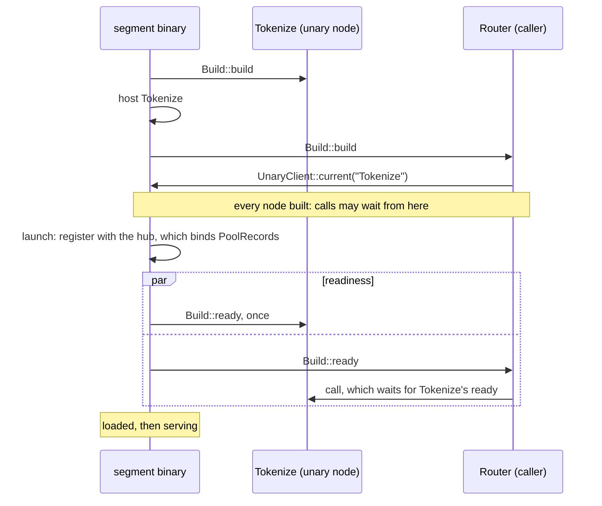

# Unary services

A unary node takes one request and returns one response. It is not on a hop. The graph declares it with `unary`, and each node that calls it says so with `calls` ([Declare unary nodes](../guides/define-a-graph.md#declare-unary-nodes)). A node calls it through a `gdl::UnaryClient<Req, Resp>`. The node code is the same wherever the placement puts the service.

```rust,ignore
// In Build::build, once:
let tokenize = UnaryClient::<Text, Tokens>::current("Tokenize")?;
// Per request:
let tokens = self.tokenize.call(&cx, text).await?;
```

[The graph model](model.md#unary-services) describes the client and the call. This chapter describes how a segment builds its services, how a node gets its client, and when a call may be made.

## How a node gets its client

A node takes its client once, in `Build::build`, with `UnaryClient::current`, and keeps it. The call names the service as the graph does.

- **The node's `calls` must name the service.** A build that takes a client of a service its `calls` does not name fails with `Placement`, naming the node and the service. So does a build that takes the client with other types than the service's, naming both.
- **The segment's own copy, when it has one.** A node in a segment that lists the service gets a client of that copy. A call to it is a direct call in the caller's task. It needs no transport, no encoding, and no admission: it runs inside its caller's request, which was admitted.
- **Outside a build there is no client.** `current` fails outside a build that the runtime runs. Code that composes nodes by hand gives each caller `UnaryClient::local(service)`.

Today a caller must be in a segment that lists the service ([Known limitations](../operations/limitations.md#a-unary-service-is-called-only-from-its-own-segment)).

## Build order and readiness



- **A segment builds its unary nodes first**, each after the services it calls, then its other nodes. So every client a build takes is of a service that is already built. `calls` has no cycle, so the order always exists.
- **No call during the build.** A call made from `Build::build` fails at once with `Routing` and the message "called during build". The service is built, but it is not ready: its `ready` may need what the launch binds.
- **A service's `ready` runs once, in the readiness phase.** That is after the build and after the instance has registered with its pool's hub, which binds `PoolRecords`. The segment takes requests only once every node is ready, its services included.
- **A call from another node's `ready` waits for the service's `ready`**, then is made. If the service's `ready` fails, the call fails with the same error, and so does the launch. It cannot deadlock: `calls` has no cycle.
- **Once the service is ready, a call reads one flag** and goes straight to the service.

A service's `ready` run during the build was rejected. A `ready` that reads `PoolRecords` would fail there, because the records are bound only once the instance has registered with its hub. A call from the build that waited for the service's `ready` was rejected for the same reason.

## What a call costs in the caller's segment

The client of a service the segment hosts reads the service's readiness once per call, then builds the service's future inside the call's own, as `UnaryClient::local` does. It makes no allocation of its own for a service future of 256 bytes or less, aligned to 8 or less. The read costs about 6 instructions over a local client ([Feature costs](../operations/feature-costs.md#a-local-unary-call)).

## Lifetime and state

- **One instance of the service per segment instance**, shared by every caller there. A cache inside it is shared by those callers.
- **Copies share nothing.** A unary node listed in several segments has a copy in each, and the copies share no state ([Specs, segments, and layouts](placement.md#unary-nodes)).
- **A call ends with its caller.** It runs inside its caller's request, so it has no bound of its own. Dropping the call's future cancels it.
- **The service is dropped after the segment's last request ends**, with the other nodes and the clients they hold.
