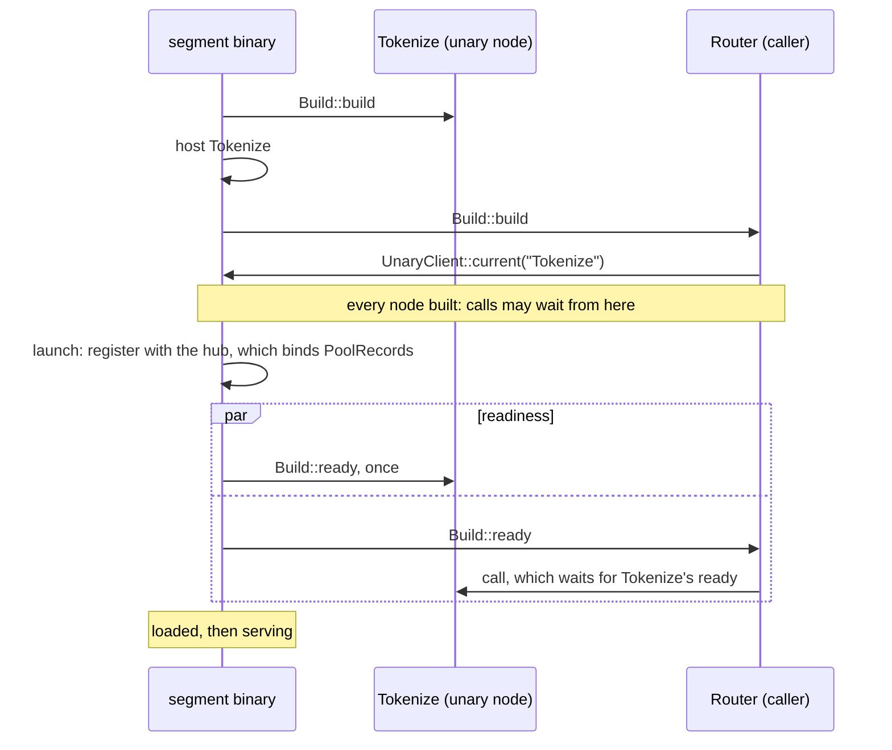
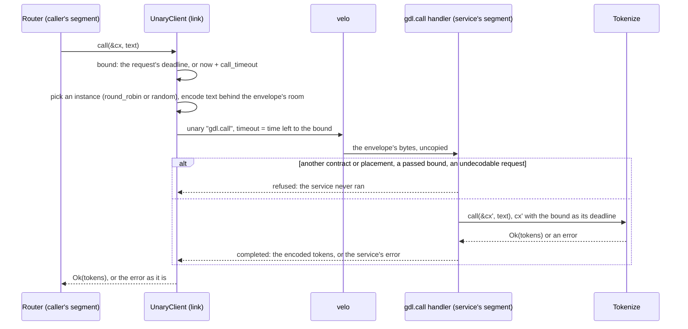

# Unary services

A unary node takes one request and returns one response. It is not on a hop. The graph declares it with `unary`, and each node that calls it says so with `calls` ([Declare unary nodes](../guides/define-a-graph.md#declare-unary-nodes)). A node calls it through a `gdl::UnaryClient<Req, Resp>`. The node code is the same wherever the placement puts the service.

```rust,ignore
// In Build::build, once:
let tokenize = UnaryClient::<Text, Tokens>::current("Tokenize")?;
// Per request:
let tokens = self.tokenize.call(&cx, text).await?;
```

[The graph model](model.md#unary-services) describes the client and the call. This chapter describes how a segment builds its services, how a node gets its client, and when a call may be made.

## How a node gets its client

A node takes its client once, in `Build::build`, with `UnaryClient::current`, and keeps it. The call names the service as the graph does.

- **The node's `calls` must name the service.** A build that takes a client of a service its `calls` does not name fails with `Placement`, naming the node and the service. So does a build that takes the client with other types than the service's, naming both.
- **The segment's own copy, when it has one.** A node in a segment that lists the service gets a client of that copy. A call to it is a direct call in the caller's task. It needs no transport, no encoding, and no admission: it runs inside its caller's request, which was admitted.
- **Otherwise, a link to the segment that hosts it.** A node in a segment that does not list the service gets a client of the runtime's link to the one other segment that does ([Specs, segments, and layouts](placement.md#unary-nodes)). The segment binary makes the link before it builds its nodes, and the deployment binds it when it starts ([A call to another segment](#a-call-to-another-segment)).
- **Outside a build there is no client.** `current` fails outside a build that the runtime runs. Code that composes nodes by hand gives each caller `UnaryClient::local(service)`, or takes a link with `RuntimeConfig::calls`.

## Build order and readiness



- **A segment builds its unary nodes first**, each after the services it calls, then its other nodes. So every client a build takes is of a service that is already built. `calls` has no cycle, so the order always exists.
- **No call during the build.** A call made from `Build::build` fails at once with `Routing` and the message "called during build". The service is built, but it is not ready: its `ready` may need what the launch binds.
- **A service's `ready` runs once, in the readiness phase.** That is after the build and after the instance has registered with its pool's hub, which binds `PoolRecords`. The segment takes requests only once every node is ready, its services included.
- **A call from another node's `ready` waits for the service's `ready`**, then is made. If the service's `ready` fails, the call fails with the same error, and so does the launch. It cannot deadlock: `calls` has no cycle.
- **Once the service is ready, a call reads one flag** and goes straight to the service.
- **A call to another segment before the segment has started fails at once with `Routing`**, "called before the segment launched". The link binds only when the segment starts, and the launch waits for every node's `ready`, so a call from `ready` that waited for the link would never end.
A service's `ready` run during the build was rejected. A `ready` that reads `PoolRecords` would fail there, because the records are bound only once the instance has registered with its hub. A call from the build that waited for the service's `ready` was rejected for the same reason.

## What a call costs in the caller's segment

The client of a service the segment hosts reads the service's readiness once per call, then builds the service's future inside the call's own, as `UnaryClient::local` does. It makes no allocation of its own for a service future of 256 bytes or less, aligned to 8 or less. The read costs about 6 instructions over a local client ([Feature costs](../operations/feature-costs.md#a-local-unary-call)).

## Lifetime and state

- **One instance of the service per segment instance**, shared by every caller there. A cache inside it is shared by those callers.
- **Copies share nothing.** A unary node listed in several segments has a copy in each, and the copies share no state ([Specs, segments, and layouts](placement.md#unary-nodes)).
- **A call in the caller's segment ends with its caller.** It runs inside its caller's request, so it has no bound of its own. Dropping the call's future cancels it. A call to another segment has a bound ([A call to another segment](#a-call-to-another-segment)).
- **The service is dropped after the segment's last request ends**, with the other nodes and the clients they hold.

## A call to another segment



- **One velo unary call.** A segment that hosts a unary node for callers in other segments registers one velo handler, `gdl.call`. Its reply is velo's response to the call, so nothing maps a reply to its call.
- **The envelope** is MessagePack: its version, the contract and placement hashes, the service's index among the unary nodes in name order, which the contract hash fixes as declaration order does not, the context's wire part with the call's bound as its deadline, and the request. The request is encoded behind room for the rest of the envelope, as a hand-off's head is, so it is not copied ([Crossing segments](crossings.md#what-crosses-the-wire)). The handler reads the bytes velo received, and decodes the request where it arrived.
- **The bound** is the request's deadline, or now plus the caller's `call_timeout` (30 s by default) when the request has none. A velo unary call with no timeout can wait for ever, so every call has a bound. The caller's velo call runs under a timeout of the time left. The handler runs the service under a context whose deadline is the bound, and stops it there. Once the bound passes, the call fails with `DeadlineExceeded` ([Segment settings](../operations/configuration.md)).
- **Two kinds of reply.** The handler refuses a call that never reached the service: another contract or placement (`Placement`), a bound that passed before the service could start, also while its request was decoded (`DeadlineExceeded`), a request it cannot decode (`Codec`). A call that reached the service is completed, with the service's response or its error. A completed error reaches the caller as it is, whatever its kind, with its message and without its source: a service that failed with `Overloaded` after a side effect is not run again.
- **A reply has a limit**, the service segment's `call_reply_max`: 8 MiB by default, below velo's 16 MiB TCP frame, which velo does not split for a unary reply. Every reply is written in one place, which holds it to this limit, its tag included, whatever it says. A larger one is replaced by a `Codec` error of fixed size: it names the service, cut to 64 bytes, and the reply's size, and a refusal stays a refusal, so the caller still knows that the service never ran. That error takes at most 153 bytes, so the setting is at least 512. A larger answer belongs in a stream.
- **The service's work ends with its call.** The handler cancels the service's context however the call ends: answered, failed, or past its bound. A worker that the service started with a clone of the context sees `cancelled()` then.
- **Which instance.** The placement's `[routing]` entry for the unary node picks it, `round_robin` by default, or `random`. Calls go round their own turns, apart from the requests'. A selector on a call is refused when the caller's segment starts ([Known limitations](../operations/limitations.md#a-call-is-routed-only-by-round_robin-or-random)).
- **The caller's segment sends to the service's.** Each call from a segment to a copy in another one is a send, as a hand-off is: the caller's serving barrier waits for the service's segment, whose handler is registered before it says it serves, and retirement and the drain's reachability count it ([Segment lifecycle](lifecycle.md)).

A call to another segment costs about 7,200 instructions and 9 allocations more than velo's raw unary call between the same two nodes, about 40,500 Ir and 27 allocations in all ([Feature costs](../operations/feature-costs.md#a-remote-unary-call)).

### What the call does not do yet

- **A dropped call does not stop its service.** velo's unary call has no cancel that reaches the handler, so a caller that drops its call tells the service nothing. The service runs on until it answers or its bound passes ([Known limitations](../operations/limitations.md#a-dropped-remote-call-runs-on-until-its-bound)).
- **A refused call is not tried on another instance**, and a call has no admission of its own: it runs inside its caller's request, and the service's segment does not count it ([Known limitations](../operations/limitations.md#a-remote-call-is-not-retried-or-admitted)).
