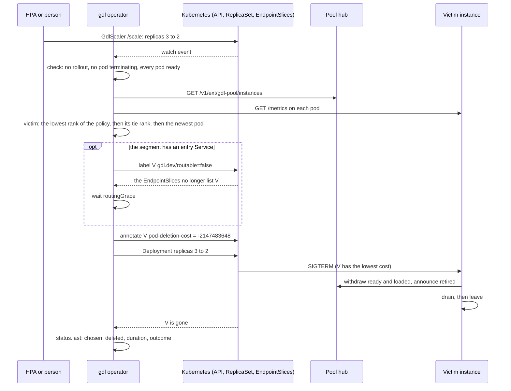
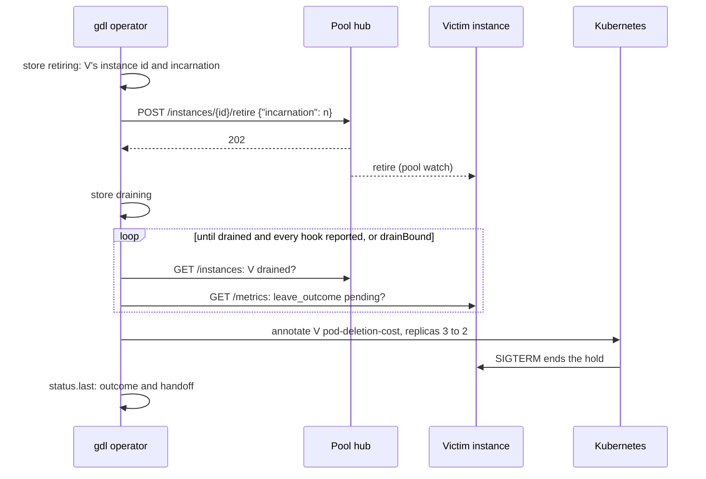

# Scale a segment with the operator

The gdl operator scales the segments of a fleet's pools on Kubernetes. A `GdlScaler` holds how many instances of one segment of one pool run. An HPA, or a person, writes that count through the scaler's `/scale` subresource, and the operator is the one writer of the segment Deployment's `replicas`. On a scale-down it chooses which instance to remove by its load, and makes sure that exactly that pod goes.

Without the operator, a Deployment scaled down by hand or by an HPA lets Kubernetes choose the pod. That choice is correct, since every instance drains on its SIGTERM ([Stopping](../concepts/lifecycle.md#stopping)), but it is blind to load: it may stop the busiest instance, whose drain is the longest.

The operator is a Rust binary, `gdl-operator`, that runs in the fleet's namespace. It reaches the Kubernetes API and each pool hub's HTTP routes, and nothing else. It never links velo.

## Install it

The operator needs two cluster-scoped objects, the `GdlScaler` CRD (`gdlscalers.gdl.dev`) and the `GdlPool` CRD (`gdlpools.gdl.dev`), and five objects in the fleet's namespace: its ServiceAccount, a Role, a RoleBinding, a StatefulSet of one replica, and the StatefulSet's headless Service. A cluster's owner applies them, since a deployer cannot grant rights it does not hold. `gdl-operator manifests` prints all seven, each labelled `gdl.dev/setup=gdl-operator`:

```bash
gdl-operator manifests --namespace gdl-api --image registry.example/gdl/gdl-operator:<tag> \
  | kubectl --context <context> apply --server-side -f -
```

The image is built from `crates/gdl-operator/Dockerfile`, at the repository's root:

```bash
docker build -f crates/gdl-operator/Dockerfile -t registry.example/gdl/gdl-operator:<tag> .
```

The Role grants only what the operator uses, in its namespace:

| Resource | Verbs | Why |
|---|---|---|
| `gdl.dev` `gdlpools` | get, list, watch, update, patch | Read each pool, and add its finalizer |
| `gdl.dev` `gdlpools/status` | get, update, patch | Report what it observed and did, and the step of a pool's stop |
| `gdl.dev` `gdlpools/finalizers` | update | Remove a pool's finalizer once its stop has ended |
| `gdl.dev` `gdlscalers` | get, list, watch, create, update, patch, delete | A pool's scalers, which it makes and deletes, and suspends at a pool's stop |
| `gdl.dev` `gdlscalers/status` | get, update, patch | Report what it observed and did |
| `apps` `deployments` | get, list, watch, create, update, patch, delete | A pool's Deployments, and each one's `replicas` |
| core `services`, `configmaps`, `persistentvolumeclaims` | get, list, watch, create, update, patch, delete | A pool's other objects |
| core `pods` | get, list, watch, patch, delete | Read the pods, and label and annotate the victim. Delete only in `retire: request` mode, a victim that retired and that the count no longer removes ([Retire on request](#retire-on-request)) |
| `apps` `replicasets` | get, list, watch | Find a pool's pods by what its Deployments own, at its stop |
| `discovery.k8s.io` `endpointslices` | get, list, watch | See that a victim has left its entry Service |
| `monitoring.coreos.com` `podmonitors` | get, list, watch, create, update, patch, delete | A pool's PodMonitor, where the cluster runs the Prometheus operator |
| `events.k8s.io` `events` | create, patch | Say what it held, refused, or could not prove |

It deletes only a pool's own objects, and a pod only in `retire: request` mode, and only a victim it retired. It has nothing on Secrets, ServiceAccounts, Namespaces, or Leases. It has no `services/proxy` right: the operator runs in the cluster, and reaches hubs and pods at their addresses.

The operator runs as a StatefulSet of one replica. A StatefulSet never runs two pods of one identity: it starts the replacement of its pod only once the old one is confirmed gone. So at most one operator acts at a time, through a rollout, a restart, or a node failure. While the operator's node does not answer, its pod is not confirmed gone, and no replacement starts: scaling pauses, the safe way, until the node answers again or Kubernetes removes it. Scaling pauses, and nothing else does: the segments serve on, and a pod that leaves meanwhile drains on its own SIGTERM.

**Never force-delete the operator's pod** (`kubectl delete --force --grace-period=0`), and never remove its node by hand while the pod may still run. Either tells Kubernetes the pod is gone when it may not be, and a second operator can then start beside the first. Two operators at once can lose a scale-up, delete the wrong pod, or leave a deletion cost behind ([Known limitations](../operations/limitations.md)). If it happens, check each `GdlScaler`'s status, and the deletion cost (`controller.kubernetes.io/pod-deletion-cost`) and `gdl.dev/routable` label of its segment's pods, once only one operator runs.

### Why a StatefulSet

The rejected alternative is an election of the operator's own, by a Kubernetes Lease. Three review passes each found a new way for it to let two operators act at once: a renewal that hung left the old holder acting after another took the lapsed lease; a delayed first read let a successor take over inside the holder's hold; and a write that passed the holder's check could land after the handoff. Kubernetes already keeps one pod of a StatefulSet's identity, and the operator needs nothing more.

## Let the operator run a cluster's pools

Set `operator = true` on a cluster in the fleet file. `cargo gdl deploy` then applies one `GdlPool` per pool of that cluster, and the operator makes each pool's objects from it, a `GdlScaler` per segment among them, and stops the pool in order when `deploy` or `down` deletes its `GdlPool` ([The operator](kubernetes.md#the-operator) in the Kubernetes guide). `deploy` refuses a cluster that sets `operator` and lacks the `GdlPool` or `GdlScaler` CRD. A cluster without `operator` gets its pools' objects from `deploy`, with each segment at the quorum and no scaler.

```toml
[cluster.use1]
context = "kind-use1"
namespace = "gdl-api"
region = "us-east-1"
registry = "registry.example/gdl"
platform = "linux/amd64"
operator = true
```

## The `GdlScaler` resource

Group `gdl.dev`, version `v1alpha1`, namespaced. One scaler per segment of a pool.

| Field | Meaning |
|---|---|
| `spec.pool`, `spec.segment` | The pool and the segment. The pool's hub's Service has the pool's name |
| `spec.targetRef` | `{apiVersion: apps/v1, kind: Deployment, name}`: the segment's Deployment |
| `spec.replicas` | How many instances to run. An HPA writes it through `/scale`. Until it is set, the scaler does nothing |
| `spec.minReplicas` | The fewest it scales to: the segment's quorum, never below 1, since the last instance of a segment is not avoided ([Known limitations](../operations/limitations.md)) |
| `spec.suspend` | `zero` holds the target at 0, whatever `replicas` and `minReplicas` say |
| `spec.maxConcurrentDrains` | How many victims drain at once: 1 by default |
| `spec.victim` | The victim policy: `fewestAdmitted` by default, `newest`, or `fewestCommittedKv` |
| `spec.retire` | `signal`, the default: the victim retires on its pod's SIGTERM. `request`: the scaler asks the victim's hub to retire it, and deletes its pod only once it has drained and its leave hooks have reported, or at `drainBound` ([Retire on request](#retire-on-request)) |
| `spec.drainBound` | The segment's drain bound, such as `20s`. In signal mode, the scaler reports a removal that took longer. In request mode, the longest it waits for a victim, which request mode needs |
| `spec.routingGrace` | How long after a victim leaves its entry Service's endpoints the scaler waits before the pod goes: `10s` by default |
| `spec.service` | The segment's entry Service, when it publishes ports |
| `spec.metricsPrefix` | The segment's `[system] metrics_prefix`: `dynamo_component` by default |
| `status.replicas`, `status.selector` | The target's count and its pods' selector, which `/scale` reports to an HPA |
| `status.readyReplicas` | Its ready pods |
| `status.retiring` | The victims chosen and not gone yet: each one's pod and its uid, its Deployment's uid, the count it is removed at (`target`), and its phase: `unrouting`, `committing`, or `removing`; in request mode also `retiring`, `draining`, and `deleting`, with its instance's id and incarnation, when it was asked (`asked`) and when its hub took the request (`retired`), and its leave hooks' worst outcome (`handoff`) |
| `status.last` | The last removal: the name of the pod chosen (`pod`), the uids of the pod chosen and the pod deleted (`chosen`, `deleted`), why, how long it took, how it ended, and in request mode its leave hooks' worst outcome (`handoff`) |
| `status.conditions` | `Scaling`, `Blocked`, and `Suspended` |

A duration is a count and one unit: `ms`, `s`, `m`, or `h`. The schema refuses any other, a `retire` other than `signal` or `request`, and a `minReplicas` below 1.

## The `GdlPool` resource

Group `gdl.dev`, version `v1alpha1`, namespaced. One per pool, named after it. Its spec is the pool with every value resolved: what `gdl-k8s` renders the pool's objects from, so that the operator in the cluster renders what `cargo gdl k8s` would. The operator owns each object it renders, by a controller reference: the pool's ConfigMap, its hub's Deployment, Service and claim, each segment's Deployment and entry Service, a `GdlScaler` per segment, and the pool's PodMonitor when it asks for one and the cluster serves them.

| Field | Meaning |
|---|---|
| `spec.fleet`, `spec.cluster`, `spec.class`, `spec.region` | Where the pool is, as the fleet names it |
| `spec.deployment` | The pool's layout as its hub admits it, the `DeploymentSpec` as JSON |
| `spec.hub` | The hub's image, variables, resources, and, for a parent under `relay`, its state directory |
| `spec.segments[]` | Each segment's name, image, settings file, quorum, published ports, variables, secrets, and resources |
| `spec.serviceAccountName`, `spec.nodeSelector`, `spec.tolerations` | Where its pods run |
| `spec.parent` | `{home: <pool>}` or `{parents: <class>}`; absent for a top pool |
| `spec.dynamodb` | The tables of the DynamoDB directory; absent under `relay` |
| `spec.podMonitor` | Whether the pool has a PodMonitor, named after it |
| `spec.presence` | `serving`, or `scaledToZero` |
| `spec.allowPoolRestart` | Whether a change that replaces the hub may be applied |
| `status.phase` | `Pending`, `Ready`, `Degraded`, `Unavailable`, from the hub's health; `Draining`, `Stopping`, `Withdrawn` while it stops |
| `status.segments`, `status.withdrawn` | Each segment's usable instances and quorum, and the withdrawal, as the hub says them |
| `status.missing` | The objects the pool renders that do not exist yet |
| `status.held` | The generation the pool-restart guard holds |
| `status.stop` | The step of the pool's stop, its start, and the uid of each object it acts on |
| `status.conditions` | `Applied`, `Healthy`, `Presence`, `PodMonitor`, `NotOwned`, `PoolRestartPending`, `Draining`, `Withdrawn`, `HubGone`, and `ForegroundDelete` |

### How a pool is kept

Each reconcile of a pool that is not being deleted:

1. adds the finalizer `gdl.dev/stop` first, before any object, so that a delete always stops the pool in order;
2. renders the pool's objects, and refuses the whole generation when one of them exists without the pool's controller reference (`NotOwned`): the operator changes no object it did not make. The rollover ConfigMap, `<pool>-rollover`, which the pool's segments mount, is not one of them: the pool does not render it, and the operator neither refuses the pool for it, nor writes, owns, or deletes it ([What a pool gets](kubernetes.md#what-a-pool-gets)). Its writer must not give it the pool's controller reference, or the pool's next generation deletes it as an object it no longer renders;
3. holds the whole generation when it changes the hub's pod template and `allowPoolRestart` is not set (`PoolRestartPending`), since a hub restart drains the pool. The hub's Deployment carries `gdl.dev/template`, a hash of its pod template as rendered, which the guard compares. A first create is not a restart, and a change to a segment's settings does not replace the hub: the hub's `gdl.dev/config` covers only the pool's deployment. Neither does the rollover volume in the segments' pods: the first generation that renders it replaces every segment's pods once and needs no `allowPoolRestart`;
4. stores its status, conditionally on the pool's resourceVersion, and only then writes anything else, so that a reconcile whose read is out of date writes nothing;
5. applies each object, by forced server-side apply under the manager `gdl`, carrying the uid of the object it read;
6. writes `replicas` once on each segment's Deployment and `GdlScaler`, at the segment's quorum, under `gdl-scaler` and `gdl-bootstrap`, while no other manager owns it: `gdl` never writes `replicas`, so a redeploy cannot undo a scale;
7. tells the hub the pool's presence (`POST /v1/ext/gdl-pool/presence`), and once it answers 204, suspends each scaler at 0 for `scaledToZero`, or lets it go for `serving`, under the manager `gdl-pool`;
8. deletes each object it controls and no longer renders, such as a renamed segment's, by its uid;
9. reads the hub's health into the status.

### How a pool stops

Garbage collection deletes a pool's objects in no order: a top pool's hub that stopped before its segments would leave an empty instance without its lease while a frontend still holds a request that needs it. So the finalizer stops the pool in order while every object of it still exists, and garbage collection deletes what is left once no process runs.

```mermaid
sequenceDiagram
    participant D as kubectl delete (background)
    participant O as gdl operator
    participant H as Pool hub
    participant S as Segment scalers and pods
    D->>O: GdlPool deletionTimestamp, finalizer gdl.dev/stop
    alt the pool has a parent and a hub
        O->>O: status.stop: drain, hub's uid
        O->>H: POST /drain
        loop until withdrawn, bounded by the longest grace and 60 s
            O->>H: GET /withdrawn
        end
    end
    O->>O: status.stop: segments, each scaler's and Deployment's uid
    O->>S: suspend each scaler at 0
    S-->>O: no segment pod runs
    O->>O: status.stop: hub, the hub Deployment's uid
    O->>H: hub Deployment replicas 0
    H-->>O: the hub's pod is gone
    O->>O: status.stop: release
    O->>D: remove gdl.dev/stop; garbage collection deletes the rest
```

The step is stored, with the uid of each object it acts on, before it is taken. A restart takes the step stored. An object made again under the same name, with another uid, is written into the step before it is acted on, and every write carries the uid, so a stale step is never taken on another object. Each step checks its precondition each time it is taken, on what the pool owns: the hub step waits while a segment pod the pool owns runs, going back to the segments step, and for a pool with a parent it reads the current hub's word that its record is withdrawn: a hub that restarted since the drain has published a record again, so the pool drains again. A top pool, whose hub refuses a drain, and a pool whose hub's Deployment is gone (`HubGone`) start at the segments. A withdrawal the hub has not said within the bound, or a drain it refuses, keeps the finalizer, with the `Withdrawn` condition and an event: the parent would still hold the pool's record. A pool deleted with foreground propagation is named in `ForegroundDelete` and an event, and still loses the finalizer once no pod of it runs ([Known limitations](../operations/limitations.md)).

## How a scale-down runs



The scaler keeps its target at `max(spec.replicas, spec.minReplicas)`. A scale-up first takes back any victim not yet committed, and raises the target's `replicas` once every committed victim's pod is being deleted ([Why a deletion cost](#why-a-deletion-cost)). A scale-down takes one victim at a time to its commit, and up to `maxConcurrentDrains` drain together, in these steps.

1. **Wait until it is safe.** The scaler removes pods while more live, not terminating and not already leaving, than the desired count. It chooses a victim only while no rollout of the target is in progress, no other pod of it is terminating, and every other pod is ready. Otherwise its `Blocked` condition says why (`RolloutInProgress`, `PodTerminating`, `PodNotReady`), and it looks again every 5 s. Every pod being ready is also what makes the ReplicaSet's choice predictable, below.
2. **Choose.** The scaler reads each pod's `/metrics`, at its IP, on its container port named `system`, and the hub's instance list (`GET /v1/ext/gdl-pool/instances`, [Listing the instances](../concepts/pools.md#listing-the-instances)), which maps a pod to its instance by the pod's IP. A pod's load is the larger of `admission_admitted` and its `inflight_requests`, summed over its entries: a source's own requests are only in the second, and an entry's admitted requests stay in the first while velo still holds their output ([Reading a drain](../operations/observability.md#reading-a-drain)). When a pod's `/metrics` does not answer, the hub's latest load report of it stands in. The names carry the segment's `metricsPrefix`, and are read by their whole name. The victim policy ranks each pod, and the lowest rank goes. A policy can break its own ties with a second rank. A tie that is left goes to the newest pod, then the greater uid. The last ready pod is never chosen.
3. **Take it out of routing.** For a segment with an entry Service, the scaler stores the victim as `unrouting`, then sets the victim's label `gdl.dev/routable` to `false`. Entry Services select on `gdl.dev/routable: "true"`, so the EndpointSlice controller drops the pod. The label is not in the Deployment's selector, so the ReplicaSet still owns the pod. The scaler waits until no EndpointSlice of the Service lists the pod, and then `routingGrace`, for kube-proxy and load balancers to stop sending to it.
4. **Delete exactly that pod.** The scaler stores the victim as `committing`, at a count one below the target's, then sets the victim's `controller.kubernetes.io/pod-deletion-cost` to `-2147483648`, the lowest, and then writes the target's `replicas` one lower. Once the count is written, the victim is `removing`: committed. The ReplicaSet deletes the pod, which retires and drains on its SIGTERM ([Stopping](../concepts/lifecycle.md#stopping)), bounded by the pod's grace: the drain bound and 30 s.
5. **Record it.** Once the pod is gone and the hub no longer lists its instance, `status.last` holds the pod chosen, the pod deleted, the time from the choice, and the outcome: `removed`, or `overran` when the pod went more than `drainBound` and 10 s after the scale-down. The 10 s are the runtime's margin past its bound ([The bound](../concepts/lifecycle.md#the-bound)). An instance that left cleanly leaves its hub as it exits. One that crashed stays listed until its lease lapses, so the scaler waits for the hub at most a minute after the pod is gone, and then says in the reason that the hub still listed it. A hub that does not answer cannot say, and the pod's exit alone ends the removal.

Each victim is in `status.retiring` from its choice until its pod is gone, with what its `/metrics` last said it holds. The status is all the scaler remembers, so an operator that restarts carries on. It is written ahead: the scaler stores each phase before the step it names, so a step that a lost write or a restart leaves half done is finished or undone from what the status says, never guessed. A victim whose pod is terminating, or whose count is at or below its target, is committed, whatever its phase says. One that is not committed and whose pod went ends as `lost`, with nothing else changed. A live pod out of its Service that no victim names gets its Service back. Only one victim at a time is not yet committed; committed victims drain together, up to `maxConcurrentDrains`.

Every write carries the read it was decided on. A status write carries the scaler's resourceVersion, a write of the count the Deployment's uid and resourceVersion, and a write to a pod the pod's uid and resourceVersion. The API server refuses a write whose read is out of date, a write that changes nothing included, and the reconcile stops; the next one reads again and decides again. A step that puts a pod back is stored before it is taken, as every step is, and each reconcile stores its status, conditionally, before its first write to a pod: a reconcile whose read of the scaler predates another's stored step writes no pod. This keeps a stale decision from overwriting a newer one in most cases. It does not make two operators at once safe: two at once on one scaler, which only a forced deletion of the operator's pod makes possible, can still lose a scale-up, delete the wrong pod, or leave a deletion cost behind, until one of them stops ([Known limitations](../operations/limitations.md)). So a reconcile that waited on a scrape cannot undo a newer scale, and a Deployment made again under the same name is not changed by a decision about the old one. A victim of the old one is abandoned: its pod gets its Service and its cost back, and `status.last` says `abandoned`. Each reconcile reads the scaler from the API, not from its watch's cache.

### Retire on request

In `retire: request` mode the scaler does not leave the victim's retirement to its SIGTERM. It asks the victim's pool hub to retire it, holds the pod until the instance has drained and its nodes' leave hooks have reported, and only then deletes it. The hooks then never race the pod's grace, and the scaler reads their outcome before the pod goes. The steps after the routing grace (step 3) replace step 4:



1. **Store the retire step.** The scaler reads the victim's instance id and the incarnation of its registration from the hub's list ([Listing the instances](../concepts/pools.md#listing-the-instances)), and stores the victim as `retiring` with both, and the time (`asked`). From here the instance may have retired, so the scale-down is never undone.
2. **Ask.** After a status write of the same reconcile, as for a pod's write, the scaler posts the retire request ([Retiring an instance on request](../concepts/pools.md#retiring-an-instance-on-request)). It does not post again while the hub lists the request. Once the hub has taken it (202), the victim is `draining` and the time is in `retired`. A hub that lists another registration at the pod's IP has another instance there: the scaler stores it, and asks it in the next reconcile. A hub that refuses, or does not answer, is asked again each reconcile. Once `drainBound` has passed since `asked`, the scale-down is blocked (`Blocked`, `RetireRefused`), and one warning event says why. No pod is deleted and the count stays: the scaler never falls back to signal mode by itself.
3. **Wait.** Each second the scaler reads the hub's list and the pod's `/metrics`. It waits until the hub lists the instance `drained`, or no longer lists it, and no leave hook is pending: `<metricsPrefix>_leave_outcome{hook, outcome}` reads 1 at `outcome="pending"` for a hook that has not ended, and 1 at its outcome once it has. A pod that shows no such series has no hook, and only its drain is waited for. Once `drainBound` has passed since `retired`, the scaler goes on whatever it read, and a hook still pending, or `/metrics` that do not answer, read as `unreported`.
4. **Delete exactly that pod,** as step 4 above: the cost, then the count. The SIGTERM ends the instance's hold, and it exits.

`handoff` in `status.retiring` and `status.last` is the hooks' worst outcome, from best to worst: `nothing`, `done`, `partial`, `failed`, `timedOut`, `unreported`.

A victim that may have retired cannot serve again, which changes two rules of signal mode:

- **A scale-up deletes it.** A scale-up gives back only a victim not yet asked, still `unrouting`. One that was asked is `deleting`: the scaler deletes its pod itself, at its uid and resourceVersion, leaves the count, and records `replaced`. The ReplicaSet makes a new pod. The instance's SIGTERM ends its hold, and it drains inside its grace.
- **A wrong victim is deleted too.** When the ReplicaSet deletes another pod ([Why a deletion cost](#why-a-deletion-cost)), the retired victim does not get its Service and cost back. The scaler deletes its pod, records `kubernetesChoseAnother`, and the ReplicaSet replaces it: the segment runs one short until the new pod is ready.

Request mode drains one victim at a time, whatever `maxConcurrentDrains` says ([Known limitations](../operations/limitations.md#the-operator-retires-on-request-one-victim-at-a-time)). It needs `drainBound` (`Blocked`, `DrainBoundRequired`). The instance's side of the request, the retirement and the hold, is in the runtime, which does not act on it yet ([Known limitations](../operations/limitations.md#an-instance-does-not-act-on-a-retire-request-yet)). Until it does, each victim waits until `drainBound`, then goes on its SIGTERM as in signal mode. Two operators at once, after a forced deletion of the operator's pod, are as unsafe in this mode as in signal mode.

### Victim policies

| Policy | Removes first |
|---|---|
| `fewestAdmitted` (the default) | The pod with the least load: the shortest drain. A pod whose load could not be read ranks last |
| `newest` | The newest pod |
| `fewestCommittedKv` | The pod with the least committed KV: the least warm cache lost. A tie goes to the pod with the least load, as in `fewestAdmitted`, then to the newest pod |

`fewestCommittedKv` reads each pod's `kv_committed` from its hub's instance list ([Listing the instances](../concepts/pools.md#listing-the-instances)). The hub counts a load report for up to three report periods, so the number can be that old. A pod with no number is unknown, not empty: it ranks after every pod with a number. Its instance reports none, or its hub does not list it or does not answer. When no pod has a number, as with a hub of an earlier build, the policy chooses as `fewestAdmitted` does.

The choice is best effort, as for every policy. The operator gives the victim the lowest deletion cost and lowers the count, but the ReplicaSet deletes a pod that is not ready first ([Why a deletion cost](#why-a-deletion-cost)). `status.last` holds the uid of the pod chosen (`chosen`) and of the pod deleted (`deleted`), so a reader compares them by uid: a new pod can take the name of one that went. It names only the chosen pod (`pod`).

A policy is registered by name, as pool policies are: `Victims::add(name, policy)` with a `VictimPolicy`, which ranks one candidate (`rank`) and can rank its ties (`tie_rank`). A scaler that names a policy no one registered is blocked (`UnknownVictimPolicy`).

### Why a deletion cost

A ReplicaSet deletes, in order: unscheduled pods, then Pending, Unknown, and Running pods, then pods that are not ready, then pods of a lower `controller.kubernetes.io/pod-deletion-cost`. Only after those does it look at nodes, readiness time, restarts, and age. The scaler acts only while every other pod runs and is ready, so the victim's cost decides. The rejected alternatives: a StatefulSet always removes the highest ordinal, so it cannot choose; and pods the operator owns directly would mean writing a ReplicaSet again, with adoption, template hashes, and rollout pacing.

The cost is a hint: the ReplicaSet reads pods from its own cache, and a pod that fails at that moment comes first. If it deletes another pod, nothing is lost. In signal mode the victim never retired, since only its SIGTERM retires it; request mode deletes the victim instead ([Retire on request](#retire-on-request)). The pod that went drains on its own SIGTERM. The scaler sees that the ReplicaSet has nothing left to delete: the victim still runs, the count is at or below its target, and no more pods live than the count. It clears the victim's cost, sets its `gdl.dev/routable` back to `true`, and records `kubernetesChoseAnother` with the pod that went. A victim left out of its Service for good would stay counted in the replicas and take no connection. Any other committed victim stays out of its Service until its pod is gone: a ReplicaSet that has not acted yet still deletes it. A scale-up takes back a victim not yet committed the same way, before any new pod. A committed one cannot be taken back, so the scale-up raises the count only once its pod is being deleted: raised before, the count would leave the ReplicaSet nothing to delete, and the victim out of its Service for good.

### Frontends

A frontend takes its requests from its Service, not from a gdl chooser. So "out of the routing table" means out of the Service's endpoints. Leaving the endpoints first means the pod stops getting new connections before its SIGTERM stops it taking requests, so a new connection is never refused once routing has converged.

That promise has two limits ([Known limitations](../operations/limitations.md)):

- **A load balancer is best effort.** Nothing in Kubernetes acknowledges that a load balancer has stopped sending to a pod: `routingGrace` is a wait, not a signal. With the AWS load balancer controller, use IP targets, and set `routingGrace` to the controller's reconcile time plus the target group's deregistration delay.
- **Open connections stay.** Leaving the endpoints moves no open connection. A keep-alive client keeps sending on its connection, and the frontend learns that it retires only at its SIGTERM. Closing keep-alive connections while it drains is the frontend's own drain policy ([Hosted frontends](frontends.md)).

## With an HPA

Point the HPA at the scaler, never at the Deployment, whose `replicas` the scaler owns:

```yaml
apiVersion: autoscaling/v2
kind: HorizontalPodAutoscaler
metadata: {name: model-a-engine, namespace: gdl-api}
spec:
  scaleTargetRef: {apiVersion: gdl.dev/v1alpha1, kind: GdlScaler, name: model-a-engine}
  minReplicas: 1
  maxReplicas: 4
```

Set the HPA's `minReplicas` to at least the segment's quorum. The scaler drains `maxConcurrentDrains` at a time, so a larger step down drains in waves, and the HPA's stabilization window (300 s by default) keeps it from flapping. A drain cannot be undone: a scale-up while a victim drains starts a new pod.

## Prove it on kind

`scripts/kind-operator.sh` runs the scale-down on a kind cluster, outside the default suite. It installs the operator as a cluster's owner would, deploys the api example's fleet with `operator = true` and `cargo gdl deploy --local`, and runs a load of streamed requests from a pod in the cluster, each on a new connection to the frontend's Service. Each response streams for about 2 s: the engine waits `pace_ms` before each word. It then proves, for the engine and for the frontend, each scaled from 3 to 2:

- the pod the scaler chose is the pod deleted, and the others stay;
- no request fails, a new connection to the frontend included;
- no offer reaches the engine's victim after its acknowledgement: its `requests_total` does not rise once its `instance_avoided` reads 1;
- the frontend's victim leaves its Service's EndpointSlices before its pod is deleted;
- the removal ends inside the drain bound and the runtime's exit margin.

Last, an HPA on the engine's `GdlScaler` scales it to 3 and back to 2 through `/scale`. kind runs no metrics server, so the HPA moves the scaler by its `minReplicas` and `maxReplicas`, which it applies before it reads any metric.

```bash
INSTALL_TOOLS=1 bash scripts/kind-operator.sh
```

A pool's stop through its `GdlPool`'s finalizer, in a prune and in `down`, under load, is proven on kind by `LOCAL=1 OPERATOR=1 bash scripts/kind-fleet.sh` ([Test a fleet on kind](kubernetes.md#test-a-fleet-on-kind)).
