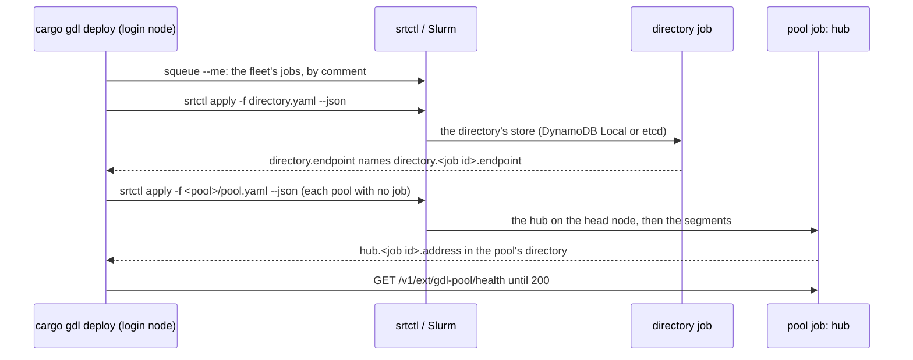

# Deploy a fleet on Slurm

A Slurm site runs each pool of a fleet as one job, which [srt-slurm](https://github.com/NVIDIA/srt-slurm) submits and runs. `cargo gdl slurm` writes the srt-slurm recipes of a fleet's Slurm sites, and the settings each job reads. It needs no Docker, no srt-slurm, and no cluster. `cargo gdl deploy`, run on a login node of the site, writes the recipes there, submits the jobs, and waits for each pool's health; `cargo gdl down` stops the pools again.

The recipes are written for srt-slurm at commit `acfb4dcc`.

## The site and its pools

A Slurm site is a `[cluster.<name>]` table with `kind = "slurm"` ([Deploy a fleet of pools](fleet.md), [reference](../appendix/spec-reference.md#fleettoml)). Its account, default partition, and network interface stay in srt-slurm's `srtslurm.yaml` on the cluster, never in the fleet file.

```toml
[fleet]
name = "api"

[cluster.lab]
kind = "slurm"
region = "slurm-lab"
srtctl = "/shared/srt-slurm"
run_dir = "/shared/gdl-runs"      # a file system the login node and every compute node share
registry = "registry.example/gdl"
platform = "linux/arm64"
time_limit = "08:00:00"

[directory]                       # required: the pools find each other through a directory the site runs
backend = "dynamodb"
records_table = "gdl-pools"
lists_table = "gdl-pool-lists"
local = true
cluster = "lab"                   # the site that runs the directory's job
# or, in place of the four keys above: backend = "etcd"

[pool.model-x-01]
class = "model_x"
cluster = "lab"
parents = "global"
slurm = { partition = "gpu", spare_nodes = 1 }
```

The fleet must have a `[directory]` that the site runs: DynamoDB with `local = true`, or etcd. A child pool's hub under the relay needs its parent's hub's address, which a job learns only once it runs. A Slurm job has no AWS role to reach DynamoDB on AWS with.

## Build the images

The images take gdl as the spec's `[gdl]` names it. The recipes set what the generator's own gdl reads, so pin a gdl at least as recent as the generator, or take it by `path` ([Limitations](../operations/limitations.md#slurm-recipes-need-a-gdl-that-reads-what-they-set)).

```bash
cargo gdl images --spec gdl.toml --fleet fleet.toml --push --out images.json
```

A Slurm site's images are built on the site's `base_image`, `debian:bookworm-slim` unless it says otherwise, and its hub's on its `hub_image`. srt-slurm runs every command under `bash -c`, and the spec's default base image has no shell. A segment's own `[deployment.segment.<name>] base_image` still wins. A Kubernetes cluster that shares the site's registry and platform gets images of its own, on the spec's base. The spec's `[deployment.codegen.<arch>]` table reaches a site's segment images as it reaches a cluster's.

## Render the recipes

```bash
cargo gdl slurm --spec gdl.toml --fleet fleet.toml --images images.json --out slurm
```

`--images` is required: a site pulls each image by its digest. `--tag` looks each image up under another tag, as `cargo gdl k8s --tag` does.

The output has one directory per site, which holds what goes in `<run_dir>/<fleet>/` on the cluster:

```text
slurm/lab/
  directory.yaml               # the DynamoDB Local's job
  model-x-01/
    pool.yaml                  # the pool's job
    join-engine.yaml           # a job that adds an engine instance to the running pool
    deployment.json            # the hub's settings
    engine.toml                # each segment's settings
```

Each recipe is one JSON object, which YAML reads as it is. Each job is named `gdl-<fleet>-<pool>`, `gdl-<fleet>-<pool>-join-<segment>`, or `gdl-<fleet>-directory`, and its sbatch comment says what it is: `gdl:<fleet>:<pool>:pool:<hash>`, `gdl:<fleet>:<pool>:join:<hash>`, or `gdl:<fleet>:-:directory:<hash>`. The hash is the first 16 hex digits of a sha256 of the recipe and the settings it mounts, so the same render gives the same hash. A job's name alone does not tell its kind: a pool may be named `x-join-engine`.

## Deploy the fleet

Run `cargo gdl deploy` on a login node of the site, with the digests file from the machine that built the images:

```bash
cargo gdl deploy --spec gdl.toml --fleet fleet.toml --images images.json
```

It needs `srtctl`, `squeue`, `scancel`, `sacct`, and `curl` on the `PATH`, and the site's `srtctl` checkout and `run_dir` on this machine. It builds nothing, and reads no credential: `srtctl` runs in its checkout and reads the account and partition from that checkout's `srtslurm.yaml`, and Slurm uses your own session. A fleet runs on one kind of site: `deploy` refuses a fleet with both Slurm sites and Kubernetes clusters, and refuses `--allow-pool-restart`, which is for the gdl operator. `--replace` needs Slurm 23.11.6 or later, as `down` does ([Take the fleet down](#take-the-fleet-down)).

The steps run in order, and the first that fails stops the deploy:

1. Check the spec and the fleet, that `squeue` answers, and that the checkout and the run directory are directories on this machine.
2. Render the recipes, as `cargo gdl slurm` does, and list the fleet's jobs with `squeue --me --all --states=all`: by default `squeue` leaves out a suspended job, and a job in a hidden partition, which still hold their nodes and their hubs. Each job's comment, `gdl:<fleet>:<pool>:<kind>:<hash>`, says what it is, so no state file is kept.
3. Reconcile the render with the jobs. A pool, or the directory, whose job runs the same recipe (the same hash) keeps its job. One with no job is submitted. Before anything changes, the deploy refuses two jobs for one pool, whether the fleet still runs it or not, since a second hub of a pool takes the pool's record from the first; a directory job of another recipe, and any pool's job, running or queued, when the directory has no job, since every process reads the store's address once, when it starts (take the fleet down, then deploy it); a job that is ending (`COMPLETING`), whose processes may still run (deploy again once Slurm no longer lists it); and a pool whose job runs another recipe, unless `--replace` is given. With `--replace`, the pool stops as `down` stops it, and its new recipe is submitted. A pool that the fleet no longer runs and whose job is gone has its record withdrawn through a parent's hub here, children first, before anything changes: before `--replace` stops a parent of it ([Take the fleet down](#take-the-fleet-down)).
4. Write the recipes into `<run_dir>/<fleet>/`. A file that has not changed is not written again.
5. Submit the directory's job, with `srtctl apply --json`, when it has none, and wait until the fleet's pointer, `directory.endpoint`, names this job's file. A file left by an earlier directory job is never read.
6. Submit each pool's job that has none.
7. Stop each pool that the fleet no longer runs, as `down` stops it.
8. Wait until each pool's hub answers 200 on `/v1/ext/gdl-pool/health`. Each read lists the fleet's jobs once and watches every job the deploy waits on, the directory's and those of pools already ready too: one that ends or is ending (`COMPLETING`) meanwhile stops the deploy at once, with the job's id, the state `sacct` gives, and where its logs are.



A second deploy of an unchanged fleet submits nothing. After a deploy that stopped part way, run it again: it keeps what it submitted, and submits only what is missing.

Each pool's hub writes `<public address> <control address>` to `hub.<job id>.address` in its pool's directory before it starts. `deploy` and `down` call the hub's routes at those addresses with `curl`. Where the login node cannot reach the compute nodes, set `reach = "srun"` on the site: each call then runs as a step of the pool's job, `srun --jobid=<job> --overlap --nodes=1 --ntasks=1 --quiet curl ...`, and needs `curl` on the compute nodes.

Every command has a time limit: 300 s for each `srtctl`, `squeue`, `scancel`, and `sacct`, and what is left of its wait for a hub's route. The wait for the directory's pointer and the wait for health are each 600 s. A job that waits in Slurm's queue for longer stops the deploy: run it again once the job runs, and it keeps the job.

## Take the fleet down

```bash
cargo gdl down --fleet fleet.toml
```

`down` stops the fleet's pools children first, one level at a time, across the fleet:

1. It cancels each job that waits to join the pool (`PENDING`), with `scancel --state=PENDING --ctld`, so that the controller applies the filter as it cancels: the pool will have no hub to join. A joiner that starts meanwhile is left to the pool's drain, and cancelled with the pool.
2. A pool with a parent drains: `POST /v1/ext/gdl-pool/drain` on its hub, then a wait until its hub's `/v1/ext/gdl-pool/withdrawn` says that the directory holds its withdrawal. Then `scancel` cancels its job, and the jobs that joined it.
3. A pool with no parent, such as a global pool, cannot drain: its hub refuses a drain. `scancel --signal=TERM` goes to each of its segments' steps, not its hub's, and to each job that joined it, once, so that each instance retires and leaves: a second `SIGTERM` would stop an instance at once and cut its drain. Once its hub lists no instance on `/v1/ext/gdl-pool/instances`, `scancel` cancels its job.
4. A pool's job that still waits in the queue has no hub and no record, and one that is ending (`COMPLETING`) is being stopped: each is cancelled at once. A waiting job is cancelled only while it still waits: one that starts after it was listed is left running, undrained, and `down` stops; run it again to drain it.
5. A pool whose job is gone, because it was killed, preempted, or lost with its hub's node, has a recipe in the fleet's directory but no job in `squeue`. Its record may still be in the directory, where its parents hold it as missing. If the pool has a parent, `down` withdraws the record once, through the hub of a running pool of its parent's class, its `home` first. The call is `POST /v1/ext/gdl-pool/children/<class>/<pool>/withdraw` on that hub's control port. Under DynamoDB and etcd, no parent's hub holds the record. So the parent's hub writes the withdrawal in the directory, at an epoch past the pool's last record, and answers 204 once the directory has stored it. A hub that holds no record of the pool answers 404, and the next pool of the class is asked: the pool's recipe is the last render, which may name another home than the one its job ran under. When none holds a record, for example after an earlier withdrawal, nothing is left to withdraw. A hub that still hears the pool, within its record's lease on the hub's own clock, refuses with 409 and how long until the lease passes: `down` says so, waits that long, at most one lease, lists the jobs again, and asks once more. A pool whose hub has just died is then withdrawn. A pool submitted again during the wait is not: `down` stops, as for a pool submitted again before the withdrawal. A pool still heard, such as one that another user's job runs, which `squeue --me` does not list, stops `down` before any pool above it stops, with one line that names the pool. Any other answer stops `down` the same way. If no parent's hub runs, `down` names the pool and goes on ([Limitations](../operations/limitations.md#a-pool-whose-job-is-gone-keeps-its-record-while-no-parents-hub-runs)).

The directory's job goes last, once no hub uses it. Each cancel waits, up to 300 s, until `squeue` no longer lists the job, `COMPLETING` included. A job that ended before its `scancel` or its `SIGTERM` reached it is passed over. The fleet's directory on the shared file system stays. `down` refuses a pool with two jobs, and a pool whose job runs but whose hub has not written its address yet, which cannot drain; it cancels nothing then.

A deploy's prune and `--replace` stop a pool the same way. Before it changes anything, a deploy also withdraws the record of a pool that the fleet no longer runs and whose job is gone. A pool that the fleet still runs and whose job is gone is submitted again, and its new hub's record replaces the old one.

`down` and `--replace` need Slurm 23.11.6 or later. Before they change anything, they read `scancel --version`, and refuse an older Slurm, or a version they cannot read, in one line that names what they read and the version they need. Before 23.11.6, `scancel --ctld --state=PENDING` filters a listing of its own and then cancels by id, so a pool's job that starts in between would be cancelled while it runs, undrained. A deploy without `--replace` reads the version only when its prune cancels a job that waits in the queue ([Limitations](../operations/limitations.md#down-and---replace-need-slurm-23116-or-later)).

## A pool's job

A pool's recipe has no frontend (`frontend.type: none`) and these services, which srt-slurm starts in order:

- `hub`, on the head node: `critical` and `terminal`, so the job ends when the hub exits. It is ready when its own `/v1/health` answers 200 on port 1337. It publishes `{node_ip}:1337` as its pool's hub, and drains its pool on the first `SIGTERM` (`GDL_POOL__DRAIN_ON_STOP=true`, for the pool's `stop_wait_ms`). Before it starts, it writes `{node_ip}:1337 {node_ip}:8337` to `hub.<job id>.address` in the pool's directory, where `cargo gdl deploy` and `down` read where to reach it; a hub that cannot write the file does not start. The job's teardown removes the file.
- one service per segment of the pool's class, in name order, on nodes of its own: one instance per node, as many as the pool's `ready` count. Each finds its hub at `{head_ip}` and gives velo `{node_ip}:0`, a port the OS chooses. A segment with `ready` 0 has no service.
- `spare`, when the pool has `slurm.spare_nodes`: a placeholder that holds those nodes for segments that join inside the job.

Each segment's preamble sets `GLIBC_TUNABLES=glibc.malloc.hugetlb=0` when the job's environment has none, and keeps the user's value when it has one ([Binary](../appendix/spec-reference.md#binary)).

Each segment instance is ready when its system listener answers `/live`, not `/health`. srt-slurm starts one instance at a time and waits for each probe before the next. An instance answers `/health` only once every segment of its class has instances, so a class of two segments would wait forever. `crates/gdl-gen/tests/slurm.rs` starts such a class in srt-slurm's order, and shows the wait on `/health`. The pool's health is its hub's `/v1/ext/gdl-pool/health`.

The job mounts `<run_dir>/<fleet>/<pool>` at `/gdl`. srt-slurm requires a model, so `model.path` is `<run_dir>/<fleet>`, which its preflight requires to be a directory, and nothing reads it.

Every job takes its nodes whole (`exclusive`) and keeps the default ports: 1337 and 8337 for the hub, 9090 for each segment's system listener. A pool's record carries only its hub's public port, so a joiner cannot learn a moved control port, and two jobs on one node would bind the same ports. Inside a job, the hub shares the head node with the first instance of the first segment. The render refuses a node where two processes would bind one port.

A pool's job also carries `no-requeue`, `signal: TERM@<signal_lead_s>`, and `no-kill` unless the site turns it off. A requeued job keeps its id, so an old endpoint file of the directory's would look fresh, and a requeued hub would restart with no registrations.

## Leaving by the job's end time

Each process of a pool's job, and of a joining job, knows when the job ends, and drains before then ([A known leave time](../concepts/lifecycle.md#a-known-leave-time)):

- The job's `host_setup` runs on each node's host before any service starts. It writes the job's end time, in Unix seconds, to `job.<job id>.end` in the pool's directory: `SLURM_JOB_END_TIME` where the cluster's Slurm sets it, else the end `squeue -h -j <job id> -o %e` gives. With neither, as for a job with no time limit, it writes an empty file. Its `teardown` removes the file.
- Each segment instance's preamble reads the file as `[runtime] leave_by` (`GDL_RUNTIME__LEAVE_BY`, in milliseconds). It starts to drain `drain_ms` and `leave_margin_ms` (30 s) before then.
- The hub's preamble reads it as `[pool] leave_by` (`GDL_POOL__LEAVE_BY`), which it reads since it drains on stop. It starts the pool's drain `stop_wait_ms` and `leave_margin_ms` before then: with the defaults, 690 s before the end, 60 s ahead of its instances (`drain_ms` 600 s).

With the default `signal_lead_s`, 900 s, Slurm's `TERM` comes first, and starts the same drains. The leave time drains the job when no signal comes. A recipe's `host_setup` replaces the cluster's `default_host_setup` in `srtslurm.yaml` ([Limitations](../operations/limitations.md#a-slurm-recipe-replaces-the-clusters-default-host-setup)).

## The directory's job

`directory.yaml` runs DynamoDB Local, pinned by digest, on a node of its own, and then the `tables` step beside it. The step removes this job's old endpoint file, runs `gdl-hub --tables`, and only then writes `http://{node_ip}:8000` to `<run_dir>/<fleet>/directory.<job id>.endpoint`, for the tool that submitted the job, and then points `<run_dir>/<fleet>/directory.endpoint`, the fleet's pointer, at that file: a link, written beside its place and renamed into it, so the latest directory job's pointer wins. When the job ends, its teardown removes its own file alone. A pointer to it then dangles, which a process reads as no address, and a later job's pointer is never touched.

Under `backend = "etcd"`, `directory.yaml` runs srt-slurm's own `etcd` service on the head node, with `--auto-compaction-mode=periodic --auto-compaction-retention=1h` and `--quota-backend-bytes=8589934592` as its `args` ([Running etcd for the directory](../concepts/pools.md#running-etcd-for-the-directory)). srt-slurm runs etcd from `/configs/etcd`, v3.5.21, in the job's container, and gives clients the node's IP. It keeps etcd's data on the node's own disk and starts each job with it empty, so the directory lasts as long as the job, as an in-memory Local does. The job ends when etcd does. srt-slurm starts the job's other services only once etcd's port answers. Then the `pointer` step writes `http://{node_ip}:2379` to the job's endpoint file and the fleet's pointer, as the `tables` step does, with no step before it: etcd needs no tables.

No recipe holds the store's address. Each pool's and joining job's processes mount `<run_dir>/<fleet>` read-only at `/fleet`, and their preambles read the pointer when they start: as `GDL_POOL__ENDPOINT` under DynamoDB, and as the one member of `GDL_POOL__ENDPOINTS` under etcd. A process with no pointer, or one that is not `http://<host>:<port>`, does not start, and says so in one line that names the file. So a new directory job moves no pool's recipe hash. A hub keeps the address it started with: after a new directory job, stop the pools and submit them again.

The store runs on the Slurm site of every Slurm pool, since a job reads the pointer from its own site's `run_dir`: `cargo gdl slurm` refuses a `[directory] cluster` that is another cluster.

The directory's job takes no `signal`. Each pool withdraws its record from the directory as it drains, on the signal before its own time limit. Run the directory's job on a partition with a longer time limit than its pools'.

## A segment that joins a running pool

`join-<segment>.yaml` adds one instance of a segment to a running pool, as a job of its own. Its `resolve` service runs `gdl-hub --resolve <class>/<pool> --write /logs/gdl-hub.toml` when the job starts, not when it is queued, since a queued job may outlive the hub it was queued for. Then the segment starts with that file over its settings. It has no `GDL_HUB__HOST`, which would override the file. The segment is `terminal`, so the job ends when it leaves.

`resolve` waits once it has written the file. srt-slurm probes the file, then asks whether the process still runs: a `resolve` that exited between the two would fail the job. `resolve` is not `critical`: the job's `TERM` before its time limit ends its wait, and srt-slurm would take a critical service's end on a signal as a failure, and cut the segment's drain short. A `resolve` that fails before it writes the file still fails the job, through its probe.

## Apply the recipes by hand

`cargo gdl deploy` does these steps, and more; by hand, they show what a job runs.

1. Copy `slurm/<site>/` to `<run_dir>/<fleet>/` on the cluster.
2. On the login node, submit the directory's job, and wait for its endpoint file:

   ```bash
   srtctl apply -f <run_dir>/<fleet>/directory.yaml --json
   cat <run_dir>/<fleet>/directory.<job id>.endpoint
   ```

3. Submit each pool's job, in any order, and wait for its health:

   ```bash
   srtctl apply -f <run_dir>/<fleet>/<pool>/pool.yaml --json
   curl -s http://<hub node>:1337/v1/ext/gdl-pool/health   # 200 once the pool is ready
   ```

Pyxis pulls a registry's image named as `<registry host>#<path>/<repository>@<digest>`, and the recipes name each image that way.

## Check the recipes with srt-slurm

```bash
bash scripts/slurm-dry-run.sh            # every pinned recipe
bash scripts/slurm-dry-run.sh slurm/     # the recipes a render wrote
```

The script runs `srtctl dry-run` on each recipe, at the pinned srt-slurm commit, fetched through uv, with a placeholder `srtslurm.yaml`. A recipe srt-slurm refuses fails it. `srtctl dry-run` submits nothing. The pinned recipes are `crates/gdl-gen/tests/fixtures/slurm/out`.
