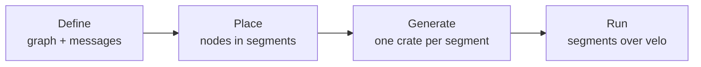

# Introduction

dynamo-gdl (gdl) is a graph definition language and runtime for request/response streaming pipelines. A request goes into a graph of nodes, and a stream of items comes back. The same graph runs in one process, or split into segments that run as separate programs and talk over [velo](https://github.com/ai-dynamo/velo).

gdl is experimental. Its design and tests are still in progress, and its APIs are not stable.

## The four steps

1. **Define** the graph once: its nodes, its topology, and the message type on every edge. A node has a role (source, operator, forward, sink, or backward) but no implementation. See [The graph model](concepts/model.md) and [Define a graph](guides/define-a-graph.md).
2. **Place** the nodes. A placement config assigns each node to a segment, and a segment is one process. See [Specs, segments, and layouts](concepts/placement.md).
3. **Generate** one crate per segment. A segment crate links only the implementations of the nodes placed in it, so a segment of CPU nodes never links the dependencies of a GPU node. See [Code generation](concepts/generation.md).
4. **Run** the segments. Inside a segment, a hop is a plain function call. Between segments, a request travels as a velo active message and a response travels as a velo stream. See [Crossing segments](concepts/crossings.md).

The graph and the node code do not change when the placement does. A graph with one segment is the local graph.

## `gdl` and `gdl-runtime`

gdl is two layers, and a crate depends on one of them:

- A crate that implements nodes depends on `gdl`. It has the role traits, the request context, selectors, the derives, and local composition, so a node crate can run its nodes in one process. It never links velo.
- A crate that runs a graph depends on `gdl-runtime`. It has segments, crossings over velo, discovery, and the segment binaries. Contract crates, generated segment crates, and programs that run a graph use it. It re-exports the `gdl` it was built with as `gdl_runtime::gdl`.

The derives expand to `::gdl::...`, so a crate that uses one depends on `gdl` itself, also when it depends on `gdl-runtime`. See [Architecture](development/architecture.md) for the reason, and for the other crates.

## What gdl adds to velo

- **Streams in both directions.** Every response is a stream, and a request can carry a stream of items. See [Streamed requests](concepts/streamed-requests.md).
- **Deadlines, stop, and cancel** that cross segments. See [Requests, attempts, and deadlines](concepts/requests.md).
- **Admission and egress limits** per instance. See [Admission and egress](concepts/admission.md).
- **Live rosters.** Instances join, retire, and drain while the others serve. See [Segment lifecycle](concepts/lifecycle.md).
- **Routing between replicas** by round robin, random, or a selector you write. See [Routing, selectors, and offers](concepts/routing.md).
- **Cells.** One graph across several deployments, each with its own hub. See [Classes and cells](concepts/cells.md).
- **Health and metrics** in the shape dynamo expects. See [Health and metrics](operations/observability.md).

## Where to go next

- Run a graph: [Getting started](guides/getting-started.md), then [Run the examples](guides/examples.md).
- Write a graph and its nodes: [Define a graph](guides/define-a-graph.md) and [Write nodes](guides/write-nodes.md).
- Split and deploy it: [Split, generate, and draw](guides/split-and-generate.md) and [Deploy with Docker Compose](guides/compose-deploy.md).
- Draw it in a browser: [Compose in the browser](guides/composer.md).
- Know the edges: [Known limitations](operations/limitations.md).
- Learn the words: the [Glossary](appendix/glossary.md).
