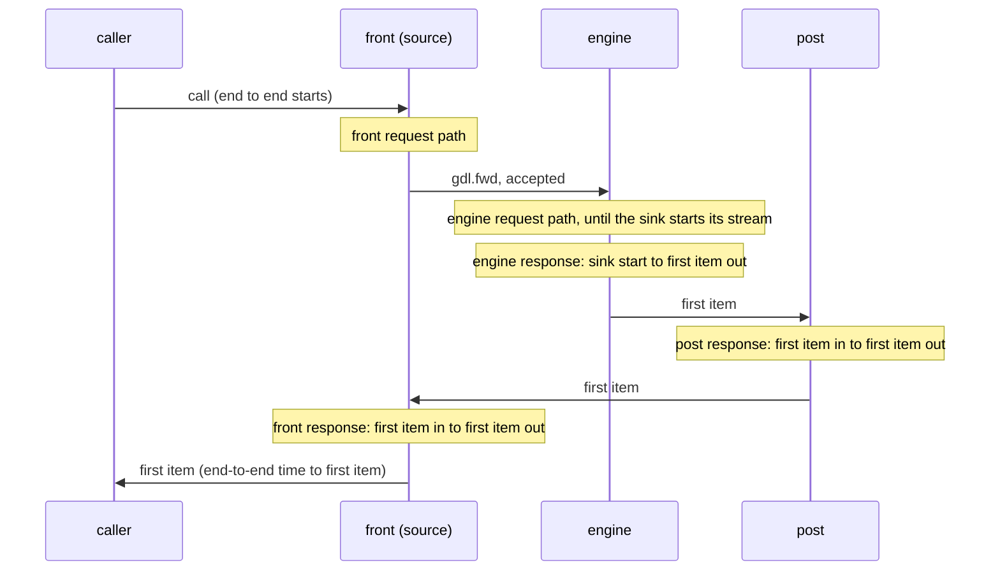

# Health and metrics

A segment process can run a system listener. It answers dynamo's live and health probes and serves Prometheus metrics, on dynamo's paths and port variables. The dynamo operator's probes and scrape configuration therefore find a gdl segment as they find a dynamo worker. This chapter covers the listener's settings, the probe contract, and how to read the runtime's figures. [Metrics reference](../appendix/metrics.md) lists every name, label, and bucket.

## The system listener

The `[system]` table of a segment's settings configures the listener. It is off unless `port` is set. Instances that share a host would collide on any default port.

| Key | Default | Meaning |
|---|---|---|
| `host` | `0.0.0.0` | The address to bind. |
| `port` | `-1` | The port. Negative is no listener. `0` is an ephemeral port. |
| `live_path` | `/live` | The live probe's path. |
| `health_path` | `/health` | The health probe's path. |
| `metrics_prefix` | `dynamo_component` | The prefix of every metric name. Empty for none. |

dynamo's variables `DYN_SYSTEM_HOST`, `DYN_SYSTEM_PORT`, `DYN_SYSTEM_LIVE_PATH`, and `DYN_SYSTEM_HEALTH_PATH` set the same keys. No other `DYN_` variable is read. The settings files come first, then the `DYN_SYSTEM_*` variables, then the `GDL_SYSTEM__*` variables, and a later source wins. [Segment settings](configuration.md) describes the files and the `GDL_` variables.

A segment refuses to start when:

- `port` is above 65535;
- a probe path does not start with `/` or holds a space;
- the two probe paths are the same, or either one is `/metrics`;
- `metrics_prefix` is not empty and is not letters, digits, `_`, and `:`, starting with a letter, `_`, or `:`.

The listener reads HTTP by hand: one request per connection, and only `GET`. It answers at most 64 connections at once. A request head over 8 KiB gets 431, and a head not sent within 5 s gets 408. Another path gets 404, and another method gets 405.

## The probes

| Path | 200 | 503 |
|---|---|---|
| `GET /live` | from the moment the process starts | never |
| `GET /health` | while the instance serves: after the barrier, before a stop or a lost lease | otherwise |

Both bodies are dynamo's JSON with gdl's phase added:

```json
{"status":"ready","uptime":12.345,"phase":"ready"}
```

`status` is `ready` or `notready`. `phase` is `starting`, `ready`, or `draining`. Draining is final: a process that began to drain does not become ready again. The listener stays up through the drain, so the probes see it. [Segment lifecycle](../concepts/lifecycle.md) defines the phases, the barrier, and the drain.

`<binary> --healthcheck <config.toml> [override.toml ...]` asks a running instance's health path and exits with success only on 200. It reads the same settings as the instance. It dials loopback when the host is unspecified, so an image needs no HTTP client. It refuses a missing listener and port `0`, and it waits at most 5 s for the answer.

## `/metrics`

`GET /metrics` answers in Prometheus text format (`text/plain; version=0.0.4`). The process has one registry. It is made once the deployment is known and before the nodes are built. Until then the answer is 200 with an empty body: a 503 would mark the scrape target as down.

The registry holds:

- `uptime_seconds`, read at each scrape;
- each node's own metrics, and each selector's, registered before `build` (see [Define node metrics](../guides/node-metrics.md));
- the runtime's figures for each segment a request passes through.

The identity labels are applied when the registry gathers, in a hash map's order. Parse the text in tests. Do not compare it as a string.

A segment binary records the runtime's figures only while its listener is on: with no listener, nobody can read them. A node's own metrics are still built and counted. A program that embeds a segment turns recording on by setting `RuntimeConfig::metrics`.

## Reading the runtime's figures

The runtime records figures per segment, not per node. A *visit* is one request's pass through one segment. A visit has a request part, a response part, or both. Each figure is labelled with `dynamo_endpoint`, the node where the visit entered the segment.



- **The parts add up.** The front's request path, the engine's request path, the engine's time to its first item, and the time each later segment adds to it sum to the end-to-end time to the first item, less the wire and the waits for acknowledgements.
- **The request path** runs from arrival until the segment sends the request on, or until a sink here starts its stream. A sent request's span is recorded once it is accepted, and the wait for the acceptance is not part of it. A request refused at admission records nothing in the refusing segment. The sender counts the refusal, as `overloaded`.
- **A response's clock** starts at its first item from another segment. Without one, it starts where a sink here started its stream, or where its backward run activated.
- **`inflight_requests`** counts each visit until the segment has nothing left to do for it. A visit that waits counts too: queued at a held roster, waiting for activation, or held by a consumer that does not read. At the source's endpoint, it is the number of requests in flight in the graph.
- **An error is counted once**, in the segment that raised it. A segment that relays the error from another segment does not count it. The end-to-end counter counts each request's outcome once.
- **A dropped response** is a cancellation, or `deadline_exceeded` once the deadline has passed.
- **Nothing is counted per item.**

Known gaps in these rules are in [Known limitations](limitations.md): a deadline can count in two segments when their clocks pass together, an operator's recovered error inside one segment counts nowhere, a streamed request's input error counts where it enters a response, and after a cancel the source can hold a request in flight until its caller reads.

dynamo's `request_duration_seconds` spans the whole handler, its stream included. gdl splits that span into the request path and the response path. So gdl does not emit the name, and reserves it. `error_type` holds gdl's error kinds, not the names of dynamo's handler steps (`generate`, `deserialization`). A dashboard keyed on dynamo's values needs an adapter. [Metrics design](../development/metrics-design.md) records why the figures take this shape. [Runtime feature costs](feature-costs.md) holds what recording costs.

## Logs

A segment binary writes the `tracing` events of its nodes, its cell policies, and the runtime to stderr, one line per event. `RUST_LOG` sets the filter, with the `EnvFilter` syntax: a level (`info`), or levels per target (`warn,gdl_runtime=debug`). Without `RUST_LOG`, the level is `warn`. A directive that does not parse is ignored, and the others still apply. Under Docker Compose, `docker compose logs <service>` shows the lines. Set `RUST_LOG` in the service's `environment` with an override file (`docker compose -f compose.yaml -f logs.yaml up`): a new bundle writes `compose.yaml` again.

```text
2026-10-26T15:30:27.098937Z  WARN policy_router: no cell serves the model model="mistral"
```

The hub binary, `gdl-hub`, writes its own events to stderr by the same rules: `RUST_LOG`, `warn` by default, no colour. Its events include a cell record the directory did not take and a cell directory's watch that failed. `docker compose logs hub` shows them.

```text
2026-10-26T20:12:25.214550Z  WARN gdl_hub::cell::publish: the directory refused the cell's record as not newer held=(epoch 1793045545212, seq 1) offered=(epoch 1793045545208, seq 2)
```

Each binary's `main` installs the subscriber, not `gdl-runtime` or the `gdl-hub` library. A program that deploys a segment through the generated library, or serves a hub through `gdl-hub`, installs its own subscriber, or none. The output goes to stderr because a source segment that serves JSON lines answers on stdout. The lines have no colour codes, which would show as noise in a container's log, even when another crate turns on `tracing-subscriber`'s `ansi` feature. Records of the `log` crate are not shown, unless another crate turns on `tracing-subscriber`'s `tracing-log` feature ([limitations](limitations.md#a-segment-binary-does-not-show-records-of-the-log-crate)).

`filter::Targets` parses the same per-target levels without the regular-expression crates that `EnvFilter` needs. It was not chosen: it drops span and field directives, and one bad directive drops the whole filter. The cost of `EnvFilter` is small next to a segment's build. In a binary that only installs the subscriber and logs one event, `EnvFilter` adds 3 crates (`matchers`, `regex-automata`, and `regex-syntax`), 3 s to a cold release build (7.45 s against 4.50 s, `cargo build --release -j 4` on a 20-core aarch64 host), and 0.76 MB to the binary (1.55 MB against 0.79 MB).
