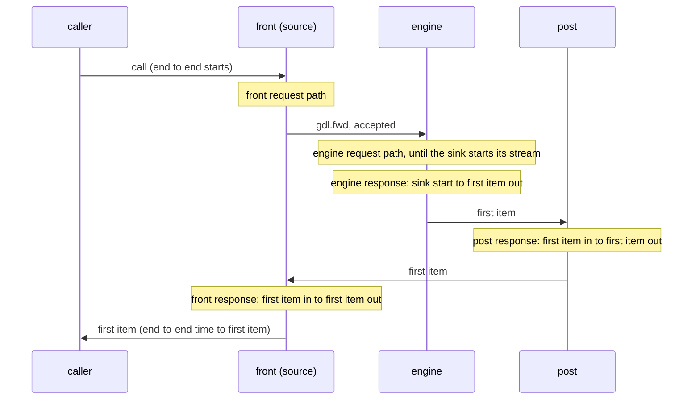

# Health and metrics

A segment process can run a system listener. It answers dynamo's live and health probes and serves Prometheus metrics, on dynamo's paths and port variables. The dynamo operator's probes and scrape configuration therefore find a gdl segment as they find a dynamo worker. This chapter covers the listener's settings, the probe contract, and how to read the runtime's figures. [Metrics reference](../appendix/metrics.md) lists every name, label, and bucket.

## The system listener

The `[system]` table of a segment's settings configures the listener. It is off unless `port` is set. Instances that share a host would collide on any default port.

| Key | Default | Meaning |
|---|---|---|
| `host` | `0.0.0.0` | The address to bind. |
| `port` | `-1` | The port. Negative is no listener. `0` is an ephemeral port. |
| `live_path` | `/live` | The live probe's path. |
| `health_path` | `/health` | The health probe's path. |
| `metrics_prefix` | `dynamo_component` | The prefix of every metric name. Empty for none. |
| `velo_metrics` | `false` | Also serve velo's own metrics ([velo's own metrics](#velos-own-metrics)). |

dynamo's variables `DYN_SYSTEM_HOST`, `DYN_SYSTEM_PORT`, `DYN_SYSTEM_LIVE_PATH`, and `DYN_SYSTEM_HEALTH_PATH` set the same keys. No other `DYN_` variable is read. The settings files come first, then the `DYN_SYSTEM_*` variables, then the `GDL_SYSTEM__*` variables, and a later source wins. [Segment settings](configuration.md) describes the files and the `GDL_` variables.

A segment refuses to start when:

- `port` is above 65535;
- a probe path does not start with `/` or holds a space;
- the two probe paths are the same, or either one is `/metrics`;
- `metrics_prefix` is not empty and is not letters, digits, `_`, and `:`, starting with a letter, `_`, or `:`;
- `metrics_prefix` is `velo` or starts with `velo_`, with `velo_metrics` on or off. The runtime's names would then be served under names that start with `velo_`, as velo's are: `velo_streaming` serves `active_anchors` as velo's `velo_streaming_active_anchors`. The error names the prefix and the first such name. The process refuses it when it makes its registry.

The listener reads HTTP by hand: one request per connection, and only `GET`. It answers at most 64 connections at once. A request head over 8 KiB gets 431, and a head not sent within 5 s gets 408. Another path gets 404, and another method gets 405.

## The probes

| Path | 200 | 503 |
|---|---|---|
| `GET /live` | from the moment the process starts | never |
| `GET /health` | while the instance serves: after the barrier, before a stop or a lost lease | otherwise |

Both bodies are dynamo's JSON with gdl's phase added:

```json
{"status":"ready","uptime":12.345,"phase":"ready"}
```

From the start's first request to its hub until that wait ends (the hub admits or refuses the instance, `hub_wait_ms` runs out, or a stop ends the start), the body adds `"waiting":"hub"`:

```json
{"status":"notready","uptime":3.210,"phase":"starting","waiting":"hub"}
```

`status` is `ready` or `notready`. `phase` is `starting`, `ready`, or `draining`. Draining is final: a process that began to drain does not become ready again. The listener stays up through the drain, so the probes see it. [Segment lifecycle](../concepts/lifecycle.md) defines the phases, the barrier, and the drain.

`<binary> --healthcheck <config.toml> [override.toml ...]` asks a running instance's health path and exits with success only on 200. It reads the same settings as the instance. It dials loopback when the host is unspecified, so an image needs no HTTP client. It refuses a missing listener and port `0`, and it waits at most 5 s for the answer.

## `/metrics`

`GET /metrics` answers in Prometheus text format (`text/plain; version=0.0.4`). The process has one registry. It is made once the deployment is known and before the nodes are built, and served once nothing more registers in it: after the launch, when the segment is made and before it serves. Until then the answer is 200 with an empty body: a 503 would mark the scrape target as down. So a scrape during startup shows no metrics, not even `uptime_seconds`. A program that embeds a segment serves its registry with `Process::serve_metrics`.

The registry holds:

- `uptime_seconds`, read at each scrape;
- `instance_phase`, the phase the probes report, one series for each phase, read at each scrape;
- `instance_avoided`, whether a retired entry instance's hub has said that the pools that follow its pool avoid it, read at each scrape;
- what the instance holds now: the roots in its admission ledger, its admission limit, its egress permits in use, and its open anchors, read at each scrape ([Reading a drain](#reading-a-drain));
- each node's own metrics, and each selector's, registered before `build` (see [Define node metrics](../guides/node-metrics.md));
- the runtime's figures for each segment a request passes through;
- in a chooser, what became of each offer to a pool, by pool and outcome ([A chooser's pool families](../appendix/metrics.md#a-choosers-pool-families)).

Beside the registry, `/metrics` serves the process's own figures ([The process's own figures](#the-processs-own-figures)), and under `velo_metrics` velo's ([velo's own metrics](#velos-own-metrics)), with the same identity labels but never the prefix.

The listener gathers the registry on a blocking thread, so a node's `ScrapeGaugeVec` closure does not run on a runtime worker. A scrape answered with 503 for its time still runs until its closures return. Up to 4 scrapes run at once, enough for an HA pair of Prometheus servers and a person. Each runs the closures on vectors of its own, so their values do not mix. A scrape that takes longer than 5 s is answered with 503 and the reason. A scrape that finds 4 running is answered with 503 at once ("a scrape is in progress"). Waiting, it would hold one of the listener's 64 connections, and enough waiting scrapes would keep the probes from being answered. A closure that panics is answered with 500.

The identity labels are applied when the registry gathers, in a hash map's order. Parse the text in tests. Do not compare it as a string.

A segment binary records the runtime's figures only while its listener is on: with no listener, nobody can read them. A node's own metrics are still built and counted. A program that embeds a segment turns recording on by setting `RuntimeConfig::metrics`.

## The process's own figures

Every segment and every pool's hub serves figures of its own process, read when `/metrics` is scraped, so nothing runs on the request path. A segment serves them beside its registry, with its identity labels. A hub serves them on its metrics route, with no labels. Neither adds a prefix, so the names are the same in every component, and dashboards built for the Prometheus client libraries read them as they are.

- **The process**, from prometheus's process collector, on Linux only: `process_cpu_seconds_total`, `process_resident_memory_bytes`, `process_virtual_memory_bytes`, `process_open_fds`, `process_max_fds`, `process_threads`, and `process_start_time_seconds`.
- **Its cgroup**, from the cgroup v2 files of the process's own cgroup, which `/proc/self/cgroup` names: CPU use and throttling from `cpu.stat`, the quota from `cpu.max`, and memory from `memory.current` and `memory.peak` ([A process's own figures](../appendix/metrics.md#a-processs-own-figures)).

No family appears twice in one scrape: a node metric whose prefixed name is one of these figures' is refused when it registers ([Reserved names](../appendix/metrics.md#reserved-names)).

A figure that cannot be read is left out, and the scrape goes on: under cgroup v1, off Linux, or when a file is missing or unreadable. `cpu.stat` always has the usage keys, and the throttling keys only where the cgroup's CPU controller is on, as it is for a container with a CPU limit. A quota of `max` is no quota: `process_cgroup_cpu_quota_cores` is absent.

**A segment's real CPU need under a limit.** A process limited to a CPU quota uses at most its quota in CPU seconds, however much more it needs. Throttled time is the rest. Read the need over a window as the cgroup's CPU use plus its throttled time, both to the microsecond:

```promql
rate(process_cgroup_cpu_usage_seconds_total[1m]) + rate(process_cgroup_cpu_throttled_seconds_total[1m])
```

The cgroup is the container's, so in a pod of one container its use is the process's. CPU per request is the use's rate over the rate of the requests the segment served. The first term alone flattens at `process_cgroup_cpu_quota_cores`. A window in which `process_cgroup_cpu_throttled_periods_total` rises is capped: the process waited for its quota, and its latency includes the wait. `process_cgroup_memory_peak_bytes` is the most the cgroup has held since it started, so a step of a load test reads its peak against a fresh process, or as the rise over the step.

`process_cpu_seconds_total` counts whole seconds: prometheus's collector rounds the kernel's ticks down. Where the cgroup's figures exist, read `process_cgroup_cpu_usage_seconds_total` instead. Otherwise read the process's as a rate over a minute or more.

## velo's own metrics

With `[system] velo_metrics = true`, a segment also serves the metrics of its velo node: its transport, messenger, streams, and mux, under velo's own names (`velo_streaming_active_anchors`, `velo_transport_active_connections`, `velo_streaming_mux_staged_records`). Each family's help text in the scrape says what it counts. They carry the segment's identity labels and never its prefix, as the process's own figures do, so dashboards built for velo read them as they are. The setting needs the listener: without it, velo records nothing.

They are off by default because velo records them per frame and per handler call: each request pays for them ([velo's own metrics](feature-costs.md#velos-own-metrics) has the numbers). [Reading a drain](#reading-a-drain) needs none of them.

No family appears twice in one scrape. A node metric whose served name starts with `velo_` is refused when the segment binary builds, with the setting on or off ([Reserved names](../appendix/metrics.md#reserved-names)).

## Reading the runtime's figures

The runtime records figures per segment, not per node. A *visit* is one request's pass through one segment. A visit has a request part, a response part, or both. Each figure is labelled with `dynamo_endpoint`, the node where the visit entered the segment.



- **The parts add up.** The front's request path, the engine's request path, the engine's time to its first item, and the time each later segment adds to it sum to the end-to-end time to the first item, less the wire and the waits for acknowledgements.
- **The request path** runs from arrival until the segment sends the request on, or until a sink here starts its stream. A sent request's span is recorded once it is accepted, and the wait for the acceptance is not part of it. A request refused at admission records nothing in the refusing segment. The sender counts the refusal, as `overloaded`.
- **A response's clock** starts at its first item from another segment. Without one, it starts where a sink here started its stream, or where its backward run activated.
- **`inflight_requests`** counts each visit until the segment has nothing left to do for it. A visit that waits counts too: queued at a held roster, waiting for activation, or held by a consumer that does not read. At the source's endpoint, it is the number of requests in flight in the graph.
- **An error is counted once**, in the segment that raised it. A segment that relays the error from another segment does not count it. The end-to-end counter counts each request's outcome once.
- **A dropped response** is a cancellation, or `deadline_exceeded` once the deadline has passed.
- **Nothing is counted per item.**

Known gaps in these rules are in [Known limitations](limitations.md): a deadline can count in two segments when their clocks pass together, an operator's recovered error inside one segment counts nowhere, a streamed request's input error counts where it enters a response, and after a cancel the source can hold a request in flight until its caller reads.

dynamo's `request_duration_seconds` spans the whole handler, its stream included. gdl splits that span into the request path and the response path. So gdl does not emit the name, and reserves it. `error_type` holds gdl's error kinds, not the names of dynamo's handler steps (`generate`, `deserialization`). A dashboard keyed on dynamo's values needs an adapter. [Metrics design](../development/metrics-design.md) records why the figures take this shape. [Runtime feature costs](feature-costs.md) holds what recording costs.

## Reading a drain

A stopped instance drains: it takes no new work and finishes what it holds ([Segment lifecycle](../concepts/lifecycle.md)). The drain is complete only when the instance's own drain completes: when its process exits. `/metrics` shows the drain's progress, not its end. Each series is read from what the instance already counts, so a request does no work for them:

| Series | What it shows |
|---|---|
| `instance_phase{phase="draining"}` | 1: the instance was stopped and takes no new work. Draining is final |
| `instance_avoided` | 1: for a retired entry instance of a pool, its hub has said that the pools that follow its pool avoid it, so no chooser of theirs offers it work from here on. An offer that reaches it after this reads 1 broke that promise |
| `admission_admitted` | Root requests that entered through a crossing and are still held, each until velo has handed on every stream the instance sent for it |
| `egress_in_use` | Streams the instance produces, each until velo holds none of its output |
| `active_anchors` | Streams still to arrive here |
| `inflight_requests` at the source's endpoint | Requests the instance's source called and has not finished: local work that admission does not see |

These can all read 0 while the instance still holds work, so 0 is not a signal to delete it:

- **A source's own requests** do not pass through admission or egress. A request that a source calls in its own segment, with every node local, opens no anchor either. Only `inflight_requests` at the source's endpoint counts it.
- **`inflight_requests` falls when the graph's stream ends,** not when the source has answered its caller. A source that collects the whole response before it answers, as the HTTP example's collected answer does, still writes the answer after the gauge reads 0.
- **A body may hold work that gdl does not see,** such as a connection that has not yet called the graph.

`admission_limit` is the instance's admission limit, so `admission_admitted` over it is the instance's load.

`inflight_requests` falls before the ledger does for a request that crosses: a visit leaves it when its response ends here, while the request keeps its admission share and its egress permit until velo's `StreamSender::retired()` resolves, until the consumer has read the stream's last output or left. The instance's own drain waits for the ledger.

The four counts are on only while the runtime records its figures: in a segment binary, while its system listener is on. `instance_phase` and `instance_avoided` are always in the registry. A segment binary serves its registry once it serves, so a scrape never shows `starting` at 1. A program that embeds a segment and serves its registry sooner can show it.

## Reading a chooser's pool choices

A chooser counts each offer to a pool of another class under the pool and how it ended: `accepted`, `declined_full`, `declined_gone`, `declined_instance`, `declined_not_present`, `unsent`, `outcome_unknown`, or `failed`. It counts each offer after a request's first as a failover too: after another pool missed it, or after another instance of the same pool declined it as its own. An offer of a request that the pool policy re-queued for its pool is not a failover.

- **Where requests go:** the rate of `pool_offers_total{outcome="accepted"}` by `pool`.
- **A full pool:** its `declined_full` rises, and `pool_failovers_total` rises on the other pools. Under a pool policy that re-queues its requests for the pool, only its `declined_full` rises, by one for each offer again, and then its `accepted`.
- **A draining pool:** its `declined_gone` rises, then stops until the relay changes the follow.
- **Instances that serve different requests:** a pool's `declined_instance` rises with its `pool_failovers_total`, and its other series do not change. Each such decline costs the request one round trip.
- **A chooser's view of the pools' properties is out of date:** a pool's `declined_not_present` rises, and its other requests are still `accepted`. Each such decline costs the request one round trip and one of its `pool_failovers`.
- **A transport fault:** `unsent` says velo refused to send. `outcome_unknown` says the request may have run, and failed for its caller.
- **How far a pool is:** `pool_offer_round_trip_seconds{outcome="accepted"}` by `pool` and `region`: the wire both ways and the entry's admission. Declines are timed apart, under their own `outcome`.
- **A pool that keeps a re-queued request waiting:** `pool_requeues_total` rises with its `declined_full`, and `pool_requeue_deadlines_total` counts the requests that waited until their deadline.

A chooser also shows what it holds of each pool now, as gauges: the last load summary it has (`pool_load_admitted`, `pool_load_limit`, `pool_load_refusals`, `pool_load_instances`) and its age (`pool_load_age_seconds`), the pool's state (`pool_state`, one series per state), and whether a pool policy sees it take work (`pool_takes_work`). These are what a pool policy reads when it chooses, so a policy can be tried against them before it is written.

- **A pool near its limit:** `pool_load_admitted` over `pool_load_limit`.
- **A stale view:** `pool_load_age_seconds` past a few of the pool's summary periods. `home_first` passes over a pool whose summary is stale.
- **A pool that stopped taking work:** `pool_takes_work` at 0, with `pool_state` saying why.

A pool's hub shows the same summary as it sends it (`hub_pool_load_*`), and whether each pool it follows has its link up (`hub_follow_up`), at `GET /v1/ext/gdl-pool/metrics` on its public listener ([A pool hub's metrics](../appendix/metrics.md#a-pool-hubs-metrics)). A chooser's `pool_load_age_seconds` that grows while its hub's `hub_follow_up` for the pool is 0 says the link is down, not the pool.

The counts are sharded by thread as the runtime's figures are. Counting one offer is one relaxed add, and two more for its round trip, with no lock and no allocation ([Runtime feature costs](feature-costs.md#counting-a-choosers-offers)). The gauges are read from the chooser's tables at each scrape and cost an offer nothing.

## Logs

A segment binary writes the `tracing` events of its nodes, its pool policies, and the runtime to stderr, one line per event. `RUST_LOG` sets the filter, with the `EnvFilter` syntax: a level (`info`), or levels per target (`warn,gdl_runtime=debug`). Without `RUST_LOG`, the level is `warn`. A directive that does not parse is ignored, and the others still apply. Under Docker Compose, `docker compose logs <service>` shows the lines. Set `RUST_LOG` in the service's `environment` with an override file (`docker compose -f compose.yaml -f logs.yaml up`): a new bundle writes `compose.yaml` again.

```text
2026-10-26T15:30:27.098937Z  WARN policy_router: no pool serves the model model="mistral"
```

The hub binary, `gdl-hub`, writes its own events to stderr by the same rules: `RUST_LOG`, `warn` by default, no colour. Its events include a pool record the directory did not take and a pool directory's watch that failed. `docker compose logs hub` shows them.

```text
2026-10-26T20:12:25.214550Z  WARN gdl_hub::pool::publish: the directory refused the pool's record as not newer held=(epoch 1793045545212, seq 1) offered=(epoch 1793045545208, seq 2)
```

Each binary's `main` installs the subscriber, not `gdl-runtime` or the `gdl-hub` library. A program that deploys a segment through the generated library, or serves a hub through `gdl-hub`, installs its own subscriber, or none. The output goes to stderr because a source segment that serves JSON lines answers on stdout. The lines have no colour codes, which would show as noise in a container's log, even when another crate turns on `tracing-subscriber`'s `ansi` feature. Records of the `log` crate are not shown, unless another crate turns on `tracing-subscriber`'s `tracing-log` feature ([limitations](limitations.md#a-segment-binary-does-not-show-records-of-the-log-crate)).

`filter::Targets` parses the same per-target levels without the regular-expression crates that `EnvFilter` needs. It was not chosen: it drops span and field directives, and one bad directive drops the whole filter. The cost of `EnvFilter` is small next to a segment's build. In a binary that only installs the subscriber and logs one event, `EnvFilter` adds 3 crates (`matchers`, `regex-automata`, and `regex-syntax`), 3 s to a cold release build (7.45 s against 4.50 s, `cargo build --release -j 4` on a 20-core aarch64 host), and 0.76 MB to the binary (1.55 MB against 0.79 MB).
