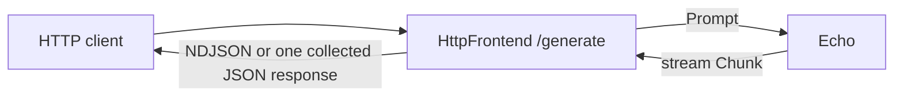

# HTTP source frontend

`HttpFrontend` implements `gdl::Frontend` and hosts an Axum service. Its graph contract is `Prompt -> stream Chunk`. The Echo sink emits one chunk per input word.



Run the local graph:

```bash
cargo run --manifest-path examples/http/Cargo.toml -- 127.0.0.1:8081
curl http://127.0.0.1:8081/generate -H 'content-type: application/json' -d '{"text":"hello source"}'
curl http://127.0.0.1:8081/generate -H 'content-type: application/json' -d '{"text":"hello source","stream":false}'
```

Streaming is the default. Each NDJSON line contains an `item`, or a terminal `error`. The collected response is `{"text":"hello source"}`. Collection has a 1 MiB limit. Each graph request has a 30-second deadline. Dropping the streaming HTTP body drops the graph stream and cancels that request. Ctrl-C stops admission and drains active HTTP requests.

`Build` binds the listener and reports bind errors. `Frontend::serve` takes a typed `Next<Prompt, Chunk>` client and a shutdown future. The same frontend can serve a local graph or a deployed segment. Dynamo HTTP and gRPC packages can implement this contract without adding their service dependencies to GDL.

To compose it in the web UI, enable local imports with `--local-root "$PWD"`. Import `examples/http`, choose `HttpFrontend` in the source card, and add Echo as the sink. The frontend fixes the source messages. Generated source binaries read its listener configuration from `[frontend]`.

Build a standalone segment:

```bash
cargo run -p gdl-gen -- build --spec examples/http/gdl.toml
```

It prints the path of the binary, `examples/http/target/gdl/http/gdl/bin/debug/http-main`. Before running it, write `/tmp/gdl-http.toml` with a fresh roster directory:

```toml
listen = "127.0.0.1:0"
roster = "/tmp/gdl-http-roster"

[frontend]
listen = "127.0.0.1:8081"
```

Run the generated service:

```bash
examples/http/target/gdl/http/gdl/bin/debug/http-main /tmp/gdl-http.toml
```

The graph spec pins the source explicitly under `[nodes] pin`. Without a source pin, a graph has a programmatic entry point. Its generated binary uses the existing JSON-lines frontend when the types support it.

Build tests before the bounded run:

```bash
cargo test --manifest-path examples/http/Cargo.toml --no-run
timeout 60 cargo test --manifest-path examples/http/Cargo.toml
```

The HTTP test uses an OS-assigned port and checks streamed output, collected output, bind errors, source registration, and shutdown.
